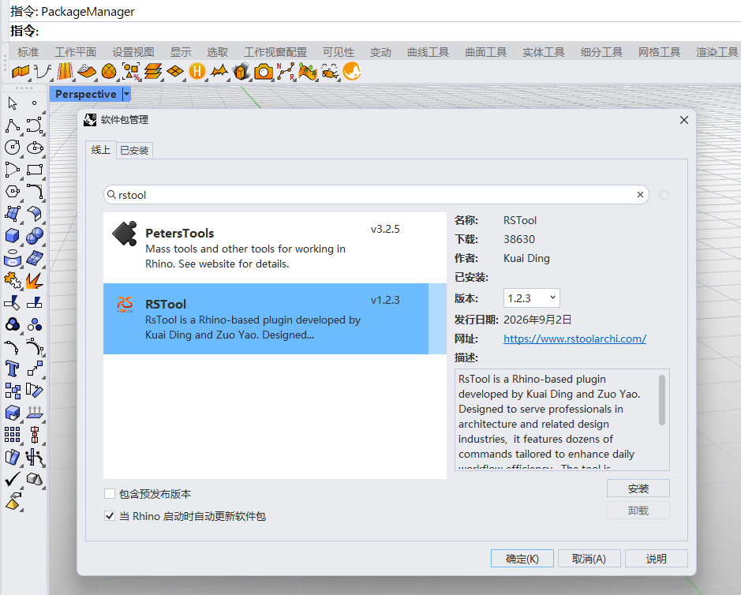
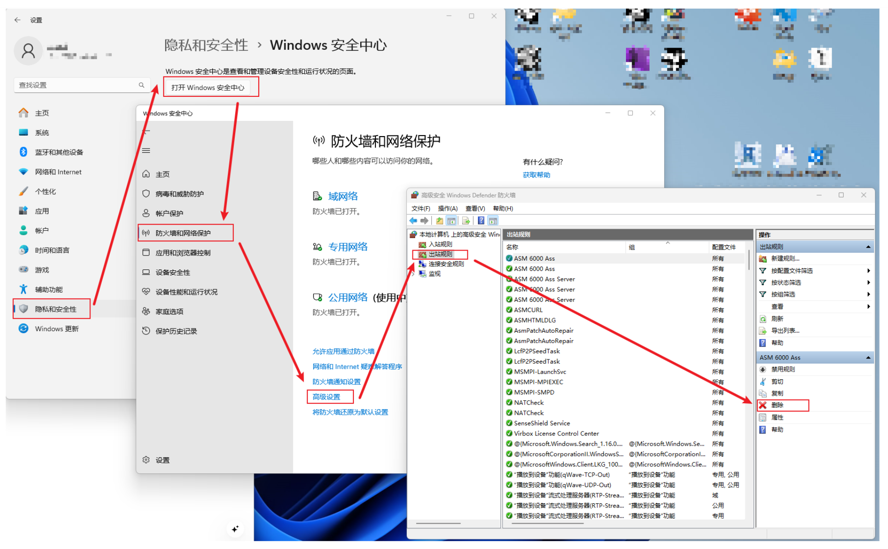

# RSTool 安装指南

先确认要安装的版本。RSTool 2.0 使用配套客户端管理登录、授权和部分工具；下面先说明 2.0 体验包的安装与连接，后面保留旧版的 YAK 和 PackageManager 安装方式。

## RSTool 2.0 体验版

### 运行要求

- Windows 与 Rhino 8。基础要求为 Rhino 8.20 或更新版本，建议使用 Rhino 8.28 或更新版本，以便使用全部已迁移的材质工具。
- Rhino 需运行在 **.NET 8** 模式。可输入 `SetDotNetRuntime`，选择 `NetCoreVersion` → `v8`，按提示保存文件并重启 Rhino 后生效。仅在 Windows 中安装 .NET 8 不会切换 Rhino 当前的运行模式。
- 当前体验构建不适用于 Rhino 7、Rhino 9 或 .NET Framework 模式。
- 需要与插件配套的 RSTool 客户端，并在客户端完成登录与本机设备授权。

### 安装完整体验包

2.0 当前为开发体验构建。请使用提供方给出的完整体验包；公开下载与软件包管理器中的版本，以实际标注为准。

1. 保存模型并关闭 Rhino。2.0 与 1.x 使用相同插件标识，升级时需要替换旧版，不能在同一个 Rhino 进程中同时加载。
2. 将体验包完整解压到固定目录，保留所有 DLL、原生模块和资源子目录。**不要只复制 `RSTool.rhp`**，后续也不要随意移动已安装的目录。
3. 打开 Rhino 8，输入 `PlugInManager`，在插件管理器中点击“安装”，选择体验包内的 `RSTool.rhp`，按提示完成安装或重启。
4. 如果提示“ID 已被使用”，先检查插件管理器里已有 RSTool 的路径：已经指向新版本时，启用现有条目即可；仍指向旧版时，按体验包的升级说明替换已有注册，避免反复安装另一份。
5. 启动体验包配套的 RSTool 客户端，完成账号登录和本机设备授权。

### 连接客户端

1. 在 Rhino 中打开文档，输入 `rs2Status`，查看插件状态、连接状态和日志位置。这个检查不要求先登录。
2. 输入 `rs2Connect`，连接 RSTool 客户端；客户端未运行时会尝试唤起已安装的客户端。若无法自动打开，请先手动启动客户端。
3. 首次完成登录或设备授权后，回到 Rhino **重新运行原命令**。插件不会自动重放登录前的操作。

2.0 中，模型库、材质库、地形下载、PDF、白板、思维导图、图像工作室和矢量工作室等入口统一放在客户端的“创作工具”里。需要从 Rhino 获取内容或把结果写回模型时，请在客户端确认选中了正确的 Rhino 实例和文档，并保持客户端运行。

## 旧版：下载 YAK 文件安装

1. 打开 [RSTool 百度网盘下载链接](https://pan.baidu.com/s/5c6yJvAa5wCCh81eEZRsGRg)，下载 RSTool 的 `.yak` 安装文件。
2. 打开 Rhino，将下载好的 `.yak` 文件直接拖入 Rhino 窗口，按提示完成安装。
3. 安装完成后，如 Rhino 提示需要重启，请保存当前文件并重新启动 Rhino。

## 旧版：通过 PackageManager 搜索安装

1. 打开 Rhino，在命令行输入 `PackageManager` 并按 Enter。
2. 在“软件包管理”的“线上”选项卡中搜索 `rstool`。
3. 选择 **RSTool**，确认需要安装的版本后单击“安装”。安装完成后，如 Rhino 提示需要重启，请保存当前文件并重新启动 Rhino。

## 搜索不到 RSTool

先确认 Rhino 能正常访问网络，并且软件包管理器处于“线上”选项卡。如果搜索仍无结果，可以检查 Windows 防火墙中是否存在阻止 Rhino 联网的出站规则：

1. 打开“设置 → 隐私和安全性 → Windows 安全中心 → 防火墙和网络保护 → 高级设置”。
2. 在“高级安全 Windows Defender 防火墙”中选择“出站规则”。
3. 查找名称中包含 Rhino、且操作明确为“阻止连接”的规则。先记录或导出原规则，再禁用或删除对应的阻止规则，然后重新打开 `PackageManager` 搜索。

::: warning 网络与授权提示

- 只处理明确阻止 Rhino 联网的规则，不要直接关闭整个 Windows 防火墙。
- 防火墙和代理设置都可能影响软件包下载及 Rhino 授权校验；修改前请记录原设置，以便出现问题时恢复。
- 如果使用代理或 VPN，建议将 Rhino / McNeel 的官网、授权及软件包服务域名加入代理工具的**直连或排除列表**（不走代理），不要直接阻断授权服务器。具体设置可参考[这篇知乎文章](https://zhuanlan.zhihu.com/p/595993046)。

:::
