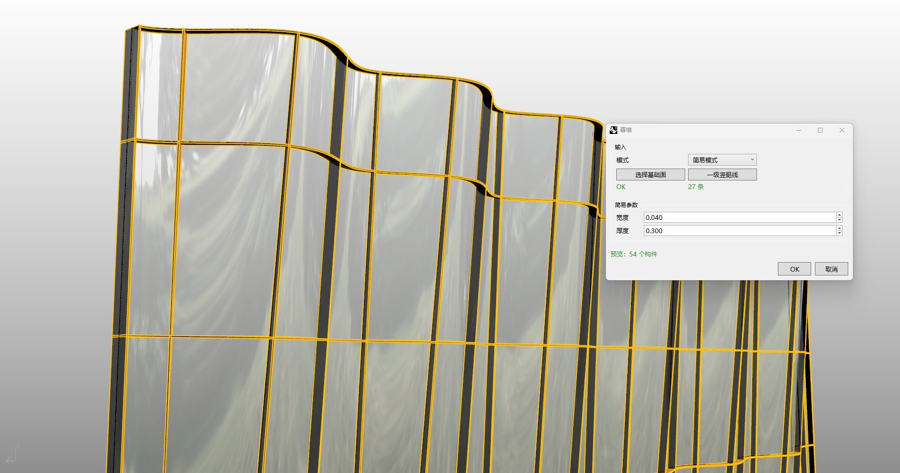
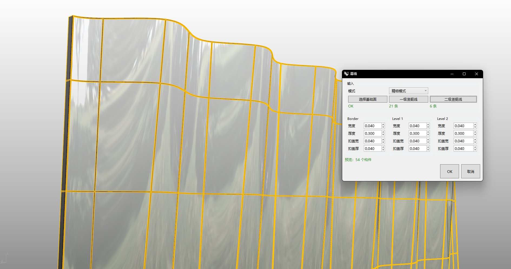

#  rsCurtain · 简单幕墙（二维／三维）

> 模块：建筑 / 建筑构件

[← 返回命令目录](/commands/)

::: info 2.0 说明

统一幕墙窗口支持二维和三维；rsCurtainWall2D 是二维快捷入口，rsCurtainPlus 仍独立保留。

[查看 2.0 命令变化与对照](/commands/v2)

:::

**功能**：在同一面板沿直线、圆弧或自由曲线生成二维幕墙或三维幕墙；分别设置平面竖梃与三维分格截面。

*Eto「幕墙」简易模式窗口：选择基础曲面与竖挺线后，仅需设置外框宽度/厚度即可按竖挺线数生成基础幕墙，底部实时显示预计构件数*

*Eto「幕墙」精细模式窗口：在基础曲面与竖挺线之上，再加选二级竖挺线，外框/一级/二级竖挺各有独立的宽度、厚度、扣盖宽度与厚度，灵活生成多层级幕墙系统*

**调用**：在 Rhino 命令行输入 `rsCurtain`（打开设置窗口）

**交互流程**：

1. 输入 rsCurtain，选择二维或三维，再选直线、圆弧或自由曲线。
2. 二维设置竖梃、玻璃夹与玻璃位置；三维设置高度、底标高、内部横竖挺数量和截面。
3. 在视口画基线。直线可连续拾点，圆弧按三点，自由曲线回车生成。
4. 需要独立新对象时点“另起一段”，结束时按 Esc 或关闭面板。

**参数**：

| 中文名 | 英文名 | 类型 | 默认值 | 范围 | 说明 |
| --- | --- | --- | --- | --- | --- |
| 绘制用途 | OutputMode | enum | 首次二维；之后记住上次成功模式 | 二维 / 三维 | 切换只影响后续绘制；修改已有对象请使用属性面板。 |
| 绘制方式 | DrawingMode | enum | 直线 | 直线 / 圆弧 / 自由曲线 | 圆弧按三点画，自由曲线逐点拾取经过点。 |
| 二维竖梃间距 | Spacing | double | 1200 mm | 正值 | 控制平面竖梃沿路径的间隔。 |
| 二维竖梃／玻璃夹 | Mullions2D | group | 宽40 / 深200 / 玻璃夹30 mm | 须能容纳当前路径与间距 | 玻璃位置可选外侧、居中或内侧，默认外侧。 |
| 三维高度／底标高 | HeightElevation | group | 3000 mm / 0 | 高度须容纳分格 | 三维按各段基线生成独立幕墙。 |
| 内部竖挺／横挺数量 | Counts | group | 3 / 2 | 各 0–64；总格数 ≤1024 | 不含四周外框；3根内部竖挺形成4列玻璃。 |
| 三维截面／外框／玻璃 | Sections3D | group | 横竖挺与外框50×100 mm；玻璃12 mm | 截面须大于容差且能容纳净格 | 分别控制正面宽度或高度与进深。 |

**输出**：参数二维幕墙或独立三维幕墙。

**备注**：尺寸按当前 Rhino 文档单位显示；下列 mm、m 是等效物理尺寸示例。

`rsCurtain` 统一简单二维／三维幕墙，`rsCurtainWall2D` 仍是同一窗口的二维快捷入口。首次默认二维，以后记住成功使用的模式。

二维连续绘制保留为同一个参数幕墙，逐段更新路径；“另起一段”创建新对象。三维每确认一段基线生成一个独立参数幕墙。切换模式保留已完成对象，放弃未完成基线并重新拾起点。

这里按路径绘制简单幕墙；需要在复杂多重曲面上布置幕墙时，使用独立的 `rsCurtainPlus`。

配图或视频可能来自旧版界面，2.0 请以本文的入口、模式和参数说明为准。
