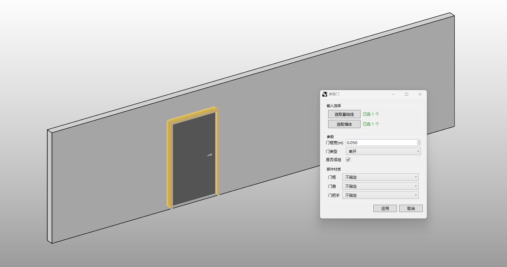

#  rsDoor · 门（二维／三维）

> 模块：建筑 / 建筑构件

[← 返回命令目录](/commands/)

::: info 2.0 说明

二维和三维门统一在此绘制；旧 rsDoor2D 名称不再是独立入口。

[查看 2.0 命令变化与对照](/commands/v2)

:::

**功能**：用一个插入面板在二维或三维墙上连续放门，支持鼠标定位、端点距离与垛宽定位，并自动更新墙洞。

*1.x 旧版界面参考：2.0 使用统一门窗插入面板，具体操作和参数请看下方文字。*

**调用**：在 Rhino 命令行输入 `rsDoor`（打开设置窗口）

**交互流程**：

1. 输入 rsDoor，在窗口选择“自动”或固定二维／三维。
2. 设置门宽；二维可选单开、双开或门洞及开启角，三维设置门高与门底位置。
3. 把鼠标移到墙体附近，检查尺寸、位置和方向预览后点击，继续插入下一处。
4. 需要精确定位时使用距起点、距终点或垛宽；Esc 或关闭面板结束。

**参数**：

| 中文名 | 英文名 | 类型 | 默认值 | 范围 | 说明 |
| --- | --- | --- | --- | --- | --- |
| 绘制用途 | OutputMode | enum | 自动 | 自动 / 二维 / 三维 | 自动识别鼠标附近的墙体；也可固定维度。 |
| 沿墙定位 | PositionMode | enum | 鼠标 | 鼠标 / 距起点 / 距终点 / 垛宽 | 距起终点按墙轴线量取，可将中心、近边或远边对齐。垛宽量到洞口近边。 |
| 定位距离／墙垛宽 | PositionDistance | group | 1000 mm / 100 mm | 按墙长和洞口净空校验 | 垛宽从鼠标所在外露墙侧最近墙端或净转角量取；曲墙沿墙侧弧长。 |
| 门宽 | Width | double | 900 mm | 须满足墙端和相邻洞口净空 | 可点常用净宽按钮。 |
| 二维门型／开启角 | DoorKind | group | 单开 / 90° | 单开 / 双开 / 门洞；角度 0–180° | 门洞不绘制门扇开启弧。 |
| 三维门高／门底 | HeightSill | group | 2100 mm / 0 | 满足宿主墙高度 | 当前三维门沿用单扇门模型。 |
| 反转方向 | Flips | group | 关闭 | 鼠标墙侧 / 铰链侧 | 改变开启朝向，预览确认后再放置。 |

**输出**：独立参数门及其墙体洞口。

**备注**：尺寸按当前 Rhino 文档单位显示；下列 mm、m 是等效物理尺寸示例。

无需先选墙：把鼠标移到墙附近，看到预览后点击即可连续插入。自动模式会识别二维／三维墙，也可以手动锁定用途。插入结果是有宿主关联的独立参数对象；移动、删除或在属性面板改尺寸时，墙上的洞口会一起更新。

旧的二维独立输入命令已合并到统一入口，旧授权键继续兼容。尺寸仍要满足墙端、相邻洞口和净空要求，不能只按输入框可填范围判断是否能生成。

`rsDoor2D` 已合并到 `rsDoor`。二维支持双开与门洞；当前三维仅提供原有单门模型，不提供三维双开门、推拉门或通口。

配图或视频可能来自旧版界面，2.0 请以本文的入口、模式和参数说明为准。
