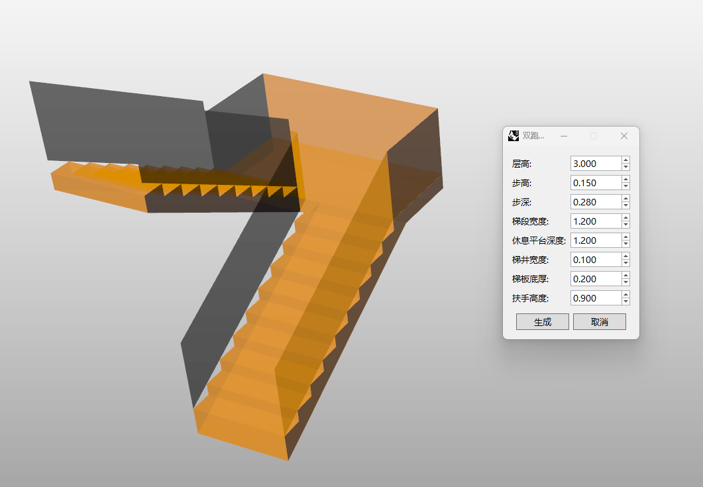

#  rsDoubleFlightStairs · 双跑楼梯（二维／三维）

> 模块：建筑 / 楼梯与坡道

[← 返回命令目录](/commands/)

::: info 2.0 说明

已合并原 rsStair2D，可在同一面板中绘制二维或三维双跑楼梯。

[查看 2.0 命令变化与对照](/commands/v2)

:::

**功能**：统一生成双跑平面楼梯或三维楼梯。设置层高、期望步高、步深、梯宽和平台，预览会显示实际级数与步高。

*拾取基点与方向点后实时生成双跑楼梯，含休息平台、梯井、扶手，全部参数对话框调整*

**调用**：在 Rhino 命令行输入 `rsDoubleFlightStairs`（打开设置窗口）

**交互流程**：

1. 输入 rsDoubleFlightStairs，在同一窗口选择二维绘图或三维建模。
2. 拾取基点和方向点；切换模式时可保留该定位。
3. 设置层高、踏步和平台，查看实际级数与步高；三维另设底厚与扶手。
4. 预览确认后点击“生成”。生成参数对象后可在属性面板继续调整。

**参数**：

| 中文名 | 英文名 | 类型 | 默认值 | 范围 | 说明 |
| --- | --- | --- | --- | --- | --- |
| 绘制用途 | OutputMode | enum | 首次二维；之后记住上次成功模式 | 二维 / 三维 | 切换只影响后续绘制；修改已有对象请使用属性面板。 |
| 层高／期望步高 | FloorRise | group | 3 m / 0.15 m | 层高与步高为正 | 总级数按层高与步高求整并调整为偶数，两跑均分，实际步高重新均分。 |
| 步深／梯段宽 | TreadWidth | group | 0.28 m / 1.2 m | 正值且大于几何容差 | 共同确定梯段平面长度和通行宽度。 |
| 平台深／梯井宽 | LandingGap | group | 1.2 m / 0.1 m | 平台为正；梯井可为0 | 不必另外指定跑数，固定为双跑。 |
| 三维底厚／扶手高 | ThicknessRail | group | 0.2 m / 0.9 m | 底厚需大于容差；扶手0关闭 | 三维专属参数，切换二维时保留输入。 |
| 生成参数楼梯对象 | GenerateObject | bool | 开启 | 开启 / 关闭（三维） | 开启后可在属性页改参数；关闭输出普通 Brep。 |

**输出**：参数二维楼梯、参数三维楼梯或普通 Brep 楼梯。

**备注**：尺寸按当前 Rhino 文档单位显示；下列 mm、m 是等效物理尺寸示例。

三维默认勾选“生成参数楼梯对象”，整梯作为独立参数对象保存。选中后可在“楼梯参数”属性页继续改尺寸，或在二维／三维间切换；移动、旋转和等比缩放后继续编辑会保留放置位置。取消该选项则输出普通 Brep。

参数对象可使用 `rsStairMake2D` 出二维线、`rsStairDupEdge` 复制边缘；需要交给只识别普通几何的后续命令，可用 `rsStairToGeometry` 转换，Undo 可恢复参数对象。

`rsStair2D` 已合并到该入口；首次默认二维，以后记住成功模式。二维用独立平面算法，不是把三维楼梯投影下来。

三维双跑参数对象支持 `PointsOn`：两个基础线控制点用于改基点与朝向，梯长仍由踏步和平台尺寸决定。

配图或视频可能来自旧版界面，2.0 请以本文的入口、模式和参数说明为准。
