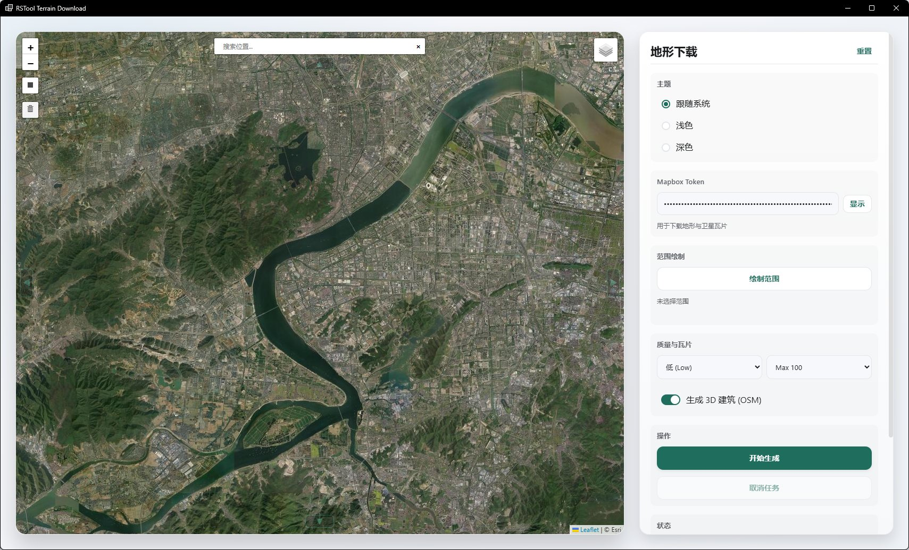

#  rsEarth · 下载地形

> 模块：地形 / 获取与编辑

[← 返回命令目录](/commands/)

::: info 2.0 说明

2.0 使用 RSTool 客户端承载面板，请先保持客户端运行并登录。

[查看 2.0 命令变化与对照](/commands/v2)

:::

**功能**：打开客户端地形下载工具，选择地图范围，下载带卫星贴图的地形，并按需生成 OSM 建筑。

**调用**：在 Rhino 命令行输入 `rsEarth`（打开设置窗口）

**交互流程**：

1. 首次使用前，前往 [Mapbox 官网](https://www.mapbox.com/) 注册并登录，在 Access tokens 页面创建或复制以 pk. 开头的公开访问令牌。
2. 在 Rhino 输入 rsEarth，打开客户端“创作工具 → 地形下载”，确认目标文档并填写 Mapbox Token。
3. 搜索地点，在地图上绘制矩形范围；查看预计瓦片、顶点和内存开销，设置质量、初始瓦片预算及是否生成建筑。
4. 点击“开始生成”，等待下载、地形构建和写入 Rhino；需要中止时点击“取消任务”。
5. 需要扩展到周边时，使用选区四周的箭头，每次移动一个选区的宽度或高度，再生成相邻地形。

**参数**：

| 中文名 | 英文名 | 类型 | 默认值 | 范围 | 说明 |
| --- | --- | --- | --- | --- | --- |
| Mapbox Token | Token | password | 无 | pk.xxxxx | 首次使用必填：前往 mapbox.com 注册账号并获取以 pk. 开头的公开访问令牌，粘贴后在本机加密保存；请勿公开分享或填写以 sk. 开头的 Secret Token |
| 精度 | Precision | radio | 中 | 高 / 中 / 低（采样步长 1 / 2 / 4） | 面板设置：控制网格采样密度 |
| 初始瓦片预算 | MaxTiles | radio | 当前设置 | 20 / 60 / 100 | 20 / 60 / 100 用于首次确定合适的缩放级别；项目锁定后，后续相邻下载沿用相同缩放与坐标基准。不是简单的最终总量上限。 |
| 缩放级别 | Zoom | int | 自动 | 依据范围自动计算最优值 | 首次根据范围与初始瓦片预算自动确定；项目锁定后保持一致，便于相邻地形衔接。 |
| 生成建筑 | GenerateBuildings | bool | 当前设置 | 开 / 关 | 可通过 OSM / Overpass 获取建筑。建筑数据暂不可用时，会提示并继续生成地形。 |
| 代理 | Proxy | bool | 关 | 开 / 关（支持 http:// 或 socks5://） | 面板设置：仅 Debug 构建可见，可点测试验证连通 |

**输出**：将下载得到的地形网格（含贴图的 Rhino 网格）写入当前文档

**备注**：2.0 的 rsEarth 直接打开客户端页面，原来的 rsEarthOld 窗口不再作为回退入口。地形生成会写入客户端当前选中的 Rhino 文档，开始前先确认实例、文档和模型单位。

## 地图与范围

左侧地图可搜索地点、缩放、切换街道/卫星底图，并绘制矩形选区。选区周围的箭头按当前选区的宽度或高度移动，适合连续下载相邻区域。右侧会显示范围坐标及预计瓦片、顶点数量和内存开销。

## 质量与项目基准

高/中/低质量控制采样密度；初始瓦片预算用于第一次确定下载缩放级别。项目锁定后，后续下载使用同一缩放级别、采样设置和坐标基准，让相邻地形能够衔接。范围越大、精度越高，下载与生成开销也越大，可以先用小范围检查效果。

## Token、建筑与日志

Mapbox Token 用于地形与卫星瓦片，请填写公开访问令牌，不要公开分享令牌或填写 sk. 开头的 Secret Token。OSM 建筑取决于当地数据覆盖；暂时取不到建筑时，仍可继续生成地形。状态区显示下载、构网和写入进度，任务日志可导出用于排查。主题和语言跟随客户端，代理测试仅在相应开发构建中提供。
