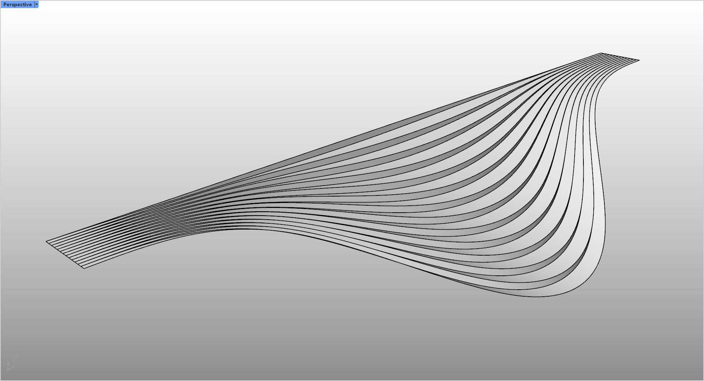

#  rsFadingStairVertical · 竖向渐变楼梯

> 模块：建筑 / 楼梯与坡道

[← 返回命令目录](/commands/)

**功能**：竖向渐消楼梯 Brep

*与 rsFadingStair 的区别：踏面是完全垂直的（rsFadingStair 踏面沿曲线倾斜渐隐，本命令踏面保持竖直，仅踏步高度渐消）*

**调用**：在 Rhino 命令行输入 `rsFadingStairVertical`（命令行交互）

**交互流程**：

1. 选择两条基础曲线
2. 输入踏步数
3. 生成竖向渐消楼梯 Brep

**参数**：

| 中文名 | 英文名 | 类型 | 默认值 | 范围 | 说明 |
| --- | --- | --- | --- | --- | --- |
| 楼梯踏步数 | StepCount | int | 12 | 1~999 | 默认 12 |
