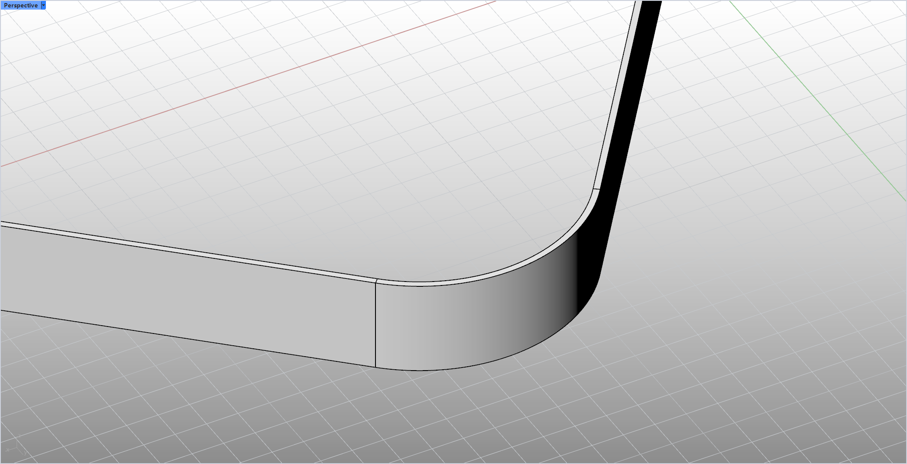

#  rsFilletWall · 墙体圆角

> 模块：建筑 / 墙体与编辑

[← 返回命令目录](/commands/)

**功能**：给两堵同维度直墙做圆角，半径为零时直接连接。

*rsFilletWall 的圆弧倒角结果（After）：Rhino 8 透视视口下白模渲染（无 UI 面板），两面相同厚度的智能墙体在前景右下转角处完成圆滑过渡——墙体外侧立面形成明显的圆弧拐角，墙体厚度方向也同步倒出等半径圆角；左侧墙体顶面、右侧墙体顶面与背景地坪网格均为浅灰（Rhino 默认工作平面与地面网格），左上角可见红色 X 轴标识与「Perspective」视口标签*

**调用**：在 Rhino 命令行输入 `rsFilletWall`（命令行交互）

**交互流程**：

1. 依次点选两堵墙需要保留的一侧。
2. 输入轴线圆角半径，确认生成。

**参数**：

| 中文名 | 英文名 | 类型 | 默认值 | 范围 | 说明 |
| --- | --- | --- | --- | --- | --- |
| 轴线半径 | Radius | double | 交互输入 | ≥0 | 0为直接连接，非0生成圆角墙。 |

**输出**：更新后的智能墙与原有关联对象。

**备注**：非零圆角要求等宽，三维还需同高同底；半径0允许不等宽。旧 rsFilletWall2D 已合并。

统一入口按所选墙真实二维／三维身份工作，混选不同维度会拒绝。

配图或视频可能来自旧版界面，2.0 请以本文的入口、模式和参数说明为准。
