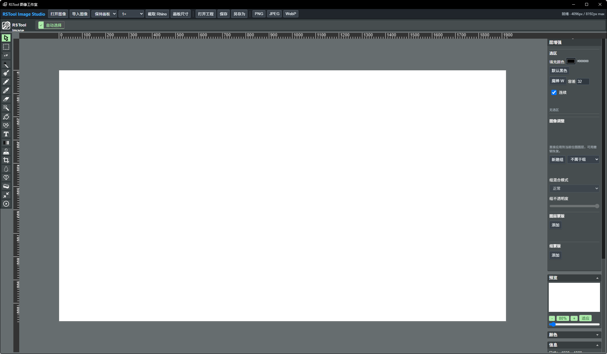

#  rsImageStudio · 图像工作室

> 模块：效率工具 / 生产力

[← 返回命令目录](/commands/)

::: info 2.0 说明

2.0 使用 RSTool 客户端承载面板，请先保持客户端运行并登录。

[查看 2.0 命令变化与对照](/commands/v2)

:::

**功能**：打开客户端的图像工作室，对位图分层编辑、标注和调色，也可截取 Rhino 视窗继续绘制。

*RSTool 图像工作室主界面（顶部工具栏 14 项，左侧绘图工具栏，右侧属性面板含 图层编辑 / 镜像测量 / 椭圆合模式 / 图层管理 / 编辑图层 / 预览 / 颜色 / 信息 8 块，底部含缩放 50% 与画布适配按钮）*

**调用**：在 Rhino 命令行输入 `rsImageStudio`（打开设置窗口）

**交互流程**：

1. 在 Rhino 输入 rsImageStudio，打开客户端“创作工具 → 图像工作室”；也可以直接从客户端进入。
2. 新建工程，打开图片，或把图片导入为新图层；需要 Rhino 截图时，先确认客户端选择的文档。
3. 用画笔、选区、文字、图层、组、蒙版和调整工具编辑；多份文档可在标签间切换，各自保留撤销记录。
4. 导出 PNG / JPEG / WebP，或保存为 .rsimage 工程以保留图层和可编辑内容。

**参数**：

| 中文名 | 英文名 | 类型 | 默认值 | 范围 | 说明 |
| --- | --- | --- | --- | --- | --- |
| 导出格式 | Format | list | png | png / jpeg / webp | 导出时设置：图像输出格式 |
| 宽度 | Width | int | 源尺寸 | 1 – 最大画布边长 | 导出 / 截图时设置 |
| 高度 | Height | int | 源尺寸 | 1 – 最大画布边长 | 导出 / 截图时设置 |
| 缩放 | Scale | double | 1.0 | > 0 | 导出 / 截图时设置 |

**输出**：导出合成图像，或保存保留图层、组和蒙版的 .rsimage 工程。

**备注**：2.0 把图像工作室并入客户端，不再启动旧版独立窗口。编辑器基于 miniPaint，打开后可独立处理本地图片；只有截取 Rhino 视窗等交互需要连接正确的 Rhino 实例与文档。

## 界面怎么用

| 区域 | 常用功能 |
| --- | --- |
| 文件与导出 | 新建、打开/导入图片、打开/保存 .rsimage 工程、最近文件，以及 PNG/JPEG/WebP 导出 |
| 绘图与编辑 | 选择、画笔、形状、文字、裁剪和图像调整 |
| 图层与属性 | 图层、组、蒙版、剪贴、锁定、不透明度与混合模式 |
| Rhino 截图 | 把当前所选 Rhino 文档的视窗截图作为图层加入工程，继续标注和绘制 |

每个工作室最多同时打开 16 页。切换客户端功能会保留工程，切换标签也保留各自的撤销记录；关闭未保存工程时可选择保存、不保存或取消。主题和中英文随客户端切换。
