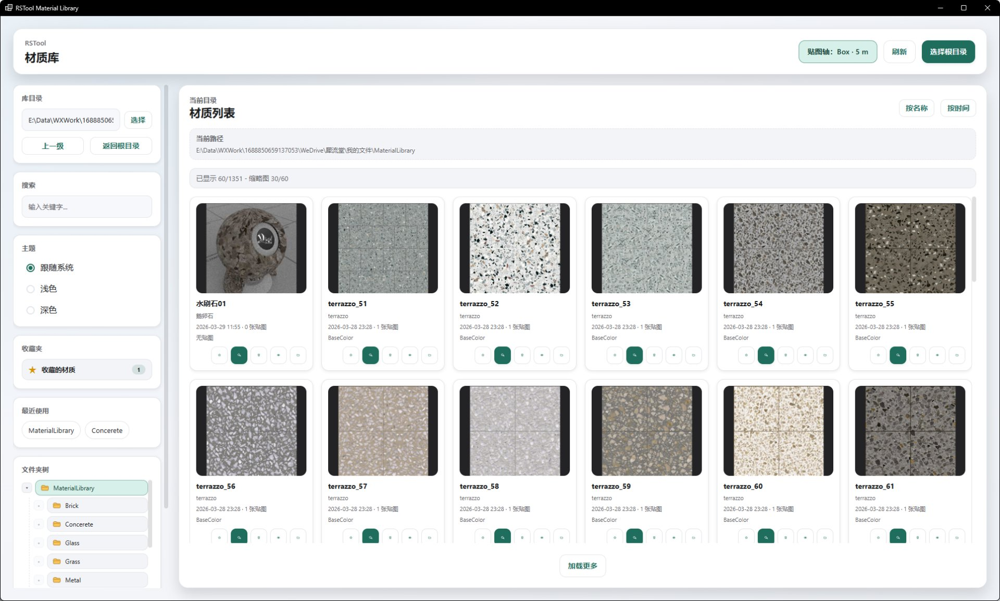

#  rsMaterial · 材质库

> 模块：资源库 / 材质库

[← 返回命令目录](/commands/)

::: info 2.0 说明

2.0 使用 RSTool 客户端承载面板，请先保持客户端运行并登录。

[查看 2.0 命令变化与对照](/commands/v2)

:::

**功能**：打开 RSTool 2.0 客户端的材质库，整理本地材质与贴图，并导入 Rhino、赋予物体或赋予图层。

*图 1：材质库主界面。标题栏右上「贴图轴：Box · 5 m」打开自动贴图轴设置（开启后赋予材质时自动按矩形/Box + 尺寸同步加贴图轴），其后是「刷新 / 选择根目录」；左侧栏结构与模型库一致（库目录 / 搜索 / 主题 / 收藏的材质 / 最近使用 / 文件夹树 / 状态栏 + 构建进度）；右侧主区显示当前路径下所有材质，命名空间 chip 区分（默认 MaterialLibrary，截图已切到 Concrete 关注水磨石），每张缩略图卡含文件名、标签、修改时间、并排 3 个圆形动作按钮（收藏材质 / 赋予物体 / 赋予图层），右键卡片可调右键菜单（Favorite Material / 赋予物体 / 赋予图层 / 导入材质 / 打开目录），底部「加载更多」分页全部*

**调用**：在 Rhino 命令行输入 `rsMaterial`（打开设置窗口）

**交互流程**：

1. 在 Rhino 输入 rsMaterial，打开客户端“创作工具 → 材质库”。
2. 选择自己的本地材质目录，通过搜索、收藏、目录树和缩略图找到需要的材质。
3. 按需设置自动贴图轴的开关、平面或箱形类型及尺寸。
4. 选择“导入材质”只加入文档，或使用“赋予物体”“赋予图层”“替换同材质物体”。
5. 赋予物体时，有预选会直接应用；没有预选则回到 Rhino 连续点选或框选，结束后再回客户端继续浏览。

**参数**：

| 中文名 | 英文名 | 类型 | 默认值 | 范围 | 说明 |
| --- | --- | --- | --- | --- | --- |
| 库目录 | rootPath | text | 上次使用值 | 本地路径 | 材质库根目录；通过「选择 / 选择根目录」换成任意含材质资产的文件夹；切换后自动重建索引 |
| 搜索 | searchInput | text | 空 | 任意关键字 | 对当前目录下的文件名/标签做即时过滤 |
| 贴图轴按钮 | btnMappingSettings | button | — | — | 标题栏「贴图轴：类型 · 尺寸」按钮：点开弹自动贴图轴设置弹层，按钮文案同步显示当前设置 |
| 自动加贴图轴 | autoTextureMappingEnabled | checkbox | 开 | 开 / 关 | 贴图轴弹层开关：开启后赋予材质时同时按当前贴图轴类型+尺寸加贴图轴对象 |
| 贴图轴类型 | autoTextureMappingType | radio | Box | 矩形（平面） / Box | 贴图轴弹层单选：矩形用同一宽高，Box 用同一长宽高；切换后按钮文案即时更新 |
| 贴图轴尺寸 | autoTextureMappingSize | number | 5.0 | > 0（按目标文档单位换算） | 默认代表 5 米的贴图尺寸，自动换算为当前 Rhino 文档单位；用于平面或箱形贴图。 |
| 收藏视图 | favoritesView | button | 关闭 | — | 左侧「收藏的材质」按钮：点亮后只显示已收藏的资产 |
| 最近使用 | recentRoots | chip | — | — | 最近 5 次访问过的根目录，chip 一键切换 |
| 文件夹树 | folderTree | tree | — | — | 根目录下子文件夹折叠树，点头切换浏览 |
| 排序 | sort | button | 按时间 | 按名称 / 按时间 | 主区右上角切换 |
| 刷新 | refresh | button | — | — | 重建索引：扫描当前根目录所有材质资产，生成缩略图与标签，状态栏显示进度 |
| 收藏/取消收藏 | favorite | button | — | — | 卡片或预览弹窗内的星标按钮：点亮黄色 = 已收藏；支持右键菜单 Favorite Material |
| 赋予物体 | assignObject | button | — | — | 有预选时直接赋予；无预选时进入 Rhino 连续点选或框选涂刷。 |
| 赋予图层 | assignLayer | button | — | — | 将材质设为目标图层的材质，供按图层获取材质的对象使用。 |
| 导入材质 | importMaterial | button | — | — | 仅将材质加入 Rhino 文档，不自动赋予物体或添加贴图轴。 |
| 打开目录 | openFolder | button | — | — | 用 Windows 资源管理器打开材质所在文件夹 |
| 加载更多 | loadMore | button | — | — | 主区底部按钮：分页加载，默认每页 60 张 |

**输出**：将材质导入所选 Rhino 文档，或赋予物体、图层及同材质对象；按需同时建立自动贴图轴。

**备注**：2.0 的材质库统一放在客户端中，主题和语言跟随客户端设置；原来的 rsMaterialLibraryOld 窗口不再作为回退入口。模型与材质操作结束后会回到客户端，连续拾取期间不会抢走 Rhino 焦点。

贴图文件可按命名自动分组，支持多种贴图槽识别和 .rmtl 导入。识别到多个贴图槽不代表每种材质路径都会启用所有通道，实际效果以 Rhino 材质预览为准。HDR、EXR、TGA 可作为贴图导入，但预览可能显示占位。

## 材质库准备

rsMaterial 使用本地材质库，用户需要自行整理材质文件及相关贴图，并将材质资产归类存放到选定的库目录中。

如需领取 RSTool 官方整理的材质库，可将 RSTool 相关视频转发到朋友圈，保留转发截图并联系 RSTool 客服领取。
