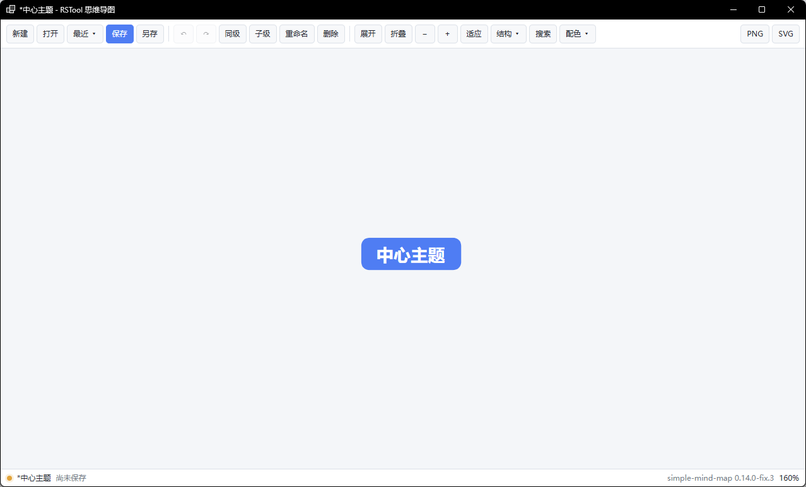

#  rsMindMap · 思维导图

> 模块：效率工具 / 生产力

[← 返回命令目录](/commands/)

::: info 2.0 说明

2.0 使用 RSTool 客户端承载面板，请先保持客户端运行并登录。

[查看 2.0 命令变化与对照](/commands/v2)

:::

**功能**：打开客户端的思维导图，整理节点、布局和配色，也可把 Rhino 截图或曲线线稿插入节点。

**调用**：在 Rhino 命令行输入 `rsMindMap`（打开设置窗口）

**交互流程**：

1. 输入 rsMindMap，打开客户端“创作工具 → 思维导图”。
2. 新建或打开文档，双击节点改名，用 Enter 新增同级、Tab 新增子节点，并按需要调整结构和配色。
3. 使用搜索、缩放、适应画布和分支折叠整理内容。
4. 需要 Rhino 内容时，先确认客户端目标，再把视窗截图或所选曲线的 SVG 插入当前节点。
5. 保存为 .rsmind / JSON 文档，或导出 PNG / SVG；多份文件可分别在标签中编辑。

**参数**：

| 中文名 | 英文名 | 类型 | 默认值 | 范围 | 说明 |
| --- | --- | --- | --- | --- | --- |
| 结构 | Structure | list | 思维导图（双向） | 思维导图 / 逻辑结构 / 向左逻辑结构 / 组织结构 / 目录结构 / 时间轴 / 鱼骨图 | 工具栏「结构」下拉：切换整体布局走向 |
| 配色 | ColorTheme | list | 清爽蓝 | 清爽蓝 / 深夜蓝 / 黑底白节点 / 暖沙棕 / 森林绿 / 紫罗兰 | 工具栏「配色」下拉：切换节点配色方案 |

**输出**：保存可继续编辑的 .rsmind / JSON 思维导图，或导出 PNG / SVG；支持节点中的 Rhino 截图和曲线 SVG。

**备注**：2.0 的思维导图在客户端中打开，保留节点编辑、搜索、布局、配色和本机恢复。每份文档各自保留撤销记录，关闭未保存内容时可选择保存、不保存或取消；切换客户端功能会保留工作区。

节点内的 Rhino 截图和曲线 SVG 来自客户端当前选中的 Rhino 实例和文档。曲线线稿是所选 Curve 的工作平面或视窗投影，并不对整个模型进行隐藏线计算。

基于 simple-mind-map 引擎（状态栏右下角显示版本）。

**操作**：左键选节点，右键拖动画布；滚轮反向缩放，范围 20%–400%。

**工具栏**（4 组共 21 个按钮）：

| 分组 | 按钮与快捷键 |
| --- | --- |
| 文件 | 新建 (Ctrl+N) · 打开 (Ctrl+O) · 最近 ▾ · 保存 (Ctrl+S) · 另存为 (Ctrl+Shift+S) |
| 编辑 | 撤销 (↶ Ctrl+Z) · 重做 (↷ Ctrl+Y) · 同级节点 (Enter) · 子节点 (Tab) · 重命名 (F2) · 删除 (Delete) |
| 视图 | 展开 · 折叠 · 缩小 (−) · 放大 (＋) · 适应画布 · 结构 ▾ · 搜索 (Ctrl+F) · 配色 ▾ |
| 导出 | PNG · SVG |

**结构**（共 6 种）：

| 名称 | 走向 / 形态 |
| --- | --- |
| 思维导图 | 双向（默认） |
| 逻辑结构 | 向右 |
| 向左逻辑结构 | 向左 |
| 组织结构 | 树形 |
| 目录结构 | 树形 |
| 时间轴 | 垂直 |
| 鱼骨图 | 横向 |

**配色**（共 6 套）：

| 配色 | 备注 |
| --- | --- |
| 清爽蓝 | 默认 |
| 深夜蓝 | 暗色 |
| 黑底白节点 | 演示用 |
| 暖沙棕 | 暖色调 |
| 森林绿 | 自然系 |
| 紫罗兰 | 紫色系 |

**其他细节**：

- 新增同级默认文本「新主题」，子级「子主题」
- 最近文件最多保留 10 条
- 状态栏 dot 实时提示保存状态
- 异常退出后再次打开会自动恢复未保存的内容
