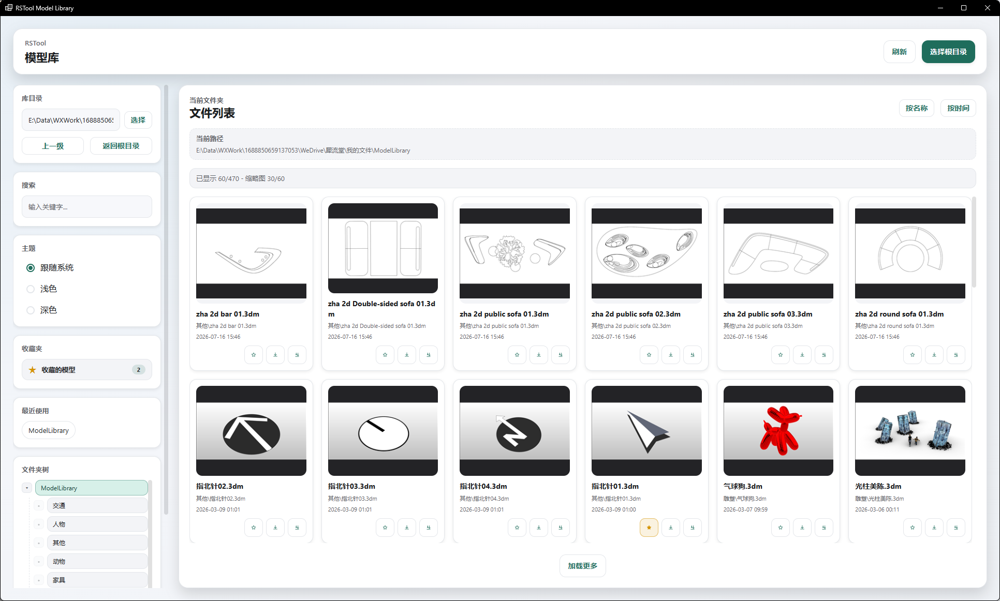

#  rsModel · 模型库

> 模块：资源库 / 模型库

[← 返回命令目录](/commands/)

::: info 2.0 说明

2.0 使用 RSTool 客户端承载面板，请先保持客户端运行并登录。

[查看 2.0 命令变化与对照](/commands/v2)

:::

**功能**：打开 RSTool 2.0 客户端的模型库，浏览自己整理的本地 .3dm 素材，按单次或连续方式放入 Rhino。

*图 1：模型库主界面。标题栏右侧「刷新 / 选择根目录」为全局操作；左侧栏从上到下依次为：库目录（输入框只读 + 「选择」按钮，配合「上一级 / 返回根目录」快速跳转）、搜索（关键字过滤当前目录下的文件）、主题（跟随系统 / 浅色 / 深色）、收藏的模型（一键只显示已收藏的资产，带数量徽章）、最近使用（chip 形式，最近访问过的根目录可一键切换）、文件夹树（树形展示当前根下的子文件夹，点头切换）；右侧主区显示当前路径下的所有模型，每张缩略图卡含文件名、原始路径、修改时间，并排 3 个圆形动作按钮（收藏模型 / 导入一个 / 导入多个，hover 显示中文 tooltip），右键卡片还能调出右键菜单（Favorite Model / 导入模型 / 打开目录），底部有「加载更多」分页按钮*

**调用**：在 Rhino 命令行输入 `rsModel`（打开设置窗口）

**交互流程**：

1. 在 Rhino 输入 rsModel，打开客户端“创作工具 → 模型库”；首次使用先在客户端完成登录和本机设备授权。
2. 选择本地模型库根目录，通过文件夹树、搜索、收藏和排序查找模型；可切换网格或列表，并打开大图预览。
3. 选择块定义模式，点击“导入一个”或“导入多个”。
4. 回到 Rhino 拾取放置点，确认旋转方向；可用 Angle / Rotate90 调整，连续模式下重复拾点放置。
5. 放置结束后回到客户端继续浏览；需要写入另一份文档时，先切换客户端顶部的 Rhino 目标。

**参数**：

| 中文名 | 英文名 | 类型 | 默认值 | 范围 | 说明 |
| --- | --- | --- | --- | --- | --- |
| 库目录 | rootPath | text | 上次使用值 | 本地路径 | 模型库的根目录路径；点击「选择 / 选择根目录」可换成任意含 .3dm 的文件夹；切换目录后自动重建索引 |
| 搜索 | searchInput | text | 空 | 任意关键字 | 对当前目录下的文件名/标签做即时过滤 |
| 收藏视图 | favoritesView | button | 关闭 | — | 左侧「收藏的模型」按钮：点亮后只显示已收藏的资产；徽章数字表示当前根目录内的收藏数 |
| 最近使用 | recentRoots | chip | — | — | 最近 5 次访问过的根目录，点 chip 快速切换 |
| 文件夹树 | folderTree | tree | — | — | 根目录下子文件夹折叠树，点头切换浏览；点行左侧三角形展开/折叠 |
| 排序 | sort | button | 按时间 | 按名称 / 按时间 | 主区右上角切换，文件卡片排列顺序即时刷新 |
| 刷新 | refresh | button | — | — | 重新扫描所选本地模型目录，更新文件、缩略图和元数据。 |
| 收藏/取消收藏 | favorite | button | — | — | 卡片或预览弹窗内的星标按钮：点亮黄色 = 已收藏；支持右键菜单 Favorite Model |
| 导入一个 | importSingle | button | — | — | 将模型导入为块，在 Rhino 拾取放置点并确认旋转；使用 Angle / Rotate90 调整方向。 |
| 导入多个 | importMultiple | button | — | — | 连续拾取位置，重复放置同一模型；每次放置可独立撤销。 |
| 打开目录 | openFolder | button | — | — | 用 Windows 资源管理器打开模型所在文件夹 |
| 加载更多 | loadMore | button | — | — | 主区底部按钮：分页加载，默认每页 60 张；超过则出现该按钮 |
| 块定义模式 | definitionType | list | linked | embedded / linkedAndEmbedded / linked | 选择嵌入、链接并嵌入或链接方式。链接模式需要保留来源文件的位置；三种方式均保留嵌套块、图层和材质。 |

**输出**：把本地 .3dm 模型作为块放入所选 Rhino 文档，保留嵌套块、图层、材质和源模型用户数据；每次放置可独立撤销。

**备注**：2.0 把模型库统一放到客户端中，原来的旧版窗口和独立 InsertAsset 入口由库内导入操作接替。主题和中英文跟随客户端设置。

放置基点取模型的底部中心，模型单位会换算为目标文档单位。若素材内部的嵌套块与文档已有定义同名且内容冲突，工具会提示先处理名称冲突，不会擅自覆盖已有块。

## 模型库准备

rsModel 使用本地模型库，用户需要自行整理模型文件，并将自己的 .3dm 模型归类存放到选定的库目录中。

如需领取 RSTool 官方整理的模型库，可将 RSTool 相关视频转发到朋友圈，保留转发截图并联系 RSTool 客服领取。
