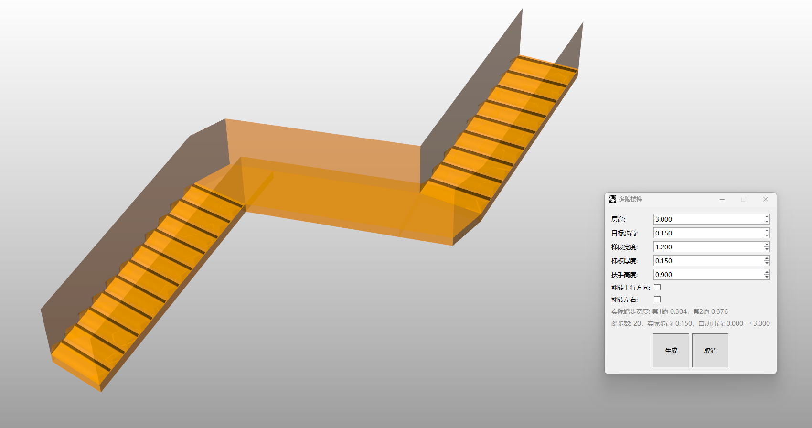

#  rsMultiFlightStairs · 多跑楼梯（二维／三维）

> 模块：建筑 / 楼梯与坡道

[← 返回命令目录](/commands/)

::: info 2.0 说明

已合并原 rsPolylineStair2D，共用路径，支持二维和三维多跑楼梯。

[查看 2.0 命令变化与对照](/commands/v2)

:::

**功能**：按折线路径绘制多跑楼梯，可明确指定梯段与平台、路径靠左居中靠右，以及固定踏宽或目标步高，支持二维／三维输出。

*沿转折路径点拾取后生成多跑楼梯，自动设置休息平台与梯板，支持整体翻转与左右翻转*

**调用**：在 Rhino 命令行输入 `rsMultiFlightStairs`（打开设置窗口）

**交互流程**：

1. 输入 rsMultiFlightStairs，选择二维／三维、路径基准和踏步控制方式。
2. 手动指定下一段是梯段还是平台，或开启自动交替，然后在视口逐点画路径。
3. 回车完成路径；检查上楼方向、转角平台与实际踏步，必要时撤回上一点或重画。
4. 三维设置梯板和扶手，确认后点“生成”；参数对象可通过属性页继续调整。

**参数**：

| 中文名 | 英文名 | 类型 | 默认值 | 范围 | 说明 |
| --- | --- | --- | --- | --- | --- |
| 绘制用途 | OutputMode | enum | 首次二维；之后记住上次成功模式 | 二维 / 三维 | 切换只影响后续绘制；修改已有对象请使用属性面板。 |
| 路径基准 | PathAlignment | enum | 中心 | 中心 / 左侧 / 右侧 | 侧边定位沿相邻段偏移交点求实际占地。 |
| 梯段宽／层高 | WidthFloor | group | 1.2 m / 3 m | 正值 | 总层高分配到全部上升踏步。 |
| 踏步控制 | StepMode | enum | 固定踏宽0.28 m | 固定踏宽 / 目标步高（默认0.15 m） | 固定踏宽会让末级吸收余量；目标步高按梯段长度分配级数并均分踏宽。 |
| 分段方式 | Segmentation | enum | 手动分段 | 手动分段 / 自动交替 | 自动交替只影响后续新段，不改已有分类；平台段不升高。 |
| 上楼方向／左右翻转 | Directions | group | 反向上楼 / 不翻转 | 沿绘制方向上楼 / 反向上楼；可翻转左右 | 反向上楼保留实际占地。 |
| 三维梯板／扶手 | ThicknessRail | group | 0.15 m / 0.9 m | 梯板有效正值；扶手0关闭 | 三维专属设置。 |
| 生成参数楼梯对象 | GenerateObject | bool | 开启 | 开启 / 关闭（三维） | 开启后可在属性页改参数；关闭输出普通 Brep。 |

**输出**：参数二维／三维多跑楼梯，或普通三维 Brep。

**备注**：尺寸按当前 Rhino 文档单位显示；下列 mm、m 是等效物理尺寸示例。

三维默认勾选“生成参数楼梯对象”，整梯作为独立参数对象保存。选中后可在“楼梯参数”属性页继续改尺寸，或在二维／三维间切换；移动、旋转和等比缩放后继续编辑会保留放置位置。取消该选项则输出普通 Brep。

参数对象可使用 `rsStairMake2D` 出二维线、`rsStairDupEdge` 复制边缘；需要交给只识别普通几何的后续命令，可用 `rsStairToGeometry` 转换，Undo 可恢复参数对象。

`rsPolylineStair2D` 已合并到该入口，首次默认二维。二维与三维共用布局，不靠三维投影生成平面。

三维参数对象的 `PointsOn` 控制点可修改实际梯段与平台路径。路径自交、折返、占地重叠或短段容不下平台时会拒绝生成。

配图或视频可能来自旧版界面，2.0 请以本文的入口、模式和参数说明为准。
