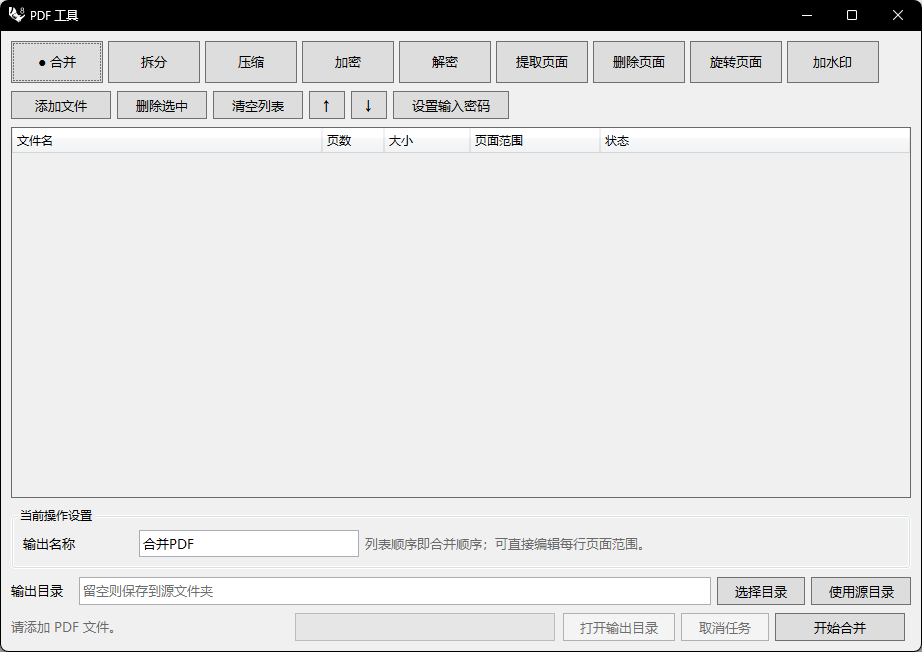

#  rsPdfTool · PDF 工具（2.0 入口）

> 模块：效率工具 / 生产力

[← 返回命令目录](/commands/)

::: info 2.0 说明

与 rsPdfTools 打开同一个客户端 PDF 工具页面，两个名称都保留。

[查看 2.0 命令变化与对照](/commands/v2)

:::

> 当前工具栏中没有此命令的对应图标。横线仅表示暂无图标，不是实际按钮；请通过命令行调用。

**功能**：2.0 的 PDF 工具入口，与 rsPdfTools 打开同一客户端页面，支持合并、拆分、压缩、水印和图片转换。

*PDF 工具主界面：标题「PDF 工具 / 文档处理工作台」；左侧 11 个功能模块（合并 / 拆分 / 压缩 / 加密 / 解密 / 提取页面 / 删除页面 / 旋转页面 / 加水印 / PDF 转图片 / 图片转 PDF），当前选中「合并」；主区顶栏工具按钮（添加文件、删除选中、清空列表、上下移、设置输入密码）+ 文件列表 + 页面缩略图预览 + 操作设置（输出名称、输出目录）+ 底部（打开输出目录 / 取消任务 / 开始合并）*

**调用**：在 Rhino 命令行输入 `rsPdfTool`（打开设置窗口）

**交互流程**：

1. 在 Rhino 输入 rsPdfTool 或 rsPdfTools，打开客户端的 PDF 工具；也可从“创作工具”直接进入。
2. 选择合并、拆分、压缩、加密、解密、提取、删除、旋转、水印、PDF 转图片或图片转 PDF。
3. 添加文件，通过缩略图和页面预览检查内容，按需要调整顺序、页码范围和操作参数。
4. 选择输出目录；留空时使用源文件目录。加密文件可分别设置输入密码。
5. 开始任务，查看进度或取消；完成后打开输出目录查看结果。

**参数**：

| 中文名 | 英文名 | 类型 | 默认值 | 范围 | 说明 |
| --- | --- | --- | --- | --- | --- |
| 拆分跨度 | SplitSpan | integer | 5 | 1-9999 | 「每 N 页」拆分模式的页数跨度（NumericStepper） |
| 拆分模式 | SplitMode | list | 逐页拆分 | 逐页拆分 / 每 N 页 / 自定义分组 | 下拉选项，默认 逐页拆分 (index 0)；选「自定义分组」时输入框支持 `1-3;4-6;7,9` 这种分号分隔多段输出 |
| 页面旋转 | PageRotation | list | 90° | 90° / 180° / 270° | 页面旋转角度，默认 90° (index 0) |
| 压缩档位 | Compression | list | 均衡（1600px / 质量 72） | 清晰(2400px/Q85) / 均衡(1600px/Q72) / 极限(1200px/Q55) | 图像压缩档位，默认 均衡 (index 1)；只重编码合格的大图片并保留文字/矢量 |
| 水印透明度 | WatermarkOpacity | integer | 18 | 1-100 | 水印不透明度百分比，默认 18 |
| 水印字体大小 | WatermarkFontSize | integer | 28 | 8-200 | 水印文字字号（pt），默认 28 |
| 水印旋转角度 | WatermarkRotation | integer | -30 | -180~180 | 水印旋转角度（度），默认 -30 |
| 水印水平间距 | WatermarkHorizontalSpacing | integer | 70 | 20-500 | 水印水平重复间距（mm），默认 70 |
| 水印垂直间距 | WatermarkVerticalSpacing | integer | 50 | 20-500 | 水印垂直重复间距（mm），默认 50 |

**输出**：对 PDF 执行拆分/旋转/压缩/提取/删除/合并/加密/解密/水印等操作并把结果 PDF 落到输出目录

**备注**：2.0 的 PDF 工具统一放在客户端“创作工具 → PDF工具”，可输入 rsPdfTool，也兼容 rsPdfTools。处理在本机完成，不上传 PDF；进入页面后可独立使用，不要求 Rhino 一直连接。

**左侧 11 个功能模块**（点中即切换设置面板；底部「开始 XXX」按钮按当前模块动态命名）：合并（默认）/ 拆分 / 压缩 / 加密 / 解密 / 提取页面 / 删除页面 / 旋转页面 / 加水印 / PDF 转图片 / 图片转 PDF。

**文件操作区**（主区顶部按钮组）：

| 按钮 | 功能 |
| --- | --- |
| 添加文件 | 弹文件选择对话框，多选 |
| 删除选中 | 移除表格中勾选行 |
| 清空列表 | 一键清空 |
| ↑ / ↓ | 仅在「合并」模块启用，按列表顺序重排 |
| 设置输入密码 | 给选定文件单独设置打开密码（解密模块使用） |

**文件表**（5 列）：文件名 / 页数 / 大小 / 页面范围（双击直接编辑每行页面范围）/ 状态。也支持把 PDF 文件直接拖入此区域批量添加。

**当前操作设置**（按模块切换的面板）：

| 模块 | 设置项 |
| --- | --- |
| 合并 | 输出名称（默认 合并PDF）+ 列表顺序即合并顺序 |
| 拆分 | 拆分模式（逐页/每 N 页/自定义分组）按模式出现「每组页数」「自定义分组」输入框 |
| 压缩 | 压缩档位（清晰/均衡/极限）|
| 加密 | 打开密码 + 确认打开密码 + 所有者密码 + 确认所有者密码 + 4 个权限 CheckBox（允许打印/复制/修改/批注） |
| 解密 | 提示文字（用上方「设置输入密码」为每个文件独立配密码） |
| 提取 / 删除 / 旋转 | 页码输入框 + 页码范围语法（同 Rhino 风格：`1;3;5-7` 或 `1-3;4-6;7,9`） |
| 加水印 | 水印文字 + 应用页码 + 透明度 1–100 + 字号 8–200 pt + 角度 -180~180 + 水平/垂直间距 20–500 mm |

**输出目录行**：输出目录输入框（默认「留空则保存到源文件夹」提示） + 选择目录 + 使用源目录两个按钮。

**底部栏**：状态文字（默认「请添加 PDF 文件。」）/ 进度条 / 三个按钮：开始 XXX（按当前模块动态命名） / 取消任务（执行中才激活） / 打开输出目录（完成后激活）。离开页面会请求取消未完成任务。输出名称冲突时会生成新名称，保留源文件。
