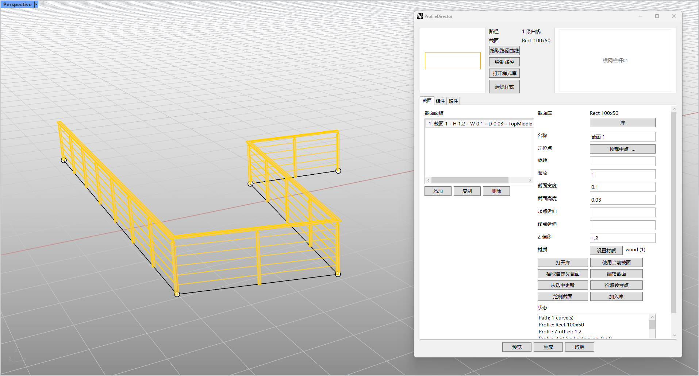
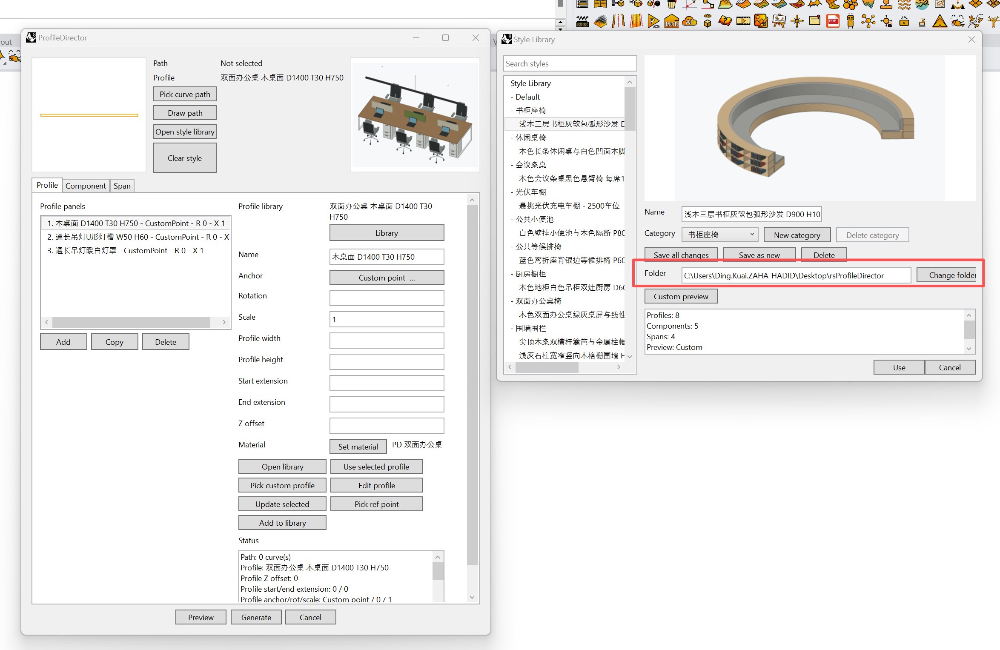

#  rsProfileDirector · Profile Director

> 模块：截面管理 / Profile Director

[← 返回命令目录](/commands/)

::: info 2.0 说明

Rhino 参数主面板保留；样式库、组件库和截面库合并到客户端的同一工具页。

[查看 2.0 命令变化与对照](/commands/v2)

:::

**功能**：沿路径生成截面、组件与跨件；2.0 保留 Rhino 参数主面板，将样式库、组件库和截面库统一放入客户端。

*Profile Director 主界面（沿曲线路径阵列栏杆截面与竖向组件）*

**调用**：在 Rhino 命令行输入 `rsProfileDirector`（打开设置窗口）

**交互流程**：

1. 在 Rhino 输入 rsProfileDirector，打开原生参数主面板。
2. 点击“拾取路径曲线”或“绘制路径”，确定生成路径。
3. 点击样式库、组件库或截面库按钮，打开客户端“创作工具 → rsProfileDirector工具”，选取素材后应用回当前文档的主工具。
4. 先选中需要调整的条目，再按面板类型修改截面、组件、跨件、转角和分布等设置。
5. 点击“预览”检查效果，满意后点击“生成”写入模型；素材库也可直接从客户端进入浏览。

**输出**：沿路径阵列生成的截面扫掠体与组件/跨件实例（可烘焙为块或独立几何体）

**备注**：2.0 保留 Rhino 中的参数主面板，把样式库、组件库和截面库合并到客户端的“rsProfileDirector工具”页面。三个库在同一入口切换；主面板中截面、组件和跨件等参数仍按各自类型设置，页面末尾保留分组介绍。

## 素材库下载与使用

可通过 [百度网盘](https://pan.baidu.com/s/5zLhuX4hCtyEUVvoC1rHkmA) 或 [Google Drive](https://drive.google.com/file/d/14BEQIffkTACkzKiMitR35b6zeuNCczRn/view?usp=sharing) 下载现成的 rsProfileDirector 素材库，海外用户可优先选择 Google Drive。压缩包需先解压，保留原有文件夹结构。

1. 在主面板点击样式库、组件库或截面库，进入客户端对应库。
2. 在库目录设置中选择解压后的 rsProfileDirector 素材库基础目录，应用后刷新列表。若目录包含 Chinese / English，工具会按客户端界面语言选择对应内容。
3. 选择需要的样式、组件或截面，点击使用/应用，回到 Rhino 主面板继续预览和生成。也可在客户端先浏览本地素材，连接 Rhino 并打开截面工具后再应用。

*上图为旧版目录设置示意。2.0 请在客户端库目录设置中选择素材所在文件夹，不需要照搬示例中的桌面路径。*

## 三个库怎么配合

样式库保存整套组合，组件库和截面库用于挑选单项素材；跨件继续在主工具中配置。可分类、搜索、排序、预览和管理本地资源，也可导入/导出本工具的 ZIP 素材包；样式导出会带上所需截面和组件。组件、截面还支持导入单个 3dm。

库地址可以放在便于管理的位置。导入时相同内容的同名素材会复用，不同内容的同名素材不会直接覆盖；需要时先整理原库或切换空目录。在线资源入口目前为待接入状态，请使用本地库。

**教学视频**：

<iframe class="rstool-video" src="https://player.bilibili.com/player.html?isOutside=true&aid=116918556236559&bvid=BV1HWNt6FEH5&cid=39940849872&p=1" scrolling="no" border="0" frameborder="no" framespacing="0" allowfullscreen="true" loading="lazy" title="RsTool · Profile Director 截面路径阵列操作演示（B 站）"></iframe>
*RsTool · Profile Director 截面路径阵列操作演示（B 站）*

**参数**：

### 主面板：路径、面板列表与预览

先选路径，再决定沿它生成什么。主窗口上方负责拾取或绘制路径、打开整套样式；下方的 Profile、Component、Span 分别处理连续截面、重复组件和跨间构件。每个选项卡左侧都能添加、复制、删除多个条目，右侧只编辑当前选中的那一项。以下是新建条目的初始设置，下载样式会带入自己的参数；长度按当前 Rhino 文档单位输入，角度用度。

| 中文名 | 英文名 | 类型 | 默认值 | 范围 | 说明 |
| --- | --- | --- | --- | --- | --- |
| 拾取路径曲线 / 绘制路径 | Path | 操作 | 未选择 | 曲线 | 使用现有曲线，或在 Rhino 中绘制路径；同一套样式可用于多条路径。 |
| 清除样式 | ClearStyle | 操作 | — | 确认后执行 | 清空截面、组件、跨件的面板设置，但保留当前路径。 |
| 预览 / 生成 / 取消 | PreviewGenerate | 操作 | 先设置再预览 | 按钮 | 预览不写入模型；开启预览后改参数会更新结果。生成写入模型；取消关闭窗口。 |

### Profile 截面面板：沿路径连续扫掠

扶手、线脚、连续板条这类沿路径一直延伸的形体，放在截面面板里做。先从截面库选轮廓，或用“拾取自定义截面”选择自己的曲线；再用定位点决定哪一处贴着路径。注意“截面高度”改的是轮廓大小，“Z 偏移”改的是整体位置，不是一回事。“编辑截面 / 从选中更新”用于修改轮廓，“加入库”用于保存为可重复使用的单个截面。

| 中文名 | 英文名 | 类型 | 默认值 | 范围 | 说明 |
| --- | --- | --- | --- | --- | --- |
| 名称 | Profile.Name | 文本 | 自动命名或沿用素材名 | 文本 | 给当前截面条目起名，方便多截面叠加时区分。 |
| 定位点 | Profile.AnchorPoint | 选项 | 中心 | 中心 / 边中点 / 角点 / 自定义点 / 轮廓拐点 | 决定截面哪一处对准路径；自定义点配合“拾取参考点”设置。 |
| 缩放 | Profile.Scale | 数值 | 1 | > 0 | 整体缩放截面；需要准确尺寸时，再填写宽度和高度。 |
| 旋转 | Profile.RotationDegrees | 数值 | 0° | 正负角度 | 旋转截面朝向，不是旋转整条路径。 |
| 截面宽度 / 截面高度 | Profile.ProfileWidth / Profile.ProfileDepth | 长度 | 留空 | 留空保留；填写正数 | 分别调整截面两个方向的尺寸；ProfileDepth 对应界面的“截面高度”。 |
| 起点延伸 / 终点延伸 | Profile.StartExtension / Profile.EndExtension | 长度 | 0 / 0 | 可正可负 | 分别调整路径两端；正值延长、负值回缩。 |
| Z 偏移 | Profile.ProfileHeight | 长度 | 0 | 可正可负 | 沿世界 Z 方向抬高或降低整条截面，不改变截面本身的高度。 |
| 材质 | Profile.MaterialId | 操作 | 未指定 | 当前文档材质 | 点击“设置材质”，为当前截面条目指定材质。 |

### Component 组件面板：沿路径重复放置物体

立柱、座椅、支架等已经建好的物体，用组件面板来排布。可从组件库选择，也可“拾取组件物体”；定位点决定物体怎样贴着路径。先选放置方式，界面才会显示对应的间距、数量或方向。“物体高度”是物体尺寸，Z 偏移是竖向移动，平面偏移则是向路径侧边移动。

| 中文名 | 英文名 | 类型 | 默认值 | 范围 | 说明 |
| --- | --- | --- | --- | --- | --- |
| 名称 | Component.Name | 文本 | 自动命名或沿用素材名 | 文本 | 标识当前组件条目；多组组件可共同组成一个样式。 |
| 放置方式 | Component.PlacementMode | 选项 | 沿曲线 | 沿曲线 / 两端 / 起点 / 终点 / 拐角 / 拐角和两端 / 分段适配 / 固定间距 | 规则阵列用沿曲线；节点构件用端点或拐角；按每段布置用分段适配或固定间距。 |
| 间距 | Component.Spacing | 长度 | 留空 | 正数；留空按模式处理 | 沿曲线模式优先按间距排布，留空用数量；分段适配会调整实际点距，固定间距保持输入点距。 |
| 数量 | Component.Count | 整数 | 5 | ≥ 1 | 只在沿曲线模式显示；间距为空时生效，转角处理可能减少实际数量。 |
| 方向 | Component.DirectionMode | 选项 | 从起点到终点 | 起点到终点 / 终点到起点 / 中点向两侧 | 只在固定间距模式显示，用于控制从哪里开始排布。 |
| 定位点 | Component.AnchorPoint | 选项 | 底部中心 | 包围盒角点 / 边中点 / 面中心 / 自定义点 | 决定物体如何对准路径；自定义定位配合“拾取参考点”。 |
| 物体宽度 / 长度 / 高度 | Component.ObjectWidth / ObjectDepth / ObjectHeight | 长度 | 留空 | 各项留空或填写正数 | 按源物体的局部包围盒尺寸调整；不填的方向保留原尺寸。 |
| Z 偏移 | Component.Height | 长度 | 0 | 可正可负 | 沿世界 Z 方向移动组件，不是修改物体高度。 |
| 平面偏移 | Component.PlaneOffset | 长度 | 0 | 可正可负 | 沿放置框架的侧向移动组件，方便让组件位于路径一侧。 |
| XY 旋转 | Component.RotationDegrees | 数值 | 0° | 正负角度 | 调整组件在放置框架中的平面朝向。 |
| 材质 | Component.MaterialId | 操作 | 未指定 | 当前文档材质 | 给这一组组件指定材质。 |

### Component 转角设置：避免碰撞与拼接

这组设置仍在组件面板里，但不是所有模式都显示。“转角基准角、整体横向适配、两侧拼接、忽略平面转角”只在“拐角 / 拐角和两端”显示；“补齐横梁”只在“分段适配 / 固定间距”显示。建议先用默认设置预览，再按素材是刚性整体、分体零件还是墙板来选择处理方式，不必把所有开关都打开。

| 中文名 | 英文名 | 类型 | 默认值 | 范围 | 说明 |
| --- | --- | --- | --- | --- | --- |
| 转角避让 | Component.AvoidCornerOverlap | 开关 | 开启 | 开启 / 关闭 | 在转角拼接面裁去越界部分并封口；图块使用独立转角版本，不改源图块。 |
| 转角基准角 | Component.CornerReferenceAngleDegrees | 数值 | 留空自动 | 0–170°；可留空 | 普通直线构件可填 0；已为直角加长的构件可填 90，用来适配实际转向角。 |
| 转角整体横向适配 | Component.StretchCornerAssembly | 开关 | 关闭 | 开启 / 关闭 | 整体横向缩放连续支架，保留零件连接，但横向截面尺寸也会变化。 |
| 转角两侧拼接 | Component.JoinCornerSides | 开关 | 关闭 | 开启 / 关闭 | 两侧各放半个组件，在角平分面裁切拼接；适合墙板或门侧收口，优先于整体横向适配。 |
| 忽略平面转角 | Component.SkipPlanCorners | 开关 | 关闭 | 开启 / 关闭 | 跳过平面转向节点，保留端点及仅坡度变化的节点。 |
| 贴合拼角坡面 | Component.FollowUprightSurface | 开关 | 关闭 | 开启 / 关闭 | 用于分体竖杆，各零件按坡面高度竖直调整；不适合需保持刚性连接的整体构件。 |
| 转角补齐横梁 | Component.FillCornerGaps | 开关 | 关闭 | 开启 / 关闭 | 按原分格补齐转角外侧的细长横梁并裁切，不会补排立柱。 |
| 转角最小间距 | CornerMinSpacing | 长度 | 留空自动 | 留空 / 0 / 正数 | 当前样式的组件共用；留空取阵列间距的 20%，0 关闭。只过滤已有对应转角组件的普通阵列。 |

### Span 跨件面板：先划分路径，再生成跨件

跨件不是另一种普通阵列：它先把路径划成一跨一跨，再在每跨里生成截面或布置组件。比如栏杆每跨的横杆、两根立柱之间的填充、隔跨出现的座椅，都可以在这里做。先设置下面的“分布方式、间距或跨数”，再选跨内的内容；“放置方式”为分段时，每个连续段分别划跨。

| 中文名 | 英文名 | 类型 | 默认值 | 范围 | 说明 |
| --- | --- | --- | --- | --- | --- |
| 名称 | Span.Name | 文本 | 自动命名 | 文本 | 给当前跨件条目起名，便于区分多层或交替布置的构件。 |
| 类型 | Span.Kind | 选项 | 截面 | 截面 / 组件 | 截面沿每跨扫掠；组件在每跨内部排布或倾斜适配，两种类型的参数不同。 |
| 放置方式 | Span.PlacementMode | 选项 | 沿曲线 | 沿曲线 / 分段 | 沿曲线对整条路径划跨；分段先按连续段拆分，再各自划跨。 |
| 分布方式 | Span.DistributionMode | 选项 | 固定间距 | 固定间距 / 分段适配 / 等分数量 | 决定路径怎样划跨；分段适配按输入间距估算跨数再均分；等分数量直接指定跨数。 |
| 方向（划跨） | Span.DistributionDirectionMode | 选项 | 从起点到终点 | 起点到终点 / 终点到起点 / 中点向两侧 | 只在固定间距显示，决定从哪端开始划跨及余量留在哪里。 |
| 间距 | Span.Spacing | 长度 | 留空 | 正数；留空不按该间距细分 | 固定间距或分段适配时显示；这是跨长设置，不是跨内组件间距。 |
| 跨数 | Span.Count | 整数 | 1 | ≥ 1 | 只在等分数量显示；分段模式下对每个连续段分别使用。 |
| 每几跨放置 / 起始跨 | Span.RepeatEvery / Span.StartSpan | 整数 | 1 / 1 | 各 ≥ 1 | 默认每跨都有；设为 2 / 1 就是第 1、3、5…跨放置。配合多个条目可做交替样式。 |
| 端部裁切 | Span.EndTrim | 长度 | 0 | ≥ 0 | 每跨两端各回缩这个距离；回缩后太短的跨会跳过。 |

### Span 截面类型：跨间横杆与连续填充

类型选“截面”时，面板显示截面库和截面定位点，而不是组件库及跨内数量。它会在裁切后的每跨上扫掠所选截面；需要绳索或下垂灯带的效果，可在后面的“垂度”中设置。

| 中文名 | 英文名 | 类型 | 默认值 | 范围 | 说明 |
| --- | --- | --- | --- | --- | --- |
| 截面库 | Span.SelectedProfileLibraryItemId | 操作 | 未选择 | 已有截面素材 | 选择用在这一组跨件里的截面，不必与主截面面板相同。 |
| 定位点 | Span.AnchorPoint | 选项 | 中心 | 中心 / 边中点 / 角点 / 自定义点 / 轮廓拐点 | 决定截面与跨路径对齐的位置；使用库内的参考点或轮廓定位点。 |

### Span 组件类型：跨内排布与坡跨适配

类型选“组件”后，先选择组件库与定位点，再设置“跨件分布”。这里是第二层分布：上面的跨数决定有几跨，下面的跨件数量决定每跨内部有几个组件。开启“沿跨倾斜适配”会改为每跨放一组并拉伸到两端，跨内分布、方向和间距/数量随之隐藏。

| 中文名 | 英文名 | 类型 | 默认值 | 范围 | 说明 |
| --- | --- | --- | --- | --- | --- |
| 组件库 | Span.SelectedComponentLibraryItemId | 操作 | 未选择 | 已有组件素材 | 选择这一组跨件使用的组件素材。 |
| 组件定位点 | Span.ComponentAnchorPoint | 选项 | 底部中心 | 包围盒定位点 / 自定义点 | 决定组件如何对准跨内的放置位置；载入素材可带入自己的定位点。 |
| 跨件分布 | Span.MemberDistributionMode | 选项 | 固定间距 | 固定间距 / 分段适配 / 等分数量 | 在每跨内部排组件；分段适配根据跨长调整数量和实际间距。 |
| 方向（跨内排布） | Span.DirectionMode | 选项 | 从中点向两侧 | 中点向两侧 / 起点到终点 / 终点到起点 | 控制每跨里的组件从哪里开始排，区别于前面的划跨方向。 |
| 跨件间距 / 跨件数量 | Span.ComponentSpacing / Span.MemberCount | 长度 / 整数 | 留空 / 1 | 间距 > 0；数量 ≥ 1 | 按跨件分布模式显示其中一项；间距留空时每跨中心放一个。 |
| 转角避让 | Span.AvoidCornerOverlap | 开关 | 开启 | 开启 / 关闭 | 组件类型显示，用于处理转角附近的越界部分。 |
| 保留完整构件 / 避让组 | Span.KeepWholeAtCorners / Span.CornerClearanceGroup | 开关 / 文本 | 关闭 / 留空 | 开启 / 关闭；组名文本 | 移动完整组件避让，放不下整组跳过，不裁切。相同组名及布置参数共用包络；需开启转角避让，且不使用倾斜适配。 |
| 贴合拼角坡面 | Span.FollowUprightSurface | 开关 | 关闭 | 开启 / 关闭 | 适合分体竖杆按坡面竖直调整；沿跨倾斜适配开启时隐藏。 |
| 沿跨倾斜适配 | Span.FitToSlopedSpan | 开关 | 关闭 | 开启 / 关闭 | 每跨一组，沿裁切后的两端连线倾斜并拉伸，截面保持竖直；弯曲路径按跨的弦线连接。 |
| 适配基准长度 | Span.SpanFitReferenceLength | 长度 | 留空 | 留空 / 正数 | 仅倾斜适配显示；留空用组件 X 范围，填写后以定位点为中心。多层组件共用基准可保持对齐。 |
| 仅用于截面开孔 | Span.CutProfiles | 开关 | 关闭 | 开启 / 关闭 | 把封闭组件实体作为切割体，对生成的截面做布尔差；切割体不预览、不烘焙。 |

### Span 尺寸与姿态：不要把尺寸当位移

这部分仍是跨件面板的参数，两种类型大多共用，但尺寸含义不同：截面类型里的“物体宽度 / 长度”对应轮廓宽度和高度；组件类型则按源物体的局部包围盒尺寸调整。垂度让跨间下垂，Z 偏移把整体抬高；先确认类型，再改尺寸和位置。

| 中文名 | 英文名 | 类型 | 默认值 | 范围 | 说明 |
| --- | --- | --- | --- | --- | --- |
| 物体宽度 / 长度 / 高度 | Span.ObjectWidth / ObjectDepth / ObjectHeight | 长度 | 留空 | 各项留空或填写正数 | 截面类型只用宽度和长度；组件类型也显示高度。倾斜适配接管沿跨宽度，宽度输入框禁用。 |
| 垂度 | Span.Sag | 长度 | 0 | ≥ 0 | 每跨中部向世界 -Z 下垂，0 不下垂；组件倾斜适配时隐藏。 |
| Z 偏移 / 平面偏移 | Span.Height / Span.PlaneOffset | 长度 | 0 / 0 | 可正可负 | 分别用于竖向移动和路径侧向移动，不改变物体尺寸。 |
| 旋转模式 / 旋转数值 | Span.RotationMode / Span.RotationValue | 选项 / 角度 | 固定旋转 / 0° | 固定用正负角；随机幅度 ≥ 0 | 固定按指定角度旋转；随机在输入幅度的正负范围内变化。 |
| 随机偏移 | Span.RandomPlaneOffset | 长度 | 0 | ≥ 0 | 在平面偏移基础上增加正负随机侧向变化，0 关闭。 |
| 材质 | Span.MaterialId | 操作 | 未指定 | 当前文档材质 | 给当前跨件条目指定材质。 |

### 客户端三库：样式、组件与截面在一个页面管理

主参数面板仍在 Rhino 中，点击任一库按钮会进入客户端“创作工具 → rsProfileDirector工具”。页面内切换样式库、组件库和截面库：样式保存整套组合，组件和截面保存单项素材，跨件继续在主面板设置。本地库可先独立浏览；应用、保存当前样式以及从 Rhino 添加或替换素材时，再连接正确文档并打开对应工具。

| 中文名 | 英文名 | 类型 | 默认值 | 范围 | 说明 |
| --- | --- | --- | --- | --- | --- |
| 搜索 / 分类 / 排序 | Library.SearchCategory | 客户端控件 | 当前库 | 名称或分类 / 全部分类 / 分类或名称排序 | 在客户端三库页面筛选素材；可切换网格或列表，选择条目后在右侧查看预览与编辑信息。 |
| 本地库地址 / 浏览 / 应用地址 | Library.Folder | 客户端路径设置 | 当前素材库基础目录 | 本地文件夹 | 可直接输入或浏览文件夹，点击“应用地址”后载入。基础目录含 Chinese / English 时按客户端语言选取对应目录；普通自定义目录直接使用。 |
| 另存当前样式 / 用当前设置替换样式 | Library.SaveStyle | 客户端操作 | — | 样式库 | 连接 Rhino 并打开截面工具后，可把当前整套设置保存为新样式，或替换选中样式。“保存名称与分类”只修改素材管理信息，不替换几何设置。 |
| 自定义预览图 / 使用样式、截面或组件 | Library.PreviewUse | 客户端操作 | 随素材 | 图片 / 已选素材 | 自定义预览图用于客户端库列表展示；使用按钮或双击把所选素材应用到来源 Rhino 文档的截面工具。失败时先检查当前文档与主工具状态。 |
| 资源来源 | Library.Source | 客户端选项 | 本地 | 本地 / 在线 | 当前使用本地素材库。在线仅为预留入口，尚未接入服务器资源；切回本地可继续使用已有目录。 |
| 从 Rhino 添加 / 替换几何 | Library.AddReplace | 客户端操作 | — | 组件库 / 截面库 | 从连接的 Rhino 文档拾取组件或封闭平面截面，添加为新素材；也可在“预览与编辑”中替换选中素材的几何。 |
| 导入 / 导出此库 | Library.ImportExport | 客户端操作 | — | ZIP；组件、截面另支持 3dm 导入 | 在更多操作中导入素材包或导出当前库；样式包包含依赖的组件与截面。相同内容的同名资源会复用，不同内容不会直接覆盖。 |
