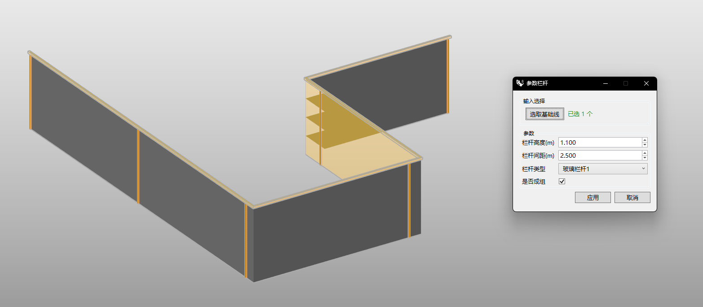

#  rsRailing · 参数栏杆

> 模块：建筑 / 建筑构件

[← 返回命令目录](/commands/)

::: info 2.0 说明

支持参数对象持续编辑，选中后在对应属性页修改；需要普通几何时使用页面中的专用转换或分解入口。

[查看 2.0 命令变化与对照](/commands/v2)

:::

**功能**：沿基础线生成 15 种样式的栏杆，默认保留参数，可在对象属性里继续改款、改高度和构件尺寸。

*Eto「参数栏杆」窗口：选择栏杆基础曲线后沿其生成栏杆（含玻璃 / 扶手 / 立柱 / 横杆），窗口内调整栏杆高度、立柱间距、栏杆类型、是否成组*

**调用**：在 Rhino 命令行输入 `rsRailing`（打开设置窗口）

**交互流程**：

1. 打开“参数栏杆”窗口，选取一条或多条基础线；支持直线、曲线、折线、闭合线和空间坡道。
2. 先挑栏杆类型，设置总高度和最大柱距；需要细调时展开“高级参数”，各款显示的选项会随样式变化。
3. 查看实时预览。默认勾选“生成 rsRailing 参数对象”，点“应用”后每条基础线生成一个可编辑栏杆。
4. 生成后选中单个栏杆，在 Rhino 对象属性的栏杆页继续修改样式、高度、柱距和高级参数。原基础线可以保留或删除。
5. 需要出二维图或取边线时用属性页的几何读取工具；需要直接做实体编辑时，点“转为普通物体”或运行 rsRailingToGeometry。

**参数**：

| 中文名 | 英文名 | 类型 | 默认值 | 范围 | 说明 |
| --- | --- | --- | --- | --- | --- |
| 栏杆类型 | Railing type | list | 玻璃栏杆1 | 玻璃栏杆1 / 栅格栏杆1 / 横网栏杆 / 玻璃栏杆2 / 栅格栏杆2 / 圆管栏杆 / 横向扁条栏杆 / X形交叉栏杆 / 竖向百叶栏杆 / 底槽式玻璃栏杆 / 实心板栏杆 / 横向钢索栏杆 / 竖向钢索栏杆 / 点支式玻璃栏杆 / 双层扶手栏杆 | 共 15 款，带缩略图；高级参数会随样式显示，不是每种栏杆都使用相同参数。 |
| 总高度（米） | Total height (m) | double | 1.1 | 0.01–100 m | 统一按米输入，插件会换算到当前模型单位。高度要能容纳扶手、填充和底部净空。 |
| 最大柱距 / 分片宽（米） | Maximum span (m) | double | 2.5 | 0.01–100 m | 这是最大跨距；沿每段基础线等分，实际柱距或分片宽会根据长度调整。 |
| 生成 rsRailing 参数对象 | Create rsRailing object | toggle | true | true / false | 默认开启，每条基础线一个独立参数栏杆，不是图块。关闭后按旧方式输出普通网格；不会转换已经生成的栏杆。 |
| 是否成组 | Group objects | toggle | true | true / false | 用于普通网格输出，按每条基础线分别成组。参数对象模式下不需要这个选项。 |
| 高级参数：扶手与主柱 | Handrail and posts | dimensions | 按所选样式 | 面板中对应的尺寸与开关 | 可调顶部扶手开关、扶手宽或直径和高度、主柱沿线宽与横向厚度；圆管等样式按直径理解。 |
| 高级参数：填充与面板 | Infill and panels | dimensions | 按所选样式 | 横杆数量 1–100；其他尺寸按面板 | 按样式显示填充杆最大中心距、宽厚、横杆数量、玻璃或面板厚度和分片净缝。 |
| 高级参数：底部净空与百叶角度 | Bottom clearance / Louver angle | dimensions | 按所选样式 | 净空 ≥0；百叶角度 −90°–90° | 净空控制底部留空；只有百叶样式显示旋转角。参数过密或高度不足时请根据提示调整。 |

**输出**：默认每条基础线生成一个可持续编辑的 rsRailing，保存基础线副本、参数和精确构件；关闭参数对象后输出普通网格。

**备注**：旧版的基础线和 15 款栏杆流程仍保留，2.0 增加的是后续可持续编辑的参数对象。各款的高级参数不同，切换样式时按面板显示调整，不必套用一整套统一数值。参数栏杆可移动、复制、镜像和缩放；复制后可以分别改款。

需要 Make2D、复制边缘或复制边界时，从栏杆属性页运行，可保留参数，不必先转普通物体。不要直接用 Rhino 原命令预选参数栏杆：自定义对象并不保证被内建命令识别。需要布尔等普通实体操作时，再用“转为普通物体”或 rsRailingToGeometry；会输出当前已应用造型的全部普通封闭 Brep，并删除源参数栏杆，可一次 Undo 恢复。

当前版 3dm 可保存栏杆参数、精确造型与外观。跨文档剪贴板、导入插入、旧版或第三方交换前先转普通物体。修改模型单位后要先恢复一致单位再改参。
