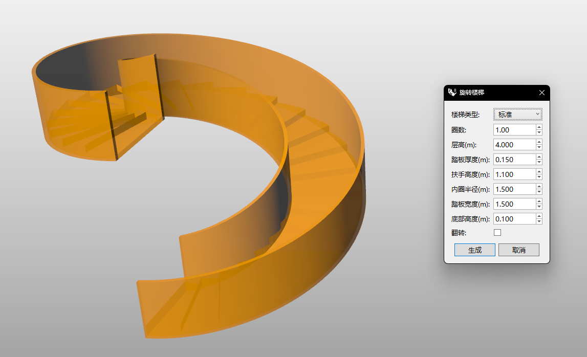

#  rsSpiralStair · 旋转楼梯

> 模块：建筑 / 楼梯与坡道

[← 返回命令目录](/commands/)

::: info 2.0 说明

支持二维和三维参数楼梯，并可在属性面板中切换；基础线控制点不适用于旋转楼梯。

[查看 2.0 命令变化与对照](/commands/v2)

:::

**功能**：通过定位线与参数生成旋转楼梯；三维参数对象可在属性页调整尺寸，并转为专用二维旋转楼梯表示。

*选取旋转楼梯基点后生成旋转楼梯，支持标准/镂空两种踏板类型，圈数/半径/踏板宽度等可调*

**调用**：在 Rhino 命令行输入 `rsSpiralStair`（打开设置窗口）

**交互流程**：

1. 输入 rsSpiralStair，拾取旋转楼梯基点，再在弹出的面板设置参数。
2. 设置圈数、层高、期望步高、内半径、梯段宽、底厚与扶手。
3. 选择标准或空踏板，检查翻转后的旋转方向与预览，再点击“生成”。
4. 保留参数对象时，可在属性页继续编辑，或在二维／三维表示间切换。

**参数**：

| 中文名 | 英文名 | 类型 | 默认值 | 范围 | 说明 |
| --- | --- | --- | --- | --- | --- |
| 圈数 | TurnCount | double | 1 | 0.01–1000 | 控制总旋转圈数。 |
| 层高／期望步高 | FloorRise | group | 4 m / 0.15 m | 层高 ≥ 步高 > 0 | 实际级数按原生成规则确定，不是单独输入踏步数。 |
| 内半径／梯段宽 | RadiusWidth | group | 1.5 m / 1.5 m | 有效正值 | 外半径由内半径和梯段宽确定。 |
| 扶手高／底厚 | RailThickness | group | 1.1 m / 0.1 m | 扶手有效正值；底厚≥0 | 尺寸按当前模型单位显示。 |
| 类型／翻转 | TypeFlip | group | 标准 / 不翻转 | 标准 / 空踏板；可翻转 | 翻转改变旋转方向。 |
| 生成参数楼梯对象 | GenerateObject | bool | 开启 | 开启 / 关闭（三维） | 开启后可在属性页改参数；关闭输出普通 Brep。 |

**输出**：参数三维旋转楼梯或普通 Brep；参数结果可转换为二维。

**备注**：尺寸按当前 Rhino 文档单位显示；下列 mm、m 是等效物理尺寸示例。

三维默认勾选“生成参数楼梯对象”，整梯作为独立参数对象保存。选中后可在“楼梯参数”属性页继续改尺寸，或在二维／三维间切换；移动、旋转和等比缩放后继续编辑会保留放置位置。取消该选项则输出普通 Brep。

参数对象可使用 `rsStairMake2D` 出二维线、`rsStairDupEdge` 复制边缘；需要交给只识别普通几何的后续命令，可用 `rsStairToGeometry` 转换，Undo 可恢复参数对象。

该命令的新建窗口仍用于三维楼梯，二维表示从参数对象属性页切换；二维由独立平面算法绘制轮廓、踏步、上行箭头与断线。二维属性中的断线高度控制显示到哪一级，多圈不会把每圈轮廓反复叠画。

旋转楼梯暂不提供 `PointsOn` 基础线控制点。

配图或视频可能来自旧版界面，2.0 请以本文的入口、模式和参数说明为准。
