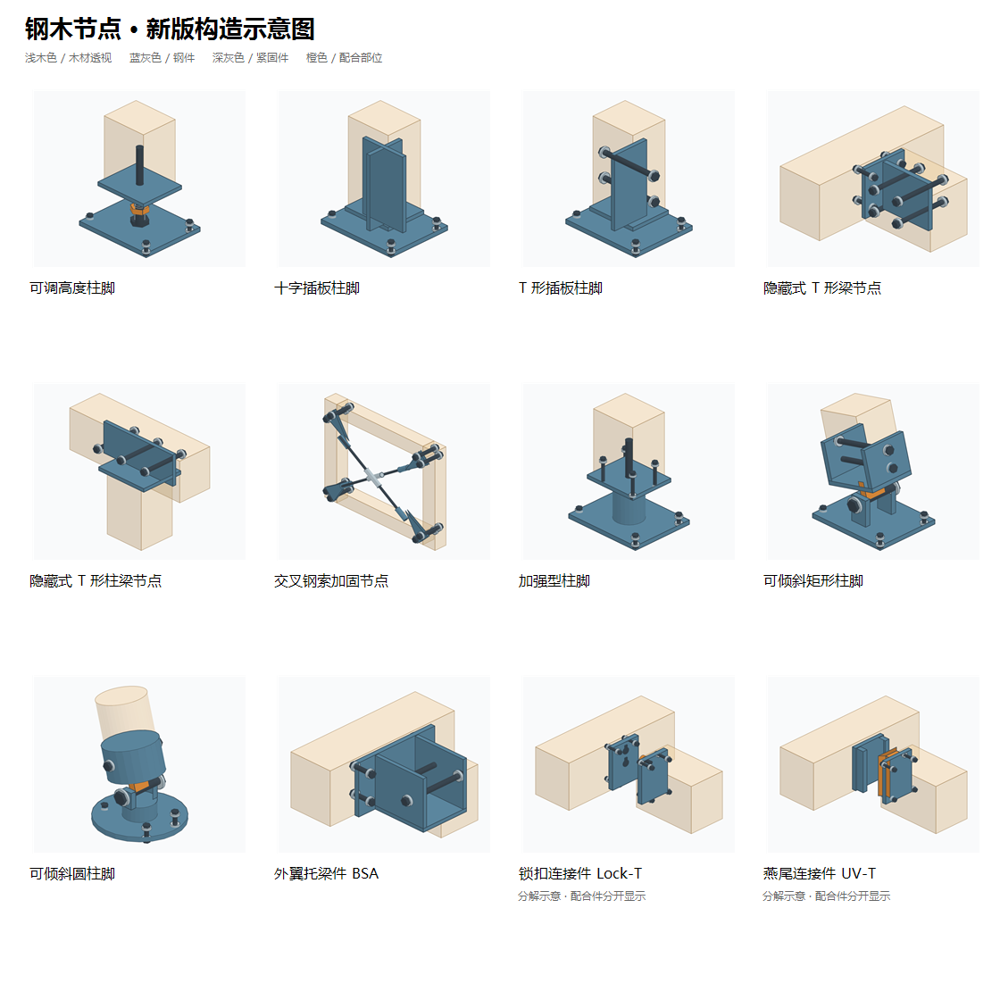

#  rsTimberJoint · 钢木节点

> 模块：建筑 / 建筑构件

[← 返回命令目录](/commands/)

**功能**：生成节点钢件、紧固件，以及按节点需要开槽、钻孔或切削后的木构件副本。加工木件继承原图层和材质，钢件与紧固件分别进入“钢木节点”下的子图层，每次生成自动分组。

*十二种节点构造总览：浅木色为透视木材，蓝灰色为钢件，深灰色为紧固件，橙色表示配合部位。示意图只用于理解构造，不随参数变化；实际模型以视口橙色预览为准。*

**调用**：在 Rhino 命令行输入 `rsTimberJoint`（打开设置窗口）

**交互流程**：

1. 输入 rsTimberJoint，打开“钢木节点 · Fu_Wood”面板。也可从 rsMenu → 建筑 → 钢木节点打开。
2. 先选分类，再选具体节点类型。切换类型会清空已选对象和支承基面，请按新类型重新选择。
3. 按面板提示分别选择柱、梁或引导线，Enter 完成每组选择。柱脚可批量选柱；梁连接至少选两根梁；柱梁连接分别选柱与梁；交叉加固需要四根周边构件及两条引导直线。
4. 按当前节点面板调整尺寸，所有长度统一输入毫米。两种可倾斜柱脚还可“取当前工作平面”作为支承基面，或点“自动”恢复各柱底的水平面。
5. 输入齐全后自动显示橙色预览，修改参数或有效源对象后会刷新，也可点“预览”手动重算。查看状态栏的连接数、构件数及提示，确认没有尺寸或接触关系错误。
6. 点击“生成”将当前输入重新计算并写入文档。结果自动分组，可一步撤销；面板保留并清空对象选择，便于继续处理下一批。

**备注**：

## 面板怎么用

面板上方先选“柱脚、梁连接、柱梁连接、加固”，再选具体样式。中间构造图帮助理解钢板和紧固件的位置，下面只显示当前样式需要的选择按钮及尺寸。尺寸表中的类型前缀用于区分同名字段，不需要在 Rhino 中手动输入这些英文键。

输入尺寸始终是毫米，即使模型单位为米也一样；结果会自动换回文档单位。下表是首次使用的默认值，同一会话会分别记住每种节点的尺寸。数值框允许 0.001–1000000，但每个尺寸还必须大于两倍模型绝对公差（换算为毫米），并满足构件截面及节点内部的几何空间要求。

## 模型要准备成什么样

木构件可以是 Brep、曲面或 Extrusion，支持曲梁及开放曲面，不接受网格或块实例。梁端和柱脚节点仍需能识别平面端面；交叉加固可使用独立侧面。对象应可见、未锁定且可编辑，同一对象不能同时作为柱和梁。

连接位置从真实几何接触关系判断，不是把钢件随意放到附近。梁端需与承接梁侧面相接，柱梁节点需柱顶与梁底相接；找不到有效接触或存在多个承接候选时，按状态栏提示整理模型后重新预览。交叉加固的两条引导线必须是内部相交、共面的直线，端点靠近四个内角。

## 倾斜柱脚的基面和高度

“可倾斜矩形柱脚”和“可倾斜圆柱脚”默认以每根柱底的水平面为基面。“取当前工作平面”会记录当时工作平面的完整位置和方向，用于统一支承面；之后切换工作平面不会自动跟随，需要重新取面。“自动”恢复默认。高度指铰轴到基面的法向距离，圆柱脚还要求柱端为圆形。

## 原模型会不会被改掉

命令在几何副本上加工，不删除或改写原木构件。“隐藏原始物体”默认开启：预览时只是临时遮蔽有加工副本的原件，关闭面板或预览失效即恢复；正式生成后隐藏这些原件，保留加工副本。取消勾选则原件继续显示，可能与结果重叠。未连接构件以及交叉加固的原框架和引导线保持原状。

生成结果是普通几何，不是可回到面板编辑的参数化节点。一次撤销可移除这一批结果并恢复被隐藏原件，也支持重做。切换文档会关闭面板，参数会话记忆不等于节点可回编。

## 使用范围

本命令用于节点构造建模，不提供结构受力验算、加工图纸或材料清单。BSA、Lock-T、UV-T 等为参数化构造表达，不是厂家产品的精确复刻；默认尺寸和装配间隙也不能替代实际项目的结构设计与加工确认。

**参数**：

### 共用面板选项

分类决定有哪些节点样式可选；对象选择按钮和尺寸会随类型变化。下面的节点尺寸均为毫米。

| 中文名 | 英文名 | 类型 | 默认值 | 范围 | 说明 |
| --- | --- | --- | --- | --- | --- |
| 分类 | Category | 选项 | 柱脚 | 柱脚 / 梁连接 / 柱梁连接 / 加固 | 先选构造大类，再选节点样式。 |
| 节点类型 | JointType | 选项 | 可调高度柱脚 | 当前分类下的样式，共 12 种 | 切换类型会清空对象选择及支承基面，并切换尺寸表。 |
| 支承基准面 | SupportPlane | 平面 | 各柱底水平面 | 自动 / 取当前工作平面 | 仅两种可倾斜柱脚显示；记录取面时的位置和方向。 |
| 隐藏原始物体 | HideOriginals | 开关 | 开启 | 开启 / 关闭 | 只隐藏有加工副本的原木构件；不删除原几何。 |

### 柱脚 · 可调高度柱脚

选择矩形截面柱，可批量生成。上下钢板之间由连接杆连接，先看顶板是否适合柱截面，再调整柱脚高度。

| 中文名 | 英文名 | 类型 | 默认值 | 范围 | 说明 |
| --- | --- | --- | --- | --- | --- |
| 顶板宽度 | AdjustableBase.TopWidth | 长度（mm） | 220 | 0.001–1000000；还须 > 2 × 文档公差（换算为 mm） | 顶板的横向尺寸。 |
| 顶板长度 | AdjustableBase.TopLength | 长度（mm） | 400 | 0.001–1000000；还须 > 2 × 文档公差（换算为 mm） | 顶板的纵向尺寸。 |
| 底板宽度 | AdjustableBase.BottomWidth | 长度（mm） | 250 | 0.001–1000000；还须 > 2 × 文档公差（换算为 mm） | 底板的横向尺寸。 |
| 底板长度 | AdjustableBase.BottomLength | 长度（mm） | 400 | 0.001–1000000；还须 > 2 × 文档公差（换算为 mm） | 底板的纵向尺寸。 |
| 钢板厚度 | AdjustableBase.Thickness | 长度（mm） | 12 | 0.001–1000000；还须 > 2 × 文档公差（换算为 mm） | 按本类型设置底板或连接钢板的厚度。 |
| 连接杆半径 | AdjustableBase.RodRadius | 长度（mm） | 15 | 0.001–1000000；还须 > 2 × 文档公差（换算为 mm） | 按本类型设置连接杆、螺栓、销轴或挂销半径；输入的是半径，不是直径。 |
| 柱脚高度 | AdjustableBase.Height | 长度（mm） | 200 | 0.001–1000000；还须 > 2 × 文档公差（换算为 mm） | 按本类型面板标签设置柱脚、插板、端板或连接件的高度；倾斜柱脚按铰轴到基面的法向距离计算。 |

### 柱脚 · 十字插板柱脚

选择矩形截面柱。十字插板伸入木柱，配合托板支承；插板厚度、托板高度和插板高度要彼此留出空间。

| 中文名 | 英文名 | 类型 | 默认值 | 范围 | 说明 |
| --- | --- | --- | --- | --- | --- |
| 底板宽度 | CrossBase.Width | 长度（mm） | 300 | 0.001–1000000；还须 > 2 × 文档公差（换算为 mm） | 按本类型面板标签设置底板、端板、连接板或托件的宽度。 |
| 底板长度 | CrossBase.Length | 长度（mm） | 200 | 0.001–1000000；还须 > 2 × 文档公差（换算为 mm） | 底板的纵向尺寸。 |
| 底板厚度 | CrossBase.Thickness | 长度（mm） | 12 | 0.001–1000000；还须 > 2 × 文档公差（换算为 mm） | 按本类型设置底板或连接钢板的厚度。 |
| 插板厚度 | CrossBase.KnifeThickness | 长度（mm） | 6 | 0.001–1000000；还须 > 2 × 文档公差（换算为 mm） | 十字插板的厚度，需要小于柱截面可用尺寸。 |
| 插板高度 | CrossBase.Height | 长度（mm） | 310 | 0.001–1000000；还须 > 2 × 文档公差（换算为 mm） | 按本类型面板标签设置柱脚、插板、端板或连接件的高度；倾斜柱脚按铰轴到基面的法向距离计算。 |
| 托板高度 | CrossBase.HoldHeight | 长度（mm） | 50 | 0.001–1000000；还须 > 2 × 文档公差（换算为 mm） | 托板高度，与底板厚度、插板高度保持合理间距。 |

### 柱脚 · T 形插板柱脚

选择矩形截面柱，生成底板、插板和穿柱螺栓，并输出带对应槽孔的木柱副本。

| 中文名 | 英文名 | 类型 | 默认值 | 范围 | 说明 |
| --- | --- | --- | --- | --- | --- |
| 底板宽度 | TBase.Width | 长度（mm） | 220 | 0.001–1000000；还须 > 2 × 文档公差（换算为 mm） | 按本类型面板标签设置底板、端板、连接板或托件的宽度。 |
| 底板长度 | TBase.Length | 长度（mm） | 400 | 0.001–1000000；还须 > 2 × 文档公差（换算为 mm） | 底板的纵向尺寸。 |
| 钢板厚度 | TBase.Thickness | 长度（mm） | 12 | 0.001–1000000；还须 > 2 × 文档公差（换算为 mm） | 按本类型设置底板或连接钢板的厚度。 |
| 插板高度 | TBase.Height | 长度（mm） | 200 | 0.001–1000000；还须 > 2 × 文档公差（换算为 mm） | 按本类型面板标签设置柱脚、插板、端板或连接件的高度；倾斜柱脚按铰轴到基面的法向距离计算。 |
| 螺栓半径 | TBase.RodRadius | 长度（mm） | 5 | 0.001–1000000；还须 > 2 × 文档公差（换算为 mm） | 按本类型设置连接杆、螺栓、销轴或挂销半径；输入的是半径，不是直径。 |

### 梁连接 · 隐藏式 T 形梁节点

选择至少两根相接的梁。命令识别接入梁端面与承接梁侧面的接触，支持曲梁端部；端板宽高要适合接入梁截面。

| 中文名 | 英文名 | 类型 | 默认值 | 范围 | 说明 |
| --- | --- | --- | --- | --- | --- |
| 端板宽度 | BeamT.Width | 长度（mm） | 150 | 0.001–1000000；还须 > 2 × 文档公差（换算为 mm） | 按本类型面板标签设置底板、端板、连接板或托件的宽度。 |
| 端板高度 | BeamT.Height | 长度（mm） | 300 | 0.001–1000000；还须 > 2 × 文档公差（换算为 mm） | 按本类型面板标签设置柱脚、插板、端板或连接件的高度；倾斜柱脚按铰轴到基面的法向距离计算。 |
| 钢板厚度 | BeamT.Thickness | 长度（mm） | 12 | 0.001–1000000；还须 > 2 × 文档公差（换算为 mm） | 按本类型设置底板或连接钢板的厚度。 |
| 插板深度 | BeamT.Depth | 长度（mm） | 200 | 0.001–1000000；还须 > 2 × 文档公差（换算为 mm） | T 形节点为插板深度；BSA 为沿接入梁延伸的承托深度。 |

### 柱梁连接 · 隐藏式 T 形柱梁节点

分别选择柱和梁，至少各一根，在柱顶与梁底接触处生成连接件。同一位置同轴的多根梁可共享连接件。

| 中文名 | 英文名 | 类型 | 默认值 | 范围 | 说明 |
| --- | --- | --- | --- | --- | --- |
| 底板宽度 | ColumnBeamT.Width | 长度（mm） | 300 | 0.001–1000000；还须 > 2 × 文档公差（换算为 mm） | 按本类型面板标签设置底板、端板、连接板或托件的宽度。 |
| 底板长度 | ColumnBeamT.Length | 长度（mm） | 200 | 0.001–1000000；还须 > 2 × 文档公差（换算为 mm） | 底板的纵向尺寸。 |
| 钢板厚度 | ColumnBeamT.Thickness | 长度（mm） | 20 | 0.001–1000000；还须 > 2 × 文档公差（换算为 mm） | 按本类型设置底板或连接钢板的厚度。 |
| 插板高度 | ColumnBeamT.Height | 长度（mm） | 400 | 0.001–1000000；还须 > 2 × 文档公差（换算为 mm） | 按本类型面板标签设置柱脚、插板、端板或连接件的高度；倾斜柱脚按铰轴到基面的法向距离计算。 |

### 加固 · 交叉钢索加固节点

选择恰好四根周边构件和两条内部相交、共面的直线；引导线端点应靠近框架四个真实内角。生成角连接板、夹片、销轴及错层杆索，原框架和引导线不加工。

| 中文名 | 英文名 | 类型 | 默认值 | 范围 | 说明 |
| --- | --- | --- | --- | --- | --- |
| 角连接板高度 | CrossBrace.Height | 长度（mm） | 200 | 0.001–1000000；还须 > 2 × 文档公差（换算为 mm） | 按本类型面板标签设置柱脚、插板、端板或连接件的高度；倾斜柱脚按铰轴到基面的法向距离计算。 |
| 角连接板宽度 | CrossBrace.Width | 长度（mm） | 100 | 0.001–1000000；还须 > 2 × 文档公差（换算为 mm） | 按本类型面板标签设置底板、端板、连接板或托件的宽度。 |
| 连接板厚度 | CrossBrace.Thickness | 长度（mm） | 10 | 0.001–1000000；还须 > 2 × 文档公差（换算为 mm） | 按本类型设置底板或连接钢板的厚度。 |
| 杆索半径 | CrossBrace.SteelPipeRadius | 长度（mm） | 15 | 0.001–1000000；还须 > 2 × 文档公差（换算为 mm） | 两根交叉杆索的半径，不是直径。 |
| 夹片孔距 | CrossBrace.ClipLength | 长度（mm） | 75 | 0.001–1000000；还须 > 2 × 文档公差（换算为 mm） | 夹片上连接孔之间的距离。 |
| 夹片大端半径 | CrossBrace.ClipRadius1 | 长度（mm） | 35 | 0.001–1000000；还须 > 2 × 文档公差（换算为 mm） | 夹片大端轮廓半径。 |
| 夹片小端半径 | CrossBrace.ClipRadius2 | 长度（mm） | 25 | 0.001–1000000；还须 > 2 × 文档公差（换算为 mm） | 夹片小端轮廓半径。 |
| 夹片厚度 | CrossBrace.ClipThickness | 长度（mm） | 5 | 0.001–1000000；还须 > 2 × 文档公差（换算为 mm） | 夹片的板厚。 |

### 柱脚 · 加强型柱脚

选择柱，以圆管支座连接上下底板，并通过中心杆及顶板螺栓连接木柱。顶板和底板可以分别设置宽度、长度。

| 中文名 | 英文名 | 类型 | 默认值 | 范围 | 说明 |
| --- | --- | --- | --- | --- | --- |
| 顶板宽度 | ResistantBase.TopWidth | 长度（mm） | 220 | 0.001–1000000；还须 > 2 × 文档公差（换算为 mm） | 顶板的横向尺寸。 |
| 顶板长度 | ResistantBase.TopLength | 长度（mm） | 400 | 0.001–1000000；还须 > 2 × 文档公差（换算为 mm） | 顶板的纵向尺寸。 |
| 底板宽度 | ResistantBase.BottomWidth | 长度（mm） | 220 | 0.001–1000000；还须 > 2 × 文档公差（换算为 mm） | 底板的横向尺寸。 |
| 底板长度 | ResistantBase.BottomLength | 长度（mm） | 400 | 0.001–1000000；还须 > 2 × 文档公差（换算为 mm） | 底板的纵向尺寸。 |
| 钢板厚度 | ResistantBase.Thickness | 长度（mm） | 12 | 0.001–1000000；还须 > 2 × 文档公差（换算为 mm） | 按本类型设置底板或连接钢板的厚度。 |
| 柱脚高度 | ResistantBase.Height | 长度（mm） | 200 | 0.001–1000000；还须 > 2 × 文档公差（换算为 mm） | 按本类型面板标签设置柱脚、插板、端板或连接件的高度；倾斜柱脚按铰轴到基面的法向距离计算。 |
| 螺栓半径 | ResistantBase.RodRadius | 长度（mm） | 5 | 0.001–1000000；还须 > 2 × 文档公差（换算为 mm） | 按本类型设置连接杆、螺栓、销轴或挂销半径；输入的是半径，不是直径。 |

### 柱脚 · 可倾斜矩形柱脚

选择矩形截面柱，托座随柱的实际倾角定位。净宽、净长应容纳柱截面；高度指铰轴到支承基面的法向距离，不是沿斜柱测量的长度。

| 中文名 | 英文名 | 类型 | 默认值 | 范围 | 说明 |
| --- | --- | --- | --- | --- | --- |
| 托座净宽 | InclinableBase.InternalWidth | 长度（mm） | 220 | 0.001–1000000；还须 > 2 × 文档公差（换算为 mm） | 托座内部净宽，应容纳柱截面。 |
| 托座净长 | InclinableBase.InternalLength | 长度（mm） | 400 | 0.001–1000000；还须 > 2 × 文档公差（换算为 mm） | 托座内部净长，应容纳柱截面。 |
| 底板宽度 | InclinableBase.BottomWidth | 长度（mm） | 220 | 0.001–1000000；还须 > 2 × 文档公差（换算为 mm） | 底板的横向尺寸。 |
| 底板长度 | InclinableBase.BottomLength | 长度（mm） | 400 | 0.001–1000000；还须 > 2 × 文档公差（换算为 mm） | 底板的纵向尺寸。 |
| 钢板厚度 | InclinableBase.Thickness | 长度（mm） | 12 | 0.001–1000000；还须 > 2 × 文档公差（换算为 mm） | 按本类型设置底板或连接钢板的厚度。 |
| 铰轴距基面高度 | InclinableBase.Height | 长度（mm） | 200 | 0.001–1000000；还须 > 2 × 文档公差（换算为 mm） | 按本类型面板标签设置柱脚、插板、端板或连接件的高度；倾斜柱脚按铰轴到基面的法向距离计算。 |
| 销轴及螺栓半径 | InclinableBase.RodRadius | 长度（mm） | 5 | 0.001–1000000；还须 > 2 × 文档公差（换算为 mm） | 按本类型设置连接杆、螺栓、销轴或挂销半径；输入的是半径，不是直径。 |

### 柱脚 · 可倾斜圆柱脚

选择具有圆形端面的柱，生成圆底座、圆筒抱箍及铰接件。可像矩形倾斜柱脚一样指定支承基面，高度仍按基面法向计算。

| 中文名 | 英文名 | 类型 | 默认值 | 范围 | 说明 |
| --- | --- | --- | --- | --- | --- |
| 底板半径 | InclinableRoundBase.PlateRadius | 长度（mm） | 220 | 0.001–1000000；还须 > 2 × 文档公差（换算为 mm） | 圆形底板的半径，不是直径。 |
| 钢板厚度 | InclinableRoundBase.Thickness | 长度（mm） | 12 | 0.001–1000000；还须 > 2 × 文档公差（换算为 mm） | 按本类型设置底板或连接钢板的厚度。 |
| 铰轴距基面高度 | InclinableRoundBase.Height | 长度（mm） | 200 | 0.001–1000000；还须 > 2 × 文档公差（换算为 mm） | 按本类型面板标签设置柱脚、插板、端板或连接件的高度；倾斜柱脚按铰轴到基面的法向距离计算。 |
| 销轴及螺栓半径 | InclinableRoundBase.RodRadius | 长度（mm） | 5 | 0.001–1000000；还须 > 2 × 文档公差（换算为 mm） | 按本类型设置连接杆、螺栓、销轴或挂销半径；输入的是半径，不是直径。 |

### 梁连接 · 外翼托梁件（BSA）

选择至少两根梁，用于梁端与梁侧连接。托件净宽应容纳接入梁，承托深度控制托件沿梁端延伸的长度，支持曲梁端部。

| 中文名 | 英文名 | 类型 | 默认值 | 范围 | 说明 |
| --- | --- | --- | --- | --- | --- |
| 托件净宽 | BeamBsa.Width | 长度（mm） | 150 | 0.001–1000000；还须 > 2 × 文档公差（换算为 mm） | 按本类型面板标签设置底板、端板、连接板或托件的宽度。 |
| 侧板高度 | BeamBsa.Height | 长度（mm） | 300 | 0.001–1000000；还须 > 2 × 文档公差（换算为 mm） | 按本类型面板标签设置柱脚、插板、端板或连接件的高度；倾斜柱脚按铰轴到基面的法向距离计算。 |
| 钢板厚度 | BeamBsa.Thickness | 长度（mm） | 12 | 0.001–1000000；还须 > 2 × 文档公差（换算为 mm） | 按本类型设置底板或连接钢板的厚度。 |
| 承托深度 | BeamBsa.Depth | 长度（mm） | 180 | 0.001–1000000；还须 > 2 × 文档公差（换算为 mm） | T 形节点为插板深度；BSA 为沿接入梁延伸的承托深度。 |
| 螺栓半径 | BeamBsa.RodRadius | 长度（mm） | 5 | 0.001–1000000；还须 > 2 × 文档公差（换算为 mm） | 按本类型设置连接杆、螺栓、销轴或挂销半径；输入的是半径，不是直径。 |

### 梁连接 · 锁扣式隐藏连接件（Lock-T）

选择至少两根梁，生成成对端板、钥匙孔和带头挂销，并加工双侧安装凹槽。装配间隙用于配合部位的预留，不代表结构设计中的施工公差已经核定。

| 中文名 | 英文名 | 类型 | 默认值 | 范围 | 说明 |
| --- | --- | --- | --- | --- | --- |
| 端板宽度 | BeamLockT.Width | 长度（mm） | 150 | 0.001–1000000；还须 > 2 × 文档公差（换算为 mm） | 按本类型面板标签设置底板、端板、连接板或托件的宽度。 |
| 端板高度 | BeamLockT.Height | 长度（mm） | 300 | 0.001–1000000；还须 > 2 × 文档公差（换算为 mm） | 按本类型面板标签设置柱脚、插板、端板或连接件的高度；倾斜柱脚按铰轴到基面的法向距离计算。 |
| 钢板厚度 | BeamLockT.Thickness | 长度（mm） | 12 | 0.001–1000000；还须 > 2 × 文档公差（换算为 mm） | 按本类型设置底板或连接钢板的厚度。 |
| 挂销及螺栓半径 | BeamLockT.RodRadius | 长度（mm） | 5 | 0.001–1000000；还须 > 2 × 文档公差（换算为 mm） | 按本类型设置连接杆、螺栓、销轴或挂销半径；输入的是半径，不是直径。 |
| 装配间隙 | BeamLockT.Clearance | 长度（mm） | 1 | 0.001–1000000；还须 > 2 × 文档公差（换算为 mm） | 连接件配合部位的预留间隙。 |

### 梁连接 · 燕尾式隐藏连接件（UV-T）

选择至少两根梁，生成燕尾滑轨、插接板及固定孔，并加工双侧安装凹槽。先看连接件是否适合梁截面，再调整装配间隙。

| 中文名 | 英文名 | 类型 | 默认值 | 范围 | 说明 |
| --- | --- | --- | --- | --- | --- |
| 连接件宽度 | BeamUvT.Width | 长度（mm） | 150 | 0.001–1000000；还须 > 2 × 文档公差（换算为 mm） | 按本类型面板标签设置底板、端板、连接板或托件的宽度。 |
| 连接件高度 | BeamUvT.Height | 长度（mm） | 300 | 0.001–1000000；还须 > 2 × 文档公差（换算为 mm） | 按本类型面板标签设置柱脚、插板、端板或连接件的高度；倾斜柱脚按铰轴到基面的法向距离计算。 |
| 钢板厚度 | BeamUvT.Thickness | 长度（mm） | 12 | 0.001–1000000；还须 > 2 × 文档公差（换算为 mm） | 按本类型设置底板或连接钢板的厚度。 |
| 螺栓半径 | BeamUvT.RodRadius | 长度（mm） | 5 | 0.001–1000000；还须 > 2 × 文档公差（换算为 mm） | 按本类型设置连接杆、螺栓、销轴或挂销半径；输入的是半径，不是直径。 |
| 装配间隙 | BeamUvT.Clearance | 长度（mm） | 1 | 0.001–1000000；还须 > 2 × 文档公差（换算为 mm） | 连接件配合部位的预留间隙。 |
