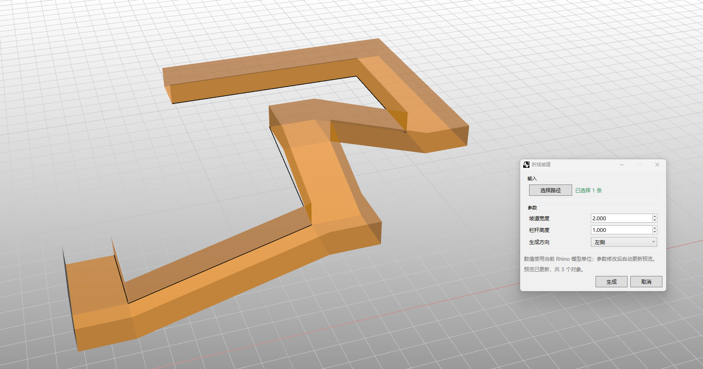

#  rsZigZagRamp · 折线坡道

> 模块：建筑 / 楼梯与坡道

[← 返回命令目录](/commands/)

**功能**：沿带真实标高的开放折线生成坡面和侧边栏杆面，窗口里可调宽度、栏杆高度与相对路径的左右位置。

*rsZigZagRamp 弹出『折线坡道』Eto 对话框（嵌入 1 条路径 + 参数 3 行：坡道宽度 / 栏杆高度 / 生成方向；底部预览已更新 + 生成/取消），同时 Rhino 视口沿折线路径生成 Z 字形 3D 坡道并自动带栏杆*

**调用**：在 Rhino 命令行输入 `rsZigZagRamp`（打开设置窗口）

**交互流程**：

1. 输入 rsZigZagRamp，在窗口点“选择路径”。
2. 选择一条或多条开放多重直线，至少三个顶点；路径Z坐标决定实际高程。
3. 设置坡道宽度、栏杆高度与左侧／右侧／中心定位，查看自动更新的预览。
4. 点击“生成”；面板期间修改已选源路径会更新预览，已生成成果不会自动跟随源路径。

**参数**：

| 中文名 | 英文名 | 类型 | 默认值 | 范围 | 说明 |
| --- | --- | --- | --- | --- | --- |
| 坡道宽度 | Width | double | 2 m | >模型容差 | 按当前模型单位输入。 |
| 栏杆高度 | HandrailHeight | double | 1.1 m | ≥0 | 0或接近容差时只生成坡面。 |
| 生成方向 | Placement | enum | 左侧 | 左侧 / 右侧 / 中心 | 相对输入路径方向决定坡面落在哪一侧。 |

**输出**：开放坡面与可选栏杆面。

**备注**：尺寸按当前 Rhino 文档单位显示；下列 mm、m 是等效物理尺寸示例。

坡道保持为独立工具，没有合并到楼梯入口。输出是开放坡面和栏杆面，不是自动加厚的实体板。它用于造型建模，不自动检查无障碍规范或完成道路工程设计。

配图或视频可能来自旧版界面，2.0 请以本文的入口、模式和参数说明为准。
