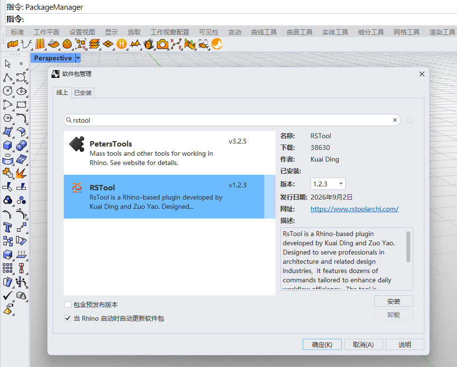
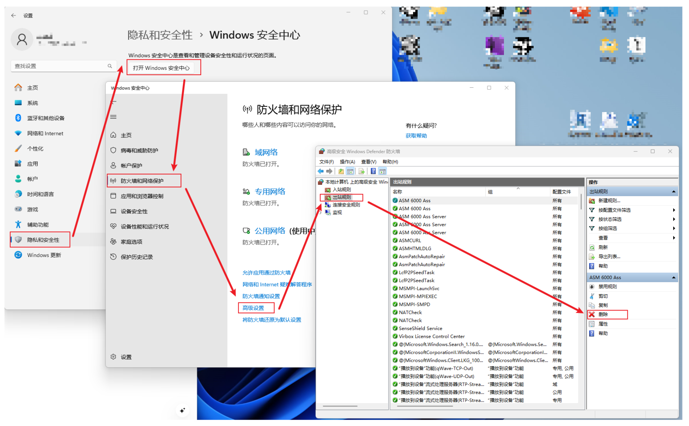

# RSTool Installation Guide

Check which version you are installing first. RSTool 2.0 uses a companion desktop client for sign-in, licensing, and several tools. The 2.0 preview setup is described first; the YAK and PackageManager instructions for earlier versions remain below.

## RSTool 2.0 preview

### Requirements

- Windows and Rhino 8. The base requirement is Rhino 8.20 or later. Rhino 8.28 or later is recommended for all migrated material tools.
- Rhino must use **.NET 8**. Run `SetDotNetRuntime`, choose `NetCoreVersion` → `v8`, then save your work and restart Rhino when prompted. Installing .NET 8 in Windows does not change the runtime of an existing Rhino session.
- The current preview build does not support Rhino 7, Rhino 9, or .NET Framework mode.
- Use the matching RSTool desktop client and complete sign-in and device licensing in the client.

### Install the complete preview package

Version 2.0 is currently a development preview. Use the complete package supplied for that preview; check the version shown on any public download or package-manager listing.

1. Save your models and close Rhino. Versions 2.0 and 1.x share the same plug-in identifier, so upgrading replaces the earlier version. They cannot both load in the same Rhino process.
2. Extract the entire package to a stable folder, keeping all DLLs, native modules, and resource subfolders. **Do not copy only `RSTool.rhp`**, and keep the installed folder in place.
3. Open Rhino 8, run `PlugInManager`, click **Install**, and choose `RSTool.rhp` from the preview package. Follow any installation or restart prompts.
4. If Rhino reports that the ID is already in use, inspect the existing RSTool entry and its path. Enable it if it already points to the new version; if it points to an earlier version, follow the preview package's upgrade instructions to update that registration.
5. Start the matching RSTool desktop client and complete account sign-in and device licensing.

### Connect the client

1. Open a Rhino document and run `rs2Status` to check the plug-in, connection, and log location. This check does not require sign-in.
2. Run `rs2Connect` to connect to the RSTool client. It attempts to launch an installed client when needed. Start the client manually if it cannot be opened automatically.
3. After completing sign-in or device licensing for the first time, return to Rhino and **run the original command again**. Operations requested before sign-in are not replayed automatically.

In 2.0, the model library, material library, terrain download, PDF tools, whiteboard, mind map, image studio, and vector studio are grouped under **Creative Tools** in the client. Before capturing Rhino content or sending results back, confirm the correct Rhino instance and document in the client, and keep the client running.

## Earlier versions: Install from a YAK file

1. Open the [RSTool download link on Baidu Netdisk](https://pan.baidu.com/s/5c6yJvAa5wCCh81eEZRsGRg) and download the RSTool `.yak` installation file.
2. Open Rhino, drag the downloaded `.yak` file into the Rhino window, and follow the prompts to install it.
3. Save your work and restart Rhino if prompted after installation.

## Earlier versions: Install with PackageManager

1. Open Rhino, enter `PackageManager` on the command line, and press Enter.
2. Search for `rstool` on the **Online** tab of the Package Manager.
3. Select **RSTool**, choose the version you want, and click **Install**. Save your work and restart Rhino if prompted.

## If RSTool does not appear in search

First confirm that Rhino can access the internet and that Package Manager is on the **Online** tab. If no result appears, check whether a Windows Firewall outbound rule is blocking Rhino:

1. Open **Settings → Privacy & security → Windows Security → Firewall & network protection → Advanced settings**.
2. Select **Outbound Rules** in Windows Defender Firewall with Advanced Security.
3. Look for a rule whose name contains Rhino and whose action is explicitly **Block the connection**. Record or export the rule first, then disable or remove only that blocking rule and search again in `PackageManager`.

::: warning Network and licensing

- Change only rules that explicitly block Rhino; do not disable Windows Firewall as a whole.
- Firewall and proxy settings may affect both package downloads and Rhino license validation. Record the original settings so you can restore them if necessary.
- If you use a proxy or VPN, add Rhino and McNeel website, licensing, and package-service domains to your proxy tool's **direct-connect or exclusion list** so they do not use the proxy. Do not block licensing servers. See [this Zhihu article](https://zhuanlan.zhihu.com/p/595993046) for a configuration example.

:::
