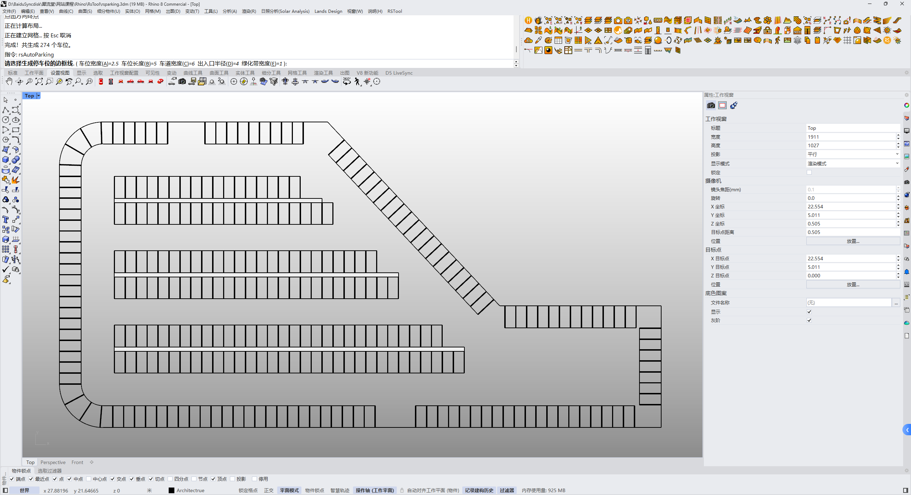

#  rsAutoParking · Automatic Parking Layout

> Module: Architecture / Roads

[← Back to command index](/en/commands/)

**Function**: Generate parking spaces, lanes, green belts and entrance and exit layouts from boundary curves and parameters

*Automatic parking generation effect: multiple rows of parking spaces, lanes, curve entrances and exits, and green belt layout*

> Screenshots and videos may show a Chinese-language interface. Labels and control positions can vary by Rhino or RSTool version.

**Run**: Enter `rsAutoParking` in the Rhino command line (command-line interaction).

**Workflow**:

1. Select a closed parking area boundary curve
2. Set parking space width / parking space length / lane width / entrance and exit radius / green belt width
3. (Optional) Select internal exclusion areas (needs to be closed and within bounds)
4. Click on the entrance/exit location (can be multiple)
5. Define the internal alignment direction (start + end)
6. Generate parking spaces/lanes/green belts/entrance layouts

**Parameters**:

| Display name | Parameter | Type | Default | Range | Description |
| --- | --- | --- | --- | --- | --- |
| Parking space width | SpotWidth | double | 2.5 | >0 (min 0.01) | Unit: meter |
| Parking space length | SpotLength | double | 5.0 | >0 (min 0.01) | Unit: meter |
| lane width | AisleWidth | double | 6.0 | >0 (min 0.01) | Unit: meter |
| Radius of entrance and exit | EntranceRadius | double | 4.0 | >0 (min 0.01) | Unit: meter |
| Green belt width | GreenBeltWidth | double | 1.0 | >=0 | Unit: meter |
