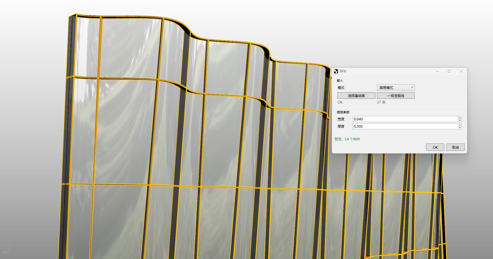
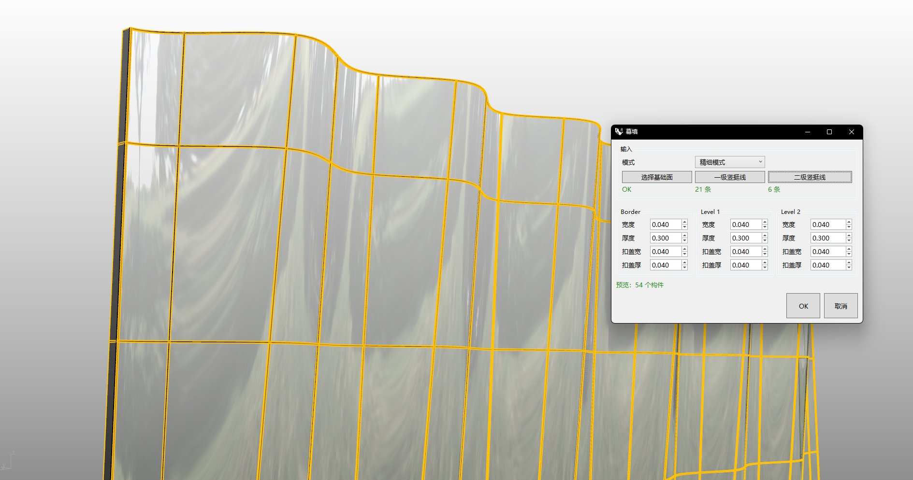

#  rsCurtain · Simple Curtain Walls (2D / 3D)

> Module: Architecture / Building Elements

[← Back to command index](/en/commands/)

::: info Version 2.0

The unified curtain-wall window supports 2D and 3D. rsCurtainWall2D is a 2D shortcut; rsCurtainPlus remains separate.

[View the 2.0 command changes](/en/commands/v2)

:::

**Function**: Draw 2D or 3D curtain walls along lines, arcs, or free curves from one panel, with separate plan mullion and 3D subdivision settings.

*Eto "Curtain Wall" simple mode window: After selecting the basic surface and vertical lines, you only need to set the width/thickness of the outer frame to generate a basic curtain wall based on the number of vertical lines. The estimated number of components is displayed in real time at the bottom*

*Eto "curtain wall" fine mode window: On top of the basic surface and vertical lines, select secondary vertical lines. The outer frame/primary/secondary verticals each have independent width, thickness, buckle cover width and thickness, flexibly generating a multi-level curtain wall system*

> Screenshots and videos may show a Chinese-language interface. Labels and control positions can vary by Rhino or RSTool version.

**Run**: Enter `rsCurtain` in the Rhino command line (opens a settings window).

**Workflow**:

1. Run rsCurtain and choose 2D/3D and line, arc, or free curve.
2. Set mullions, clamps, and glass position in 2D, or height, elevation, mullion counts, and sections in 3D.
3. Draw the baseline continuously for lines, with three points for arcs, or with Enter to finish a free curve.
4. Use New chain for another object; Esc or closing the panel finishes.

**Parameters**:

| Display name | Parameter | Type | Default | Range | Description |
| --- | --- | --- | --- | --- | --- |
| Output mode | OutputMode | enum | 2D initially; then last successful mode | 2D / 3D | Switching affects subsequent drawing. Use object properties to change an existing object. |
| Drawing method | DrawingMode | enum | Line | Line / Arc / Free curve | Draw arcs with three points and free curves through picked points. |
| 2D mullion spacing | Spacing | double | 1200 mm | Positive | Controls mullion spacing along the plan path. |
| 2D mullion / glass clamp | Mullions2D | group | Width 40 / Depth 200 / Clamp 30 mm | Must fit the path and spacing | Glass can be outer, centered, or inner; outer is the default. |
| 3D height / base elevation | HeightElevation | group | 3000 mm / 0 | Height must fit the subdivisions | Each confirmed 3D baseline creates a separate curtain wall. |
| Internal vertical / horizontal mullions | Counts | group | 3 / 2 | Each 0–64; total cells ≤1024 | Counts exclude the outer frame; 3 internal mullions form 4 glass columns. |
| 3D sections / frame / glass | Sections3D | group | Mullions and frame 50×100 mm; glass 12 mm | Sections must exceed tolerance and leave valid glass cells | Set face width/height and depth independently. |

**Output**: Parametric 2D or independent 3D curtain walls.

**Notes**: Dimensions are displayed in current Rhino model units; mm and m below describe equivalent physical sizes.

`rsCurtain` unifies simple 2D/3D curtain walls; `rsCurtainWall2D` remains a direct 2D shortcut. It starts in 2D and remembers the last successful mode.

A continuous 2D chain updates one parametric curtain wall; New chain creates another. In 3D, each confirmed baseline creates a separate parametric curtain wall. Switching mode retains completed objects, discards the unfinished baseline, and asks for a new start point.

This tool draws simple curtain walls along a path. Use the separate `rsCurtainPlus` for complex polysurface-based curtain walls.

Images or videos may show the old interface. For 2.0, follow the entries, modes, and parameter descriptions on this page.
