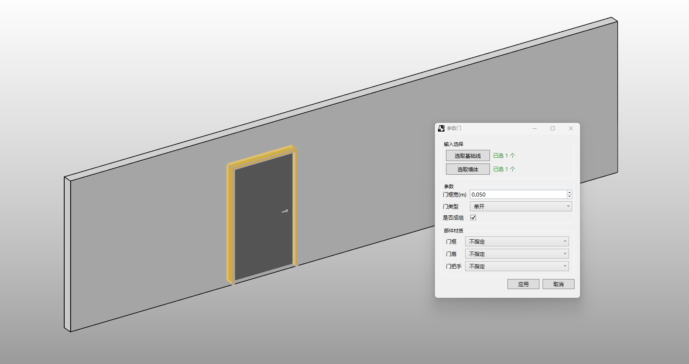

#  rsDoor · Doors (2D / 3D)

> Module: Architecture / Building Elements

[← Back to command index](/en/commands/)

::: info Version 2.0

Create 2D and 3D doors here. The old rsDoor2D name is no longer a separate entry.

[View the 2.0 command changes](/en/commands/v2)

:::

**Function**: Place hosted doors repeatedly in 2D or 3D walls, using pointer, end-distance, or pier-width positioning and automatic wall openings.

*1.x interface reference. Version 2.0 uses the unified opening panel; follow the workflow and parameter descriptions below.*

> Screenshots and videos may show a Chinese-language interface. Labels and control positions can vary by Rhino or RSTool version.

**Run**: Enter `rsDoor` in the Rhino command line (opens a settings window).

**Workflow**:

1. Run rsDoor and choose Automatic or a fixed 2D/3D mode.
2. Set door width; in 2D choose single, double, or passage and swing angle. In 3D set height and base offset.
3. Move near a wall, check size, position, and direction in the preview, and click; continue placing.
4. For precision use From start, From end, or Pier width. Esc or closing the panel finishes placement.

**Parameters**:

| Display name | Parameter | Type | Default | Range | Description |
| --- | --- | --- | --- | --- | --- |
| Placement mode | OutputMode | enum | Automatic | Automatic / 2D / 3D | Detect the wall near the pointer, or choose a fixed dimension. |
| Along-wall positioning | PositionMode | enum | Pointer | Pointer / From start / From end / Pier width | Start/end distances follow the wall axis with center, near-edge, or far-edge anchors. Pier width measures to the near opening edge. |
| Distance / pier width | PositionDistance | group | 1000 mm / 100 mm | Validated against wall length and opening clearance | Measure pier width from the nearest exposed wall end or clear corner on the pointer side; curved walls use side arc length. |
| Door width | Width | double | 900 mm | Must fit wall ends and neighboring openings | Use common clear-width preset buttons. |
| 2D kind / swing angle | DoorKind | group | Single / 90° | Single / Double / Passage; 0–180° | Passages have no door leaf or swing arc. |
| 3D height / base offset | HeightSill | group | 2100 mm / 0 | Must fit host wall height | The current 3D representation is a single door. |
| Direction flips | Flips | group | Off | Pointer wall side / Hinge side | Check the updated swing direction in the preview before placing. |

**Output**: Independent parametric doors and hosted wall openings.

**Notes**: Dimensions are displayed in current Rhino model units; mm and m below describe equivalent physical sizes.

No wall preselection is required: move near a wall and click its preview to place repeatedly. Automatic mode detects 2D or 3D walls; a fixed mode is also available. Results are independent parametric objects with host associations; moving, deleting, or editing them updates their wall openings.

Legacy separate 2D commands have been merged into the unified entry while their entitlement keys remain compatible. Sizes must still satisfy wall-end, neighboring-opening, and clearance checks.

`rsDoor2D` is merged into `rsDoor`. Double doors and passages are 2D options; the current 3D representation is a single door without double-door, sliding-door, or passage variants.

Images or videos may show the old interface. For 2.0, follow the entries, modes, and parameter descriptions on this page.
