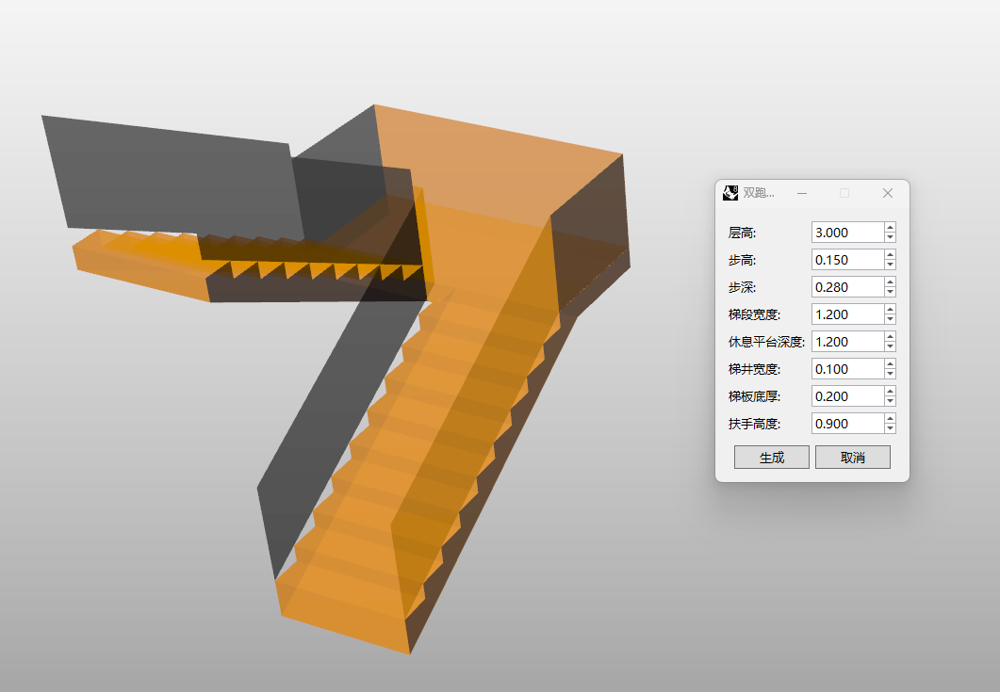

#  rsDoubleFlightStairs · Double-Flight Stairs (2D / 3D)

> Module: Architecture / Stairs & Ramps

[← Back to command index](/en/commands/)

::: info Version 2.0

Now includes the former rsStair2D workflow. Create 2D or 3D double-flight stairs in one panel.

[View the 2.0 command changes](/en/commands/v2)

:::

**Function**: Create 2D or 3D double-flight stairs from one panel. Set floor height, target rise, tread depth, flight width, and landing; preview shows actual steps and rise.

*After picking the base point and direction point, a double-running staircase is generated in real time, including a landing, stairwell, and handrails, and all parameters are adjusted in the dialog box*

> Screenshots and videos may show a Chinese-language interface. Labels and control positions can vary by Rhino or RSTool version.

**Run**: Enter `rsDoubleFlightStairs` in the Rhino command line (opens a settings window).

**Workflow**:

1. Run rsDoubleFlightStairs and choose 2D drawing or 3D modeling.
2. Pick a base and direction; this placement is retained when switching modes.
3. Set floor height, treads, and landing, check actual steps and rise, and set slab and rail sizes in 3D.
4. Check the preview and click Generate. Edit parametric results further in Properties.

**Parameters**:

| Display name | Parameter | Type | Default | Range | Description |
| --- | --- | --- | --- | --- | --- |
| Output mode | OutputMode | enum | 2D initially; then last successful mode | 2D / 3D | Switching affects subsequent drawing. Use object properties to change an existing object. |
| Floor height / target rise | FloorRise | group | 3 m / 0.15 m | Positive floor height and rise | Rounds the height/rise ratio to an even count, splits flights equally, and recalculates actual rise. |
| Tread depth / flight width | TreadWidth | group | 0.28 m / 1.2 m | Positive and above geometric tolerance | Determine flight plan length and usable width. |
| Landing depth / well gap | LandingGap | group | 1.2 m / 0.1 m | Positive landing; gap may be 0 | This is always a two-flight layout. |
| 3D slab thickness / rail height | ThicknessRail | group | 0.2 m / 0.9 m | Slab above tolerance; rail 0 disables | 3D-only inputs are retained when switching to 2D. |
| Create parametric stair object | GenerateObject | bool | On | On / Off (3D) | Enable property editing, or disable for ordinary Brep output. |

**Output**: Parametric 2D/3D stairs or ordinary Brep stairs.

**Notes**: Dimensions are displayed in current Rhino model units; mm and m below describe equivalent physical sizes.

Create parametric stair object is enabled for 3D by default, saving the whole stair as an independent object. Use Stair parameters in Properties to edit dimensions or switch between 2D and 3D. Editing retains placement after moves, rotations, and uniform scaling. Disable the option for ordinary Breps.

Use `rsStairMake2D` for linework and `rsStairDupEdge` for edges. Use `rsStairToGeometry` when downstream tools require ordinary geometry; Undo restores the parametric object.

`rsStair2D` is merged into this entry. It starts in 2D and remembers the successful mode. 2D uses a dedicated plan builder.

3D parametric double-flight stairs support `PointsOn`: two baseline grips control position and direction; dimensions still determine stair length.

Images or videos may show the old interface. For 2.0, follow the entries, modes, and parameter descriptions on this page.
