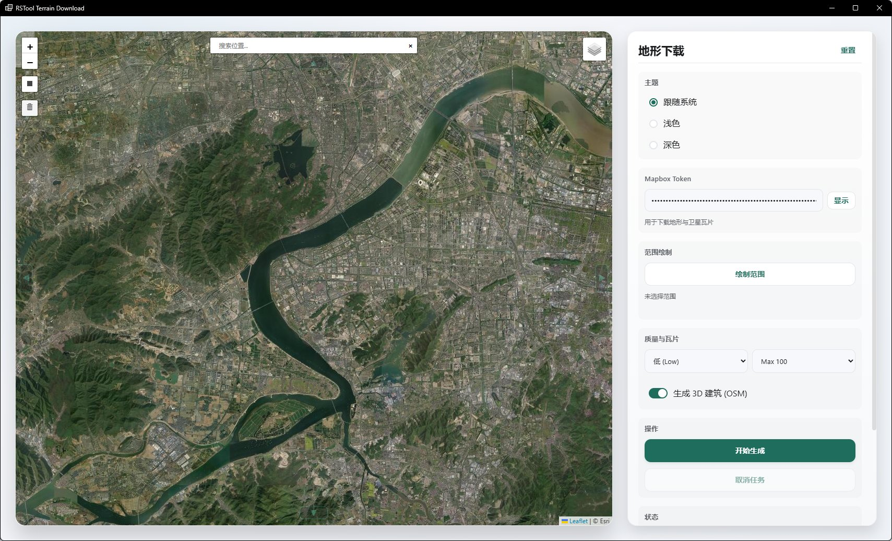

#  rsEarth · Terrain Downloader

> Module: Terrain / Acquisition & Editing

[← Back to command index](/en/commands/)

::: info Version 2.0

Version 2.0 hosts this panel in the RSTool client. Keep the client running and signed in.

[View the 2.0 command changes](/en/commands/v2)

:::

**Function**: Open Terrain Download in the client to select an area, download terrain with satellite imagery, and optionally generate OSM buildings.

> Screenshots and videos may show a Chinese-language interface. Labels and control positions can vary by Rhino or RSTool version.

**Run**: Enter `rsEarth` in the Rhino command line (opens a settings window).

**Workflow**:

1. Create an account at [Mapbox](https://www.mapbox.com/) and create or copy a public access token starting with pk. from Access tokens.
2. Run rsEarth in Rhino to open Creative Tools → Terrain Download, confirm the target document, and enter the token.
3. Search for a location and draw a rectangle. Check estimated tiles, vertices, and memory, then choose quality, initial tile budget, and optional buildings.
4. Click Generate and wait for downloads, mesh generation, and Rhino output. Use Cancel Task when needed.
5. For adjacent areas, use the arrows around the selection to move by its width or height and generate again.

**Parameters**:

| Display name | Parameter | Type | Default | Range | Description |
| --- | --- | --- | --- | --- | --- |
| Mapbox Token | Token | password | None | pk.xxxxx | Required for first use: register at mapbox.com and obtain a public access token beginning with pk. The pasted token is encrypted and stored locally. Do not share it publicly or enter a Secret Token beginning with sk. |
| Accuracy | Precision | radio | in | High / Medium / Low (sampling step 1 / 2 / 4) | Panel settings: Control grid sampling density |
| Initial tile budget | MaxTiles | radio | Current setting | 20 / 60 / 100 | 20 / 60 / 100 guides the initial zoom calculation. Once a project is locked, adjacent downloads reuse its zoom and coordinate origin; this is not simply a final total-tile cap. |
| zoom level | Zoom | int | automatic | Automatically calculate optimal value based on range | Calculated from the initial selection and tile budget, then retained for a locked project so adjacent terrain aligns. |
| Generate buildings | GenerateBuildings | bool | Current setting | on/off | Request building data from OSM / Overpass. If it is unavailable, the tool reports this and continues generating terrain. |
| agent | Proxy | bool | close | On/off (supports http:// or socks5://) | Panel settings: Only Debug builds are visible, you can click Test to verify connectivity |

**Output**: Write the downloaded terrain mesh (Rhino mesh with map) into the current document

**Notes**: In 2.0, rsEarth opens the client page directly; the earlier rsEarthOld window is no longer a fallback. Terrain is written to the selected Rhino document, so check its instance, document, and model units first.

## Map and selection

Search, zoom, switch street/satellite maps, and draw a rectangular selection on the left. The surrounding arrows move by the selection width or height for adjacent downloads. The right panel shows coordinates and estimated tiles, vertices, and memory.

## Quality and project origin

High/medium/low quality controls sampling density. The initial tile budget helps determine the first download zoom. A locked project reuses its zoom, sampling, and coordinate origin to align adjacent terrain. Larger areas and higher detail take more time and memory; start with a small area to check the result.

## Token, buildings, and logs

Use a Mapbox public access token for terrain and satellite tiles. Do not share it publicly or use a Secret Token starting with sk. OSM buildings depend on local data coverage; unavailable building data does not prevent terrain generation. The status panel reports download, meshing, and output stages, with exportable task logs. Theme and language follow the client; proxy tests are only available in applicable development builds.
