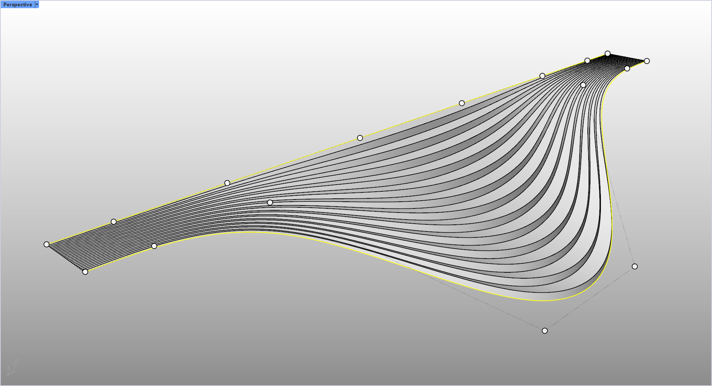

#  rsFadingStair · Tapered Staircase

> Module: Architecture / Stairs & Ramps

[← Back to command index](/en/commands/)

> Right-click the [rsFadingStairVertical](./rsFadingStairVertical) toolbar button to run this command. The two commands share the visible button icon.

**Function**: An evanescent staircase generated by the gradient of two basic curves

*Gradient stairs: The ends of the steps gradually disappear with the curve, forming a free curve shape from the lower left to the upper right.*

> Screenshots and videos may show a Chinese-language interface. Labels and control positions can vary by Rhino or RSTool version.

**Run**: Enter `rsFadingStair` in the Rhino command line (command-line interaction).

**Workflow**:

1. Select two base curves (top/bottom)
2. Enter the number of steps
3. Select gradient position (left/center/right)
4. Generate evanescent stairs

**Parameters**:

| Display name | Parameter | Type | Default | Range | Description |
| --- | --- | --- | --- | --- | --- |
| Number of steps on stairs | StepCount | int | 12 | 3~9999 | Default 12 |
| gradient position | FadePosition | list | 0 | Left \| Center \| Right | 0=left, 1=middle, 2=right |
