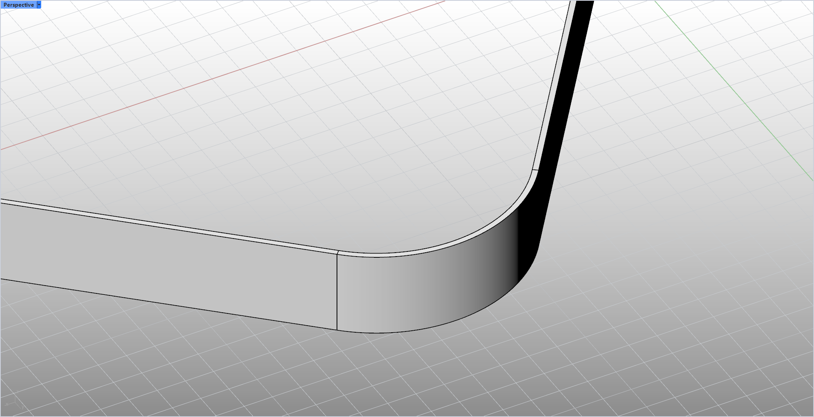

#  rsFilletWall · Fillet Walls

> Module: Architecture / Walls and Editing

[← Back to command index](/en/commands/)

**Function**: Fillet two straight walls of the same dimension, or connect them with zero radius.

*Arc chamfering result of rsFilletWall (After): White model rendering under Rhino 8 perspective viewport (without UI panel), two smart walls with the same thickness complete a smooth transition at the lower right corner of the foreground - the outer facade of the wall forms an obvious arc corner, and the thickness direction of the wall also pours out equal radius fillets simultaneously; the top surface of the left wall, the top surface of the right wall and the background floor grid are all light gray (Rhino Default working plane and ground grid), the red X-axis mark and the "Perspective" viewport label are visible in the upper left corner*

> Screenshots and videos may show a Chinese-language interface. Labels and control positions can vary by Rhino or RSTool version.

**Run**: Enter `rsFilletWall` in the Rhino command line (command-line interaction).

**Workflow**:

1. Pick the retained side of each wall.
2. Enter the axis fillet radius and confirm.

**Parameters**:

| Display name | Parameter | Type | Default | Range | Description |
| --- | --- | --- | --- | --- | --- |
| Axis radius | Radius | double | Picked | ≥0 | Zero connects directly; positive values create a fillet wall. |

**Output**: Updated smart walls and associated objects.

**Notes**: Nonzero radii require equal widths; 3D also requires equal height and base elevation. Zero radius allows unequal widths. Legacy rsFilletWall2D is merged.

The unified entry uses the actual dimension of selected walls and rejects mixed dimensions.

Images or videos may show the old interface. For 2.0, follow the entries, modes, and parameter descriptions on this page.
