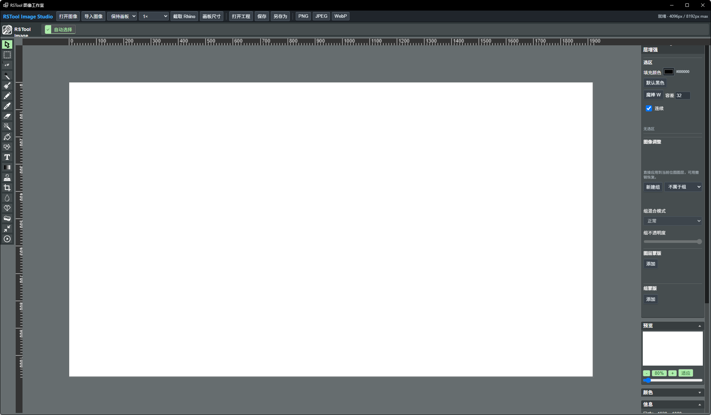

#  rsImageStudio · Image Studio

> Module: Productivity / Productivity

[← Back to command index](/en/commands/)

::: info Version 2.0

Version 2.0 hosts this panel in the RSTool client. Keep the client running and signed in.

[View the 2.0 command changes](/en/commands/v2)

:::

**Function**: Open Image Studio in the client for layered bitmap editing, annotation, and adjustments, including Rhino viewport captures.

*RsTool image studio main interface (top toolbar 14 items, left drawing toolbar, right property panel including layer editing/mirror measurement/ellipse mode/layer management/edit layer/preview/color/information 8 items, bottom including zoom 50% and canvas adaptation buttons)*

> Screenshots and videos may show a Chinese-language interface. Labels and control positions can vary by Rhino or RSTool version.

**Run**: Enter `rsImageStudio` in the Rhino command line (opens a settings window).

**Workflow**:

1. Run rsImageStudio in Rhino to open Creative Tools → Image Studio, or open it directly from the client.
2. Create a project, open an image, or import an image as a new layer. Confirm the target document before capturing Rhino.
3. Edit with brushes, selections, text, layers, groups, masks, and adjustments. Use separate tabs for documents with independent Undo histories.
4. Export PNG / JPEG / WebP, or save an .rsimage project to retain layers and editable content.

**Parameters**:

| Display name | Parameter | Type | Default | Range | Description |
| --- | --- | --- | --- | --- | --- |
| Export format | Format | list | png | png / jpeg / webp | Set when exporting: Image output format |
| Width | Width | int | source size | 1 – Maximum canvas side length | Set when exporting/taking screenshots |
| height | Height | int | source size | 1 – Maximum canvas side length | Set when exporting/taking screenshots |
| Zoom | Scale | double | 1.0 | > 0 | Set when exporting/taking screenshots |

**Output**: Export a flattened image or save an .rsimage project retaining layers, groups, and masks.

**Notes**: In 2.0, Image Studio is part of the client and no longer opens an earlier standalone window. It uses miniPaint and can edit local images independently; Rhino interaction requires the correct connected instance and document.

## Using the interface

| Area | Main tools |
| --- | --- |
| Files and export | Create projects, open/import images, open/save .rsimage projects, recent files, and PNG/JPEG/WebP export |
| Drawing and editing | Selections, brushes, shapes, text, cropping, and image adjustments |
| Layers and properties | Layers, groups, masks, clipping, locks, opacity, and blend modes |
| Rhino capture | Add a viewport capture from the selected Rhino document as a layer for further editing |

Each studio supports up to 16 open documents. Switching client features retains projects, and each tab retains its Undo history. Closing an unsaved project offers Save, Discard, and Cancel. Theme and language follow the client.
