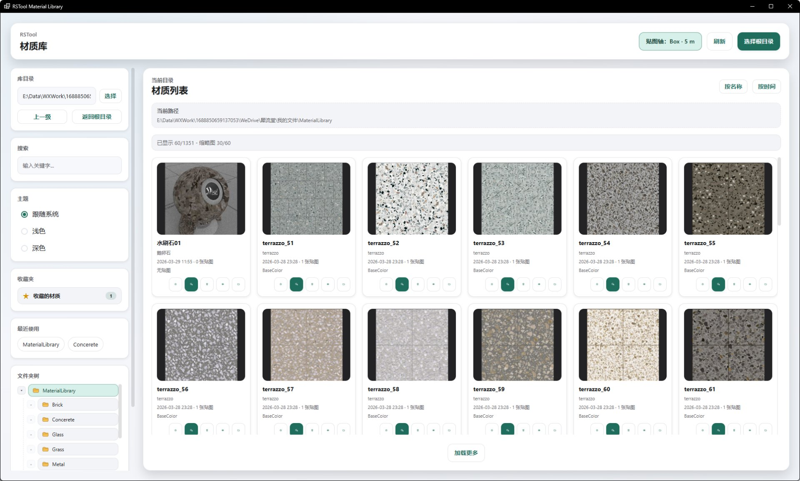

#  rsMaterial · Material library

> Module: Libraries / Material Library

[← Back to command index](/en/commands/)

::: info Version 2.0

Version 2.0 hosts this panel in the RSTool client. Keep the client running and signed in.

[View the 2.0 command changes](/en/commands/v2)

:::

**Function**: Open the material library in the RSTool 2.0 client to organize local materials and textures, import them into Rhino, or apply them to objects and layers.

*Figure 1: Main interface of material library. "Texture Axis: Box · 5 m" on the upper right side of the title bar opens the automatic texture axis setting (when it is turned on, the texture axis is automatically added according to the rectangle/Box + size when assigning materials), followed by "Refresh/Select Root Directory"; the structure of the left column is consistent with the model library (Library Directory/Search/Theme/Favorite Materials/Recently Used/Folder Tree/Status Bar + Construction Progress); the main area on the right displays all materials under the current path, distinguished by namespace chip (default MaterialLibrary, the screenshot has been cut to Concrete (focus on terrazzo), each thumbnail card contains the file name, label, modification time, 3 circular action buttons side by side (Collect Material/Assign Object/Assign Layer), right-click the card to adjust the right-click menu (Favorite Material/Assign Object/Assign Layer/Import Material/Open Directory), and the "Load More" page at the bottom all*

> Screenshots and videos may show a Chinese-language interface. Labels and control positions can vary by Rhino or RSTool version.

**Run**: Enter `rsMaterial` in the Rhino command line (opens a settings window).

**Workflow**:

1. Run rsMaterial in Rhino to open Creative Tools → Material Library in the client.
2. Choose a local material folder and browse with search, favorites, the folder tree, and thumbnails.
3. Set automatic mapping, planar/box mapping, and mapping size as needed.
4. Use Import Material to add it to the document, or choose Apply to Objects, Apply to Layers, or Replace Objects with the Same Material.
5. Preselected objects receive the material directly. Otherwise, pick or window-select objects repeatedly in Rhino, then return to the client when finished.

**Parameters**:

| Display name | Parameter | Type | Default | Range | Description |
| --- | --- | --- | --- | --- | --- |
| library directory | rootPath | text | last used value | local path | Material library root directory; change to any folder containing material assets through "Select/Select Root Directory"; automatically rebuild the index after switching |
| Search | searchInput | text | empty | any keyword | Perform instant filtering on file names/tags in the current directory |
| Map axis button | btnMappingSettings | button | — | — | Title bar "Texture Axis: Type·Size" button: Click to open the automatic texture axis setting pop-up layer, and the button text will display the current settings simultaneously. |
| Automatically add texture axes | autoTextureMappingEnabled | checkbox | open | on/off | Texture axis elastic layer switch: After turning it on, when assigning materials, add the texture axis object according to the current texture axis type + size. |
| Map axis type | autoTextureMappingType | radio | Box | Rectangle (Plane) / Box | Texture axis elastic layer radio selection: Rectangle uses the same width and height, Box uses the same length, width and height; the button text is updated immediately after switching |
| Texture axis size | autoTextureMappingSize | number | 5.0 | > 0 (converted to document units) | The default represents a 5 m mapping size, converted to the current Rhino document units for planar or box mapping. |
| favorite view | favoritesView | button | Close | — | The "Collected Materials" button on the left: When lit, only the collected assets will be displayed. |
| Recently used | recentRoots | chip | — | — | The root directory visited the last 5 times, chip switches with one click |
| folder tree | folderTree | tree | — | — | Subfolder tree under the root directory, nod to switch browsing |
| sort | sort | button | by time | by name/by time | Switch in the upper right corner of the main area |
| Refresh | refresh | button | — | — | Rebuild the index: scan all material assets in the current root directory, generate thumbnails and labels, and display the progress in the status bar |
| Favorites/Unfavorites | favorite | button | — | — | Star button in card or preview pop-up window: lit yellow = Favorite; supports right-click menu Favorite Material |
| give object | assignObject | button | — | — | Apply to preselected objects directly, or enter repeated picking/window selection in Rhino when nothing is preselected. |
| Assign layer | assignLayer | button | — | — | Set the target layer material for objects whose material source is By Layer. |
| Import materials | importMaterial | button | — | — | Add the material to the Rhino document without assigning it to objects or adding mapping. |
| Open directory | openFolder | button | — | — | Use Windows Explorer to open the folder where the material is located |
| load more | loadMore | button | — | — | Button at the bottom of the main area: page loading, default 60 pictures per page |

**Output**: Import materials into the selected Rhino document or apply them to objects, layers, and objects sharing a material. Add automatic texture mapping when enabled.

**Notes**: The 2.0 material library lives in the client, following its theme and language. The earlier rsMaterialLibraryOld window is no longer used as a fallback. The client returns to the foreground when an operation ends, while repeated Rhino picking keeps focus.

Textures can be grouped by file naming, with multiple map slots recognized and .rmtl import supported. Recognizing slots does not guarantee that every material path uses every channel; check the actual Rhino material preview. HDR, EXR, and TGA files can be imported as textures, but may show a placeholder in previews.

## Preparing the material library

Organize your material files and related textures in the selected local library folder.

To receive the material library curated by the RSTool team, share an RSTool-related video on WeChat Moments, keep a screenshot of the post, and contact RSTool customer service.
