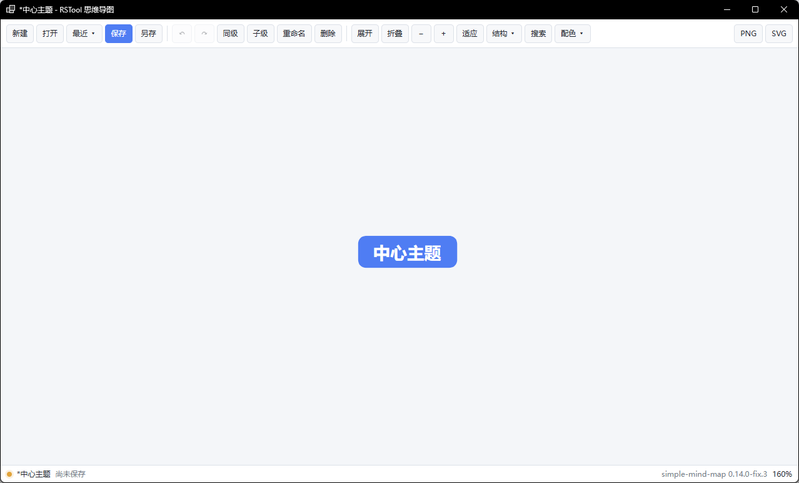

#  rsMindMap · Mind Map

> Module: Productivity / Productivity

[← Back to command index](/en/commands/)

::: info Version 2.0

Version 2.0 hosts this panel in the RSTool client. Keep the client running and signed in.

[View the 2.0 command changes](/en/commands/v2)

:::

**Function**: Open Mind Map in the client to organize nodes, layouts, and colors, and insert Rhino viewport images or curve drawings into nodes.

> Screenshots and videos may show a Chinese-language interface. Labels and control positions can vary by Rhino or RSTool version.

**Run**: Enter `rsMindMap` in the Rhino command line (opens a settings window).

**Workflow**:

1. Run rsMindMap to open Creative Tools → Mind Map in the client.
2. Create or open a document. Double-click a node to rename it, use Enter for a sibling and Tab for a child, and choose a layout and color scheme.
3. Organize the map with search, zoom, fit-to-canvas, and branch folding.
4. Confirm the Rhino target before inserting a viewport image or an SVG of selected curves into the current node.
5. Save as .rsmind / JSON or export PNG / SVG. Edit multiple files in separate tabs.

**Parameters**:

| Display name | Parameter | Type | Default | Range | Description |
| --- | --- | --- | --- | --- | --- |
| structure | Structure | list | Mind map (two-way) | Mind Map / Logical Structure / Leftward Logical Structure / Organizational Structure / Directory Structure / Timeline / Fishbone Diagram | Toolbar "Structure" drop-down: switch the overall layout direction |
| color matching | ColorTheme | list | refreshing blue | Refreshing blue / late night blue / black background with white nodes / warm sand brown / forest green / violet | Toolbar "Color Color" drop-down: switch node color scheme |

**Output**: Save editable .rsmind / JSON mind maps or export PNG / SVG, including Rhino images and curve SVG in nodes.

**Notes**: The 2.0 mind map runs in the client, retaining node editing, search, layouts, colors, and local recovery. Each document has its own Undo history. Closing unsaved content offers Save, Discard, and Cancel; switching client features retains the workspace.

Rhino images and curve SVG come from the selected instance and document. Curve drawings project selected Curve objects onto the construction plane or viewport; they do not calculate hidden lines for a whole model.

Based on the simple-mind-map engine (the version is displayed in the lower right corner of the status bar).

**Operation**: Left-click to select the node, right-click to drag the canvas; the scroll wheel zooms in reverse, the range is 20%–400%.

**Toolbar** (4 groups of 21 buttons):

| Grouping | Buttons and shortcut keys |
| --- | --- |
| File | New (Ctrl+N) · Open (Ctrl+O) · Recent ▾ · Save (Ctrl+S) · Save as (Ctrl+Shift+S) |
| Edit | Undo (↶ Ctrl+Z) · Redo (↷ Ctrl+Y) · Sibling node (Enter) · Child node (Tab) · Rename (F2) · Delete (Delete) |
| View | Expand · Collapse · Reduce (−) · Zoom in (+) · Fit to canvas · Structure ▾ · Search (Ctrl+F) · Color ▾ |
| Export | PNG · SVG |

**Structure** (6 types in total):

| Name | Direction / Form |
| --- | --- |
| Mind Map | Two-way (Default) |
| Logical structure | Right |
| Leftward logical structure | Leftward |
| Organizational Structure | Tree |
| Directory structure | Tree |
| Timeline | Vertical |
| Fishbone diagram | Horizontal |

**Color Color** (6 sets in total):

| Color | Remarks |
| --- | --- |
| Refreshing Blue | Default |
| Midnight blue | Dark color |
| White nodes on black background | For demonstration purposes |
| Warm sand brown | Warm colors |
| Forest Green | Natural |
| Violet | Purple series |

**Additional Details**:

- Added default text "New Topic" at the same level and "Subtopic" at the sub-level
- Keep up to 10 recent files
- Status bar dot prompts for saving status in real time
- Opening it again after abnormal exit will automatically restore unsaved content
