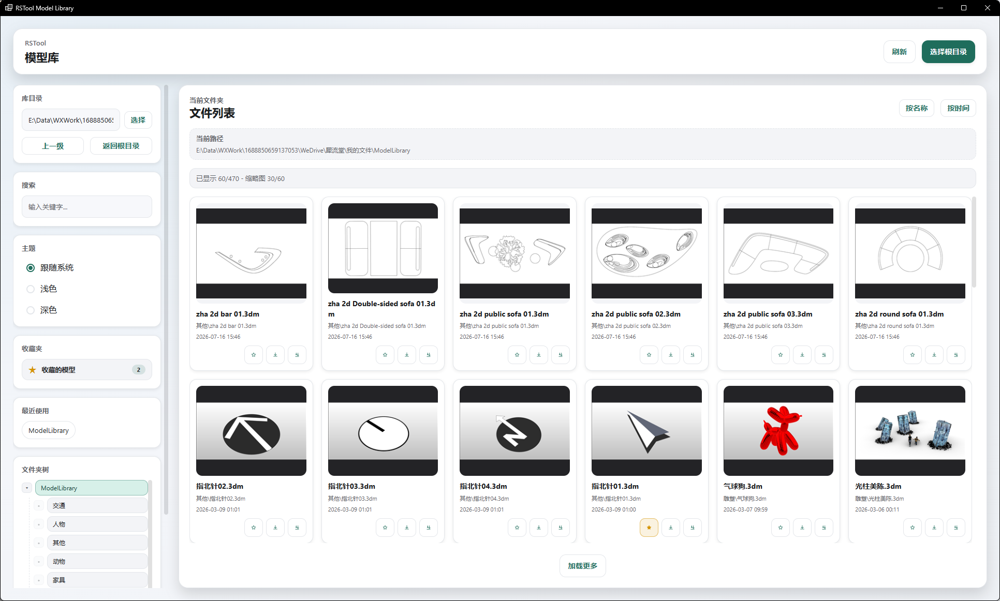

#  rsModel · Model library

> Module: Libraries / Model Library

[← Back to command index](/en/commands/)

::: info Version 2.0

Version 2.0 hosts this panel in the RSTool client. Keep the client running and signed in.

[View the 2.0 command changes](/en/commands/v2)

:::

**Function**: Open the model library in the RSTool 2.0 client to browse your local .3dm assets and place them in Rhino once or repeatedly.

*Figure 1: Main interface of model library. "Refresh/select root directory" on the right side of the title bar is a global operation; the left column from top to bottom is: library directory (read-only input box + "select" button, with "previous level/return to root directory" to quickly jump), search (keyword filter files in the current directory), theme (follow the system / light / dark), collected models (one click only displays the collected assets, with a quantity badge), recently used (chip form, the recently visited root directory can be switched with one click), folder tree (the tree shows the subfolders under the current root, nod to switch); the main area on the right displays all models under the current path, each thumbnail card contains the file name, original path, modification time, and 3 circular action buttons side by side (Collect model/Import one/Import multiple, hover displays Chinese tooltip), and the right-click card can also bring up the right-click menu (Favorite Model/Import model/ Open the directory), there is a "Load More" paging button at the bottom*

> Screenshots and videos may show a Chinese-language interface. Labels and control positions can vary by Rhino or RSTool version.

**Run**: Enter `rsModel` in the Rhino command line (opens a settings window).

**Workflow**:

1. Run rsModel in Rhino to open Creative Tools → Model Library in the client. Complete sign-in and device licensing first.
2. Choose a local library root, then browse with the folder tree, search, favorites, and sorting. Use grid/list views and large previews as needed.
3. Choose a block definition mode and click Import One or Import Multiple.
4. Pick a position in Rhino and confirm rotation. Use Angle / Rotate90 to adjust orientation, and keep picking points for repeated placement.
5. Return to the client when placement finishes. Select another Rhino target in the client before writing to a different document.

**Parameters**:

| Display name | Parameter | Type | Default | Range | Description |
| --- | --- | --- | --- | --- | --- |
| library directory | rootPath | text | last used value | local path | The root directory path of the model library; click "Select/Select Root Directory" to change to any folder containing .3dm; the index will be automatically rebuilt after switching directories. |
| Search | searchInput | text | empty | any keyword | Perform instant filtering on file names/tags in the current directory |
| favorite view | favoritesView | button | Close | — | The "Collected Models" button on the left: When lit, only the collected assets are displayed; the badge number indicates the number of collections in the current root directory. |
| Recently used | recentRoots | chip | — | — | The root directory visited the last 5 times, click chip to quickly switch |
| folder tree | folderTree | tree | — | — | To collapse the subfolder tree under the root directory, nod to switch browsing; click the triangle on the left side of the line to expand/collapse |
| sort | sort | button | by time | by name/by time | Switch in the upper right corner of the main area, and the order of file cards is refreshed instantly |
| Refresh | refresh | button | — | — | Rescan the selected local model folder to update its files, thumbnails, and metadata. |
| Favorites/Unfavorites | favorite | button | — | — | Star button in card or preview pop-up window: lit yellow = Favorite; supports right-click menu Favorite Model |
| Import a | importSingle | button | — | — | Import the model as a block, pick its position in Rhino, and confirm rotation. Use Angle / Rotate90 to adjust its orientation. |
| Import multiple | importMultiple | button | — | — | Pick successive positions to place the same model. Each placement has its own Undo step. |
| Open directory | openFolder | button | — | — | Use Windows Explorer to open the folder where the model is located |
| load more | loadMore | button | — | — | Button at the bottom of the main area: page loading, the default is 60 pictures per page; this button will appear if the number exceeds |
| Block definition mode | definitionType | list | linked | embedded / linkedAndEmbedded / linked | Choose embedded, linked and embedded, or linked definitions. Keep source files in place for linked definitions. All three modes retain nested blocks, layers, and materials. |

**Output**: Place local .3dm models as blocks in the selected Rhino document, retaining nested blocks, layers, materials, and source user data. Each placement has its own Undo step.

**Notes**: In 2.0, the model library lives in the client. Its import actions replace the earlier standalone library windows and InsertAsset entry. Theme and language follow the client.

Placement uses the bottom center of the model, and units are converted to the target document. If an asset contains a nested block whose name conflicts with a different definition in the document, resolve that conflict first; existing blocks are not overwritten automatically.

## Preparing the model library

rsModel uses a local model library. Organize your .3dm files into folders under the selected library root.

To receive the model library curated by the RSTool team, share an RSTool-related video on WeChat Moments, keep a screenshot of the post, and contact RSTool customer service.
