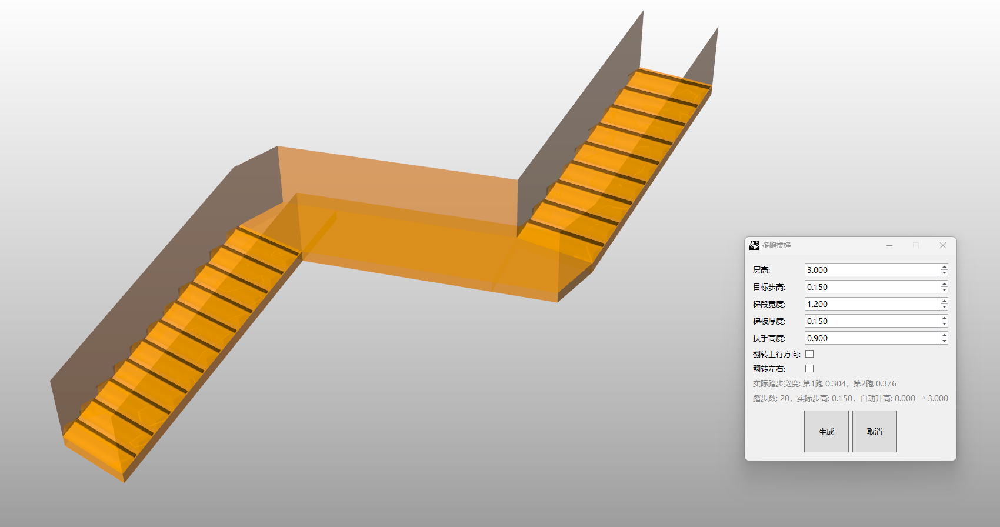

#  rsMultiFlightStairs · Multi-Flight Stairs (2D / 3D)

> Module: Architecture / Stairs & Ramps

[← Back to command index](/en/commands/)

::: info Version 2.0

Now includes the former rsPolylineStair2D workflow, sharing a path for 2D and 3D multi-flight stairs.

[View the 2.0 command changes](/en/commands/v2)

:::

**Function**: Draw multi-flight stairs along a polyline with explicit flights/platforms, center or side alignment, fixed treads or target rise, and 2D/3D output.

*Generate multi-run stairs after picking along the turning path point, automatically set the landing and ladder, support overall flipping and left-right flipping*

> Screenshots and videos may show a Chinese-language interface. Labels and control positions can vary by Rhino or RSTool version.

**Run**: Enter `rsMultiFlightStairs` in the Rhino command line (opens a settings window).

**Workflow**:

1. Run rsMultiFlightStairs, choose 2D/3D, path alignment, and tread control.
2. Assign the next segment as a flight or platform, or enable alternating segments, then pick the path.
3. Enter completes the path. Check ascent, corner landings, and steps; undo a point or redraw if needed.
4. Set slab and rail sizes in 3D and click Generate; edit parametric results in Properties.

**Parameters**:

| Display name | Parameter | Type | Default | Range | Description |
| --- | --- | --- | --- | --- | --- |
| Output mode | OutputMode | enum | 2D initially; then last successful mode | 2D / 3D | Switching affects subsequent drawing. Use object properties to change an existing object. |
| Path alignment | PathAlignment | enum | Center | Center / Left / Right | Side alignment resolves offsets at adjacent segment intersections. |
| Flight width / floor height | WidthFloor | group | 1.2 m / 3 m | Positive | Total rise is shared by all ascending steps. |
| Step control | StepMode | enum | Fixed tread 0.28 m | Fixed tread / Target rise (default 0.15 m) | Fixed treads absorb the remainder at the last step; target rise allocates steps by flight length and equalizes treads. |
| Segment classification | Segmentation | enum | Manual | Manual / Alternating | Alternating affects only new segments. Platforms remain level. |
| Ascent / side flip | Directions | group | Reverse ascent / No flip | Forward / Reverse ascent; optional side flip | Reversing ascent retains the footprint. |
| 3D slab / rail | ThicknessRail | group | 0.15 m / 0.9 m | Valid positive slab; rail 0 disables | 3D-only settings. |
| Create parametric stair object | GenerateObject | bool | On | On / Off (3D) | Enable property editing, or disable for ordinary Brep output. |

**Output**: Parametric 2D/3D multi-flight stairs or ordinary 3D Breps.

**Notes**: Dimensions are displayed in current Rhino model units; mm and m below describe equivalent physical sizes.

Create parametric stair object is enabled for 3D by default, saving the whole stair as an independent object. Use Stair parameters in Properties to edit dimensions or switch between 2D and 3D. Editing retains placement after moves, rotations, and uniform scaling. Disable the option for ordinary Breps.

Use `rsStairMake2D` for linework and `rsStairDupEdge` for edges. Use `rsStairToGeometry` when downstream tools require ordinary geometry; Undo restores the parametric object.

`rsPolylineStair2D` is merged into this entry, initially in 2D. Both dimensions share a layout without projecting 3D geometry.

`PointsOn` on 3D parametric objects edits the actual flight/platform path. Self-intersections, reversals, footprint overlaps, or segments too short for landings are rejected.

Images or videos may show the old interface. For 2.0, follow the entries, modes, and parameter descriptions on this page.
