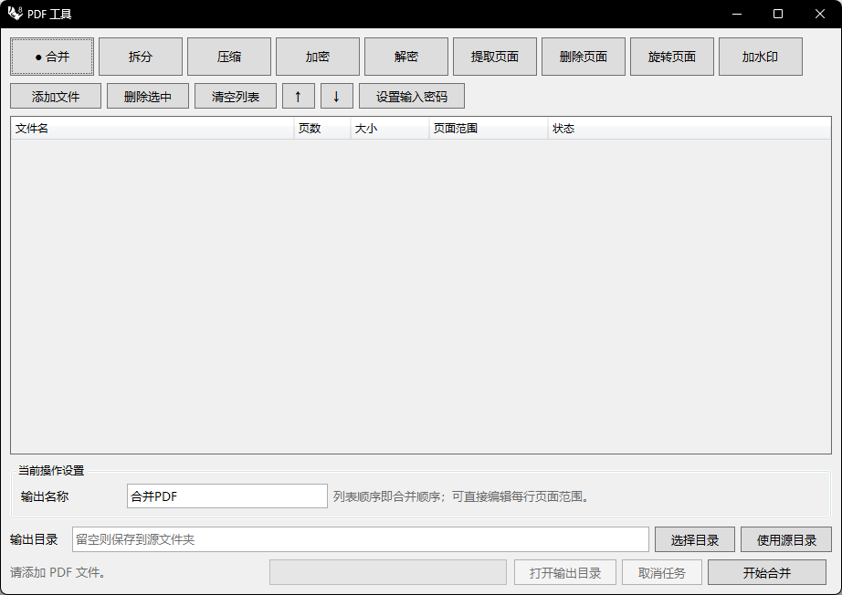

#  rsPdfTools · PDF tools

> Module: Productivity / Productivity

[← Back to command index](/en/commands/)

::: info Version 2.0

Version 2.0 hosts this panel in the RSTool client. Keep the client running and signed in.

[View the 2.0 command changes](/en/commands/v2)

:::

**Function**: Open PDF Tools in the client to merge, split, compress, and organize pages, convert images, add watermarks, and manage passwords. Version 2.0 also supports rsPdfTool.

*PDF Tool main interface: Title "PDF Tools/Document Processing Workbench"; 11 functional modules on the left (Merge/Split/Compress/Encrypt/Decrypt/Extract Pages/Delete Pages/Rotate Pages/Add Watermark/PDF to Image/Image to PDF), "Merge" is currently selected; Tool buttons on the top bar of the main area (Add File, Delete Selected, Clear List, Move Up and Down, Set Input Password) + File List + Page Thumbnail Preview + Operation settings (output name, output directory) + bottom (open output directory / cancel task / start merging)*

> Screenshots and videos may show a Chinese-language interface. Labels and control positions can vary by Rhino or RSTool version.

**Run**: Enter `rsPdfTools` in the Rhino command line (opens a settings window).

**Workflow**:

1. Run rsPdfTool or rsPdfTools in Rhino to open PDF Tools in the client, or open it directly from Creative Tools.
2. Choose merge, split, compression, encryption, decryption, extraction, deletion, rotation, watermarking, PDF-to-image, or image-to-PDF.
3. Add files, inspect thumbnails and previews, and adjust ordering, page ranges, and settings.
4. Choose an output folder, or leave it empty to use each source folder. Set input passwords separately when needed.
5. Start the task, watch progress or cancel, then open the output folder to inspect results.

**Parameters**:

| Display name | Parameter | Type | Default | Range | Description |
| --- | --- | --- | --- | --- | --- |
| split span | SplitSpan | integer | 5 | 1-9999 | Page span for "every N pages" split mode (NumericStepper) |
| split mode | SplitMode | list | Split page by page | Split page by page/every N pages/custom grouping | Drop-down option, the default is to split page by page (index 0); when "Custom Grouping" is selected, the input box supports `1-3;4-6;7,9` semicolon-delimited multi-segment output. |
| page rotation | PageRotation | list | 90° | 90° / 180° / 270° | Page rotation angle, default 90° (index 0) |
| Compression gear | Compression | list | Balanced (1600px / quality 72) | Clear(2400px/Q85) / Balanced(1600px/Q72) / Extreme(1200px/Q55) | Image compression level, default balanced (index 1); only re-encode qualified large images and retain text/vectors |
| watermark transparency | WatermarkOpacity | integer | 18 | 1-100 | Watermark opacity percentage, default 18 |
| Watermark font size | WatermarkFontSize | integer | 28 | 8-200 | Watermark text font size (pt), default 28 |
| Watermark rotation angle | WatermarkRotation | integer | -30 | -180~180 | Watermark rotation angle (degrees), default -30 |
| watermark horizontal spacing | WatermarkHorizontalSpacing | integer | 70 | 20-500 | Watermark horizontal repeat spacing (mm), default 70 |
| watermark vertical spacing | WatermarkVerticalSpacing | integer | 50 | 20-500 | Watermark vertical repeat spacing (mm), default 50 |

**Output**: Perform split/rotate/compress/extract/delete/merge/encrypt/decrypt/watermark operations on PDF and drop the resulting PDF to the output directory

**Notes**: PDF Tools runs locally in the 2.0 client and does not upload PDF files. Both rsPdfTool and rsPdfTools open the same page. Once open, it can work independently of the Rhino connection.

## Operations and settings

| Operation | Main settings |
| --- | --- |
| Merge and organize | File/page order, ranges, copying, removal, reversal, and dragging pages |
| Split | Individual pages, every N pages, or custom groups |
| Compress | Clear, Balanced, or Maximum presets, retaining text and vectors |
| Encrypt/decrypt | Open/owner passwords and print/copy/edit/annotation permissions; known input passwords for decryption |
| Extract/delete/rotate | Page ranges and rotation angles; deletion must leave at least one page |
| Watermark | Text, opacity, size, angle, repeated spacing, and preview |
| PDF to images | PNG/JPEG, DPI, and JPEG quality |
| Images to PDF | Image list order |

Inspect thumbnails and the large preview before processing. Leave the output folder empty to use the source folder. Existing output files receive a new filename rather than being overwritten, and source files are preserved. Leaving the page requests cancellation of unfinished tasks.
