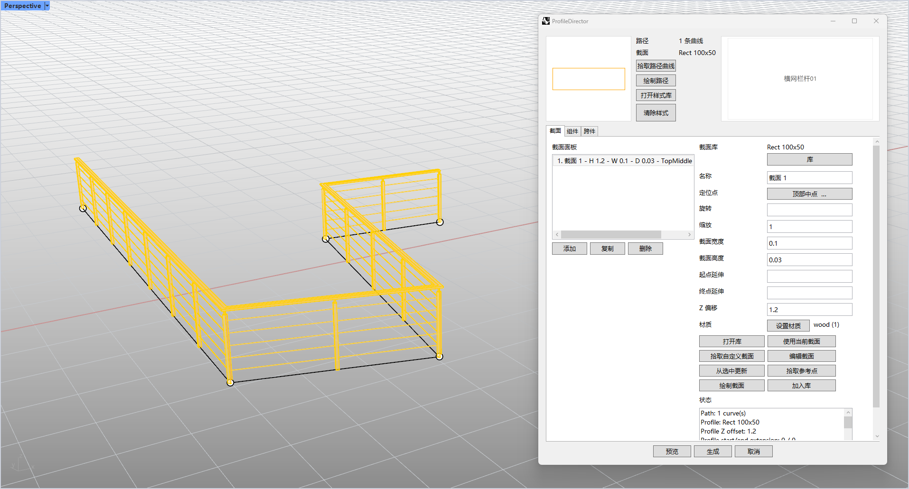
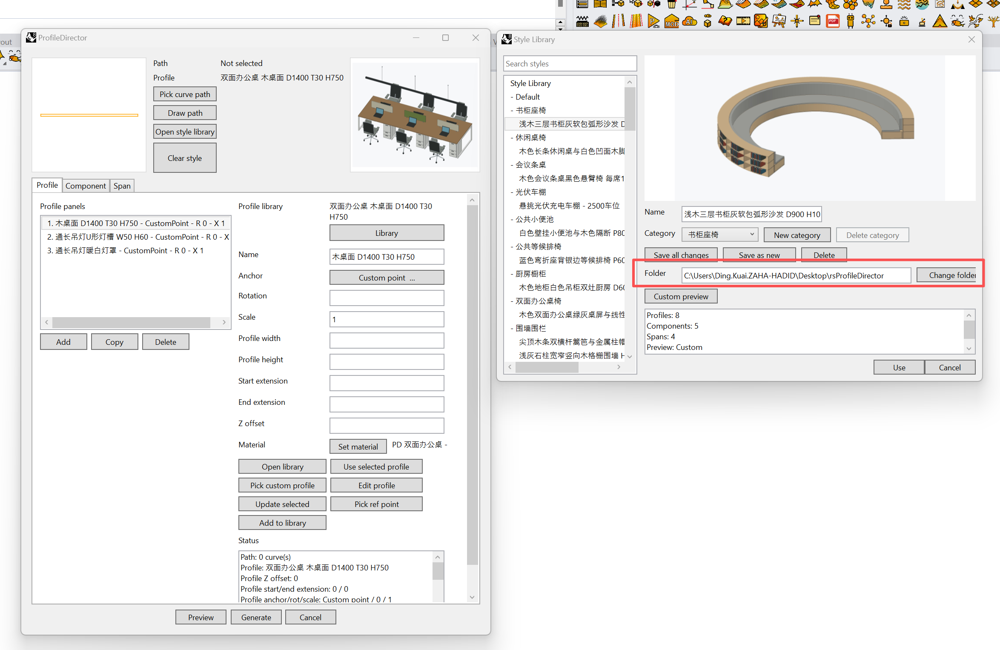

# rsProfileDirector · Profile Director

> Module: Section Management / Profile Director

[← Back to command index](/en/commands/)

**Function**: Generated section sweeps and component/span instances along path array (can be baked as blocks or independent geometries)

*Profile Director main interface (array railing sections and vertical components along a curved path)*

> Screenshots and videos may show a Chinese-language interface. Labels and control positions can vary by Rhino or RSTool version.

**Run**: Enter `rsProfileDirector` in the Rhino command line (opens a settings window).

**Workflow**:

1. Enter rsProfileDirector in Rhino to open the main panel.
2. Use Pick curve path or Draw path to define where geometry is generated.
3. Open Style Library for a ready-made combination, or add items under Profile, Component, and Span.
4. Select an item in the left list before editing on the right. Placement mode and span type determine which controls appear.
5. Click Preview to check placement, spacing, and corners, then Generate to add the result to the model.

**Notes**: See the asset download instructions below. The end of this page explains controls by panel. Each item has independent settings; loaded styles use values stored in the asset. Labels and control positions may vary by version.

## Download and use the asset library

To get started without building your own collection, download the ready-made [rsProfileDirector asset library from Baidu Netdisk](https://pan.baidu.com/s/5zLhuX4hCtyEUVvoC1rHkmA). Place the library in the `rsProfileDirector` folder to use it. If the download is an archive, extract it first and keep the library's existing folder structure.

1. Click **Open style library** in the `rsProfileDirector` main panel.
2. Check the **Folder** path near the bottom of the Style Library window, and place the downloaded library in the `rsProfileDirector` folder shown there.
3. If you store the library elsewhere, click **Change folder** and select the `rsProfileDirector` folder containing it. Select a style and click **Use** to return to the main panel for previewing and generation.

*The red box highlights the library folder settings: Folder shows the current path; click Change folder to select the rsProfileDirector folder containing your library.*

You can store the library wherever it is convenient. The important part is that the Folder path matches its actual location; you do not need to copy the example's desktop path.

**Tutorial videos**:

<iframe class="rstool-video" src="https://player.bilibili.com/player.html?isOutside=true&aid=116918556236559&bvid=BV1HWNt6FEH5&cid=39940849872&p=1" scrolling="no" border="0" frameborder="no" framespacing="0" allowfullscreen="true" loading="lazy" title="RsTool · Profile Director Section Path Array Operation Demonstration (Bilibili)"></iframe>
*RsTool · Profile Director Section Path Array Operation Demonstration (Bilibili)*

**Parameters**:

### Main panel: paths, item lists, and preview

Choose a path first, then decide what to generate along it. The top of the window handles paths and complete styles; Profile, Component, and Span handle continuous sweeps, repeated objects, and members within bays. Each tab has an item list with Add, Copy, and Delete; the editor applies only to the selected item. Defaults below refer to new items; loaded styles bring their own settings. Lengths use current Rhino document units and angles use degrees.

| Display name | Parameter | Type | Default | Range | Description |
| --- | --- | --- | --- | --- | --- |
| Pick curve path / Draw path | Path | Action | Not selected | Curves | Use existing curves or draw a path in Rhino; one style can apply to multiple paths. |
| Clear style | ClearStyle | Action | — | Requires confirmation | Clear profile, component, and span settings while keeping current paths. |
| Preview / Generate / Cancel | PreviewGenerate | Action | Configure before previewing | Buttons | Preview does not add objects; changes refresh it once enabled. Generate adds results to the model; Cancel closes the window. |

### Profile tab: continuous sweeps along the path

Use Profile for handrails, moldings, or strips that run continuously along a path. Choose a library profile or Pick custom profile, then set its anchor on the path. Profile height changes section size; Z offset moves it vertically. Edit profile and Update selected modify the source outline; Add to library saves a reusable individual profile.

| Display name | Parameter | Type | Default | Range | Description |
| --- | --- | --- | --- | --- | --- |
| Name | Profile.Name | Text | Automatic or source name | Text | Name the item to distinguish multiple profiles. |
| Anchor | Profile.AnchorPoint | Option | Center | Center / edge midpoints / corners / custom point / curve corner | Align a part of the section to the path; use Pick ref point for a custom anchor. |
| Scale | Profile.Scale | Number | 1 | > 0 | Scale uniformly; enter target width and height for precise dimensions. |
| Rotation | Profile.RotationDegrees | Number | 0° | Signed angle | Rotate the section, not the entire path. |
| Profile width / Profile height | Profile.ProfileWidth / Profile.ProfileDepth | Length | Blank | Blank preserves size; otherwise positive | Set the two section dimensions; ProfileDepth is the UI's Profile height. |
| Start extension / End extension | Profile.StartExtension / Profile.EndExtension | Length | 0 / 0 | Signed | Adjust each end separately: positive extends and negative retracts. |
| Z offset | Profile.ProfileHeight | Length | 0 | Signed | Move along world Z without changing section height. |
| Material | Profile.MaterialId | Action | Not assigned | Document materials | Use Set material to assign a material to this profile item. |

### Component tab: repeat objects along the path

Use Component to repeat existing posts, seats, brackets, or other objects. Choose from the component library or Pick component object, then set an anchor. Placement controls which spacing, count, and direction fields appear. Object height resizes the object; Z offset moves it vertically, while Plane offset shifts it sideways relative to the path.

| Display name | Parameter | Type | Default | Range | Description |
| --- | --- | --- | --- | --- | --- |
| Name | Component.Name | Text | Automatic or source name | Text | Identify this component item; several items can form one style. |
| Placement | Component.PlacementMode | Option | Along curve | Along curve / Both ends / Start / End / Corners / Corners and ends / Segment fit / Segment spacing | Use Along curve for arrays, endpoint/corner modes for joints, and segment modes for per-segment layouts. |
| Spacing | Component.Spacing | Length | Blank | Positive; blank is mode-dependent | Along curve prioritizes spacing, using count when blank. Segment fit adjusts spacing; Segment spacing preserves it. |
| Count | Component.Count | Integer | 5 | ≥ 1 | Shown only for Along curve and used when spacing is blank; corner handling may reduce the result. |
| Direction | Component.DirectionMode | Option | Start to end | Start to end / End to start / Center out | Shown only for Segment spacing; choose where the array starts. |
| Anchor | Component.AnchorPoint | Option | Bottom center | Bounding-box corners / edge midpoints / face centers / custom point | Align an anchor to the path; use Pick reference point for a custom point. |
| Object width / length / height | Component.ObjectWidth / ObjectDepth / ObjectHeight | Length | Blank | Each blank or positive | Resize using source local bounding-box dimensions; blank axes retain their size. |
| Z offset | Component.Height | Length | 0 | Signed | Move along world Z without changing object height. |
| Plane offset | Component.PlaneOffset | Length | 0 | Signed | Shift sideways in the placement frame to place objects beside the path. |
| XY rotation | Component.RotationDegrees | Number | 0° | Signed angle | Rotate the component in its placement plane. |
| Material | Component.MaterialId | Action | Not assigned | Document materials | Assign a material to this component item. |

### Component corner settings: clearance and joints

These settings belong to Component but are mode-dependent. Source turn angle, Stretch corner assembly, Join corner sides, and Skip plan turns appear only in Corners or Corners and ends. Fill corner beams appears in Segment fit or Segment spacing. Preview defaults first, then choose options for a rigid assembly, separate parts, or panels; they need not all be enabled.

| Display name | Parameter | Type | Default | Range | Description |
| --- | --- | --- | --- | --- | --- |
| Corner clearance | Component.AvoidCornerOverlap | Toggle | On | On / Off | Trim and cap overlaps at joints; blocks use separate corner variants without modifying the source. |
| Source turn angle | Component.CornerReferenceAngleDegrees | Number | Blank: automatic | 0–170° or blank | Use 0 for straight assemblies or 90 for pre-lengthened right-angle ones to adapt to the actual turn. |
| Stretch corner assembly | Component.StretchCornerAssembly | Toggle | Off | On / Off | Scale a continuous assembly transversely, keeping connections; transverse dimensions also change. |
| Join corner sides | Component.JoinCornerSides | Toggle | Off | On / Off | Place a half on each side and miter at the bisector; for panels and jambs, overriding assembly stretch. |
| Skip plan turns | Component.SkipPlanCorners | Toggle | Off | On / Off | Skip plan turns while keeping endpoints and pitch-only joints. |
| Follow ramp surface | Component.FollowUprightSurface | Toggle | Off | On / Off | Adjust separate upright rods vertically to the ramp surface; not for rigid connected assemblies. |
| Fill corner beams | Component.FillCornerGaps | Toggle | Off | On / Off | Extend slender beams into outer corners using the existing grid, then trim; does not add posts. |
| Corner min spacing | CornerMinSpacing | Length | Blank: automatic | Blank / 0 / positive | Shared by the style's components; blank uses 20% of array spacing, 0 disables. Filters regular arrays only with a matching corner component. |

### Span tab: divide the path into bays

Span divides a path into bays, then creates a profile or places components in each bay. Use it for rails between posts, bay infill, or seats in alternating bays. Set Distribution and Spacing or Span count first, then configure contents. Segments placement divides each continuous segment separately.

| Display name | Parameter | Type | Default | Range | Description |
| --- | --- | --- | --- | --- | --- |
| Name | Span.Name | Text | Automatic | Text | Identify layered or alternating span items. |
| Type | Span.Kind | Option | Profile | Profile / Component | Profile sweeps each bay; Component repeats or fits objects within it. Their editors differ. |
| Placement | Span.PlacementMode | Option | Along curve | Along curve / Segments | Divide the whole path, or divide each continuous segment separately. |
| Distribution | Span.DistributionMode | Option | Segment spacing | Segment spacing / Segment fit / Equal count | Choose bay division; Segment fit estimates a count from spacing then divides evenly; Equal count uses the specified count. |
| Direction (bay division) | Span.DistributionDirectionMode | Option | Start to end | Start to end / End to start / Center out | Shown for Segment spacing; controls the division origin and leftover intervals. |
| Spacing | Span.Spacing | Length | Blank | Positive; blank does not subdivide by this spacing | Shown for Segment spacing or Segment fit; this is bay length, not internal member spacing. |
| Span count | Span.Count | Integer | 1 | ≥ 1 | Shown for Equal count; applied to each continuous segment in Segments mode. |
| Every N spans / First span | Span.RepeatEvery / Span.StartSpan | Integer | 1 / 1 | Each ≥ 1 | Defaults to every bay; 2 / 1 uses bays 1, 3, 5, and so on. Combine items for alternating styles. |
| End trim | Span.EndTrim | Length | 0 | ≥ 0 | Retract both ends by this distance; bays too short afterward are skipped. |

### Span Profile type: rails and swept infill

Profile type shows the profile library and anchor rather than component-library or member-count controls. It sweeps the section along each trimmed bay; use Sag below for a hanging cable or light-strip effect.

| Display name | Parameter | Type | Default | Range | Description |
| --- | --- | --- | --- | --- | --- |
| Profile library | Span.SelectedProfileLibraryItemId | Action | Not selected | Existing profile assets | Choose a section for this span item; it need not match the Profile tab. |
| Anchor | Span.AnchorPoint | Option | Center | Center / edge midpoints / corners / custom point / curve corner | Align the section to the bay path using its reference or outline anchor. |

### Span Component type: members within each bay

For Component type, choose a library object and anchor, then set Member distribution. This is a second layer: Span count creates bays; Member count controls objects inside each bay. Fit sloped span uses one fitted assembly per bay and hides internal distribution, direction, and spacing/count controls.

| Display name | Parameter | Type | Default | Range | Description |
| --- | --- | --- | --- | --- | --- |
| Component library | Span.SelectedComponentLibraryItemId | Action | Not selected | Existing component assets | Choose the component asset for this span item. |
| Component anchor | Span.ComponentAnchorPoint | Option | Bottom center | Bounding-box anchors / custom point | Align the component to bay stations; loaded assets may supply their own anchors. |
| Member distribution | Span.MemberDistributionMode | Option | Segment spacing | Segment spacing / Segment fit / Equal count | Distribute objects inside each bay; Segment fit adjusts count and spacing to bay length. |
| Direction (within a bay) | Span.DirectionMode | Option | Center out | Center out / Start to end / End to start | Choose where members start within a bay, independently of the bay-division direction. |
| Member spacing / Member count | Span.ComponentSpacing / Span.MemberCount | Length / Integer | Blank / 1 | Spacing > 0; count ≥ 1 | The mode determines which field appears; blank spacing places one object at the center. |
| Corner clearance | Span.AvoidCornerOverlap | Toggle | On | On / Off | Shown for Component type; handles overlaps at corner joints. |
| Keep whole members / Clearance group | Span.KeepWholeAtCorners / Span.CornerClearanceGroup | Toggle / Text | Off / blank | On / Off; group-name text | Move whole members to clear corners or omit groups that cannot fit, without trimming. Matching group names and layouts share an envelope. Requires clearance and no sloped fitting. |
| Follow ramp surface | Span.FollowUprightSurface | Toggle | Off | On / Off | Adjust separate upright rods to the ramp surface; hidden during sloped fitting. |
| Fit sloped span | Span.FitToSlopedSpan | Toggle | Off | On / Off | Fit one assembly to each trimmed endpoint chord, keeping sections upright; curved bays use their chords. |
| Fit reference length | Span.SpanFitReferenceLength | Length | Blank | Blank / positive | For sloped fitting only; blank uses component X bounds, otherwise centered on the anchor. Shared lengths align layered assemblies. |
| Cut profiles only | Span.CutProfiles | Toggle | Off | On / Off | Use closed component solids to subtract from generated profiles; cutters are neither displayed nor baked. |

### Span size and pose: dimensions versus offsets

These controls remain in Span and are mostly shared, but dimensions differ by type. For Profile, Object width/length set section width/height; for Component, they resize source bounding-box dimensions. Sag lowers the middle of a bay; Z offset moves it vertically. Confirm the type before editing.

| Display name | Parameter | Type | Default | Range | Description |
| --- | --- | --- | --- | --- | --- |
| Object width / length / height | Span.ObjectWidth / ObjectDepth / ObjectHeight | Length | Blank | Each blank or positive | Profile uses width/length; Component also shows height. Sloped fitting controls along-bay width and disables its input. |
| Sag | Span.Sag | Length | 0 | ≥ 0 | Lower the middle of each bay along world -Z; 0 means no sag. Hidden for sloped component fitting. |
| Z offset / Plane offset | Span.Height / Span.PlaneOffset | Length | 0 / 0 | Signed | Move vertically or sideways without changing dimensions. |
| Rotation mode / Rotation value | Span.RotationMode / Span.RotationValue | Option / Angle | Fixed rotation / 0° | Signed fixed angle; random amplitude ≥ 0 | Fixed uses the angle; Random varies within the signed input amplitude. |
| Random offset | Span.RandomPlaneOffset | Length | 0 | ≥ 0 | Add signed random lateral variation to Plane offset; 0 disables it. |
| Material | Span.MaterialId | Action | Not assigned | Document materials | Assign a material to this span item. |

### Library windows: complete styles versus individual assets

Style Library stores a complete combination of profiles, components, and spans. Profile Library stores outlines; Component Library stores objects. Open Style Library applies a complete setup; a tab's own library replaces one asset. Names, categories, folders, and preview images manage assets rather than geometry dimensions.

| Display name | Parameter | Type | Default | Range | Description |
| --- | --- | --- | --- | --- | --- |
| Search / Name / Category | Library.SearchCategory | Text | From the asset | Text / category | Find assets and organize by name/category; select an actual item before using it. |
| Folder / Change folder | Library.Folder | Action | Current library folder | Local folder | View or change the library path; it must match the actual asset folder. |
| Save all changes / Save as new | Library.SaveStyle | Action | — | Style Library buttons | Save all changes updates the selected style's name, category, and current settings; Save as new creates a new style. |
| Custom preview / Use | Library.PreviewUse | Action | From the asset | Image / selected asset | Preview images are for library display; Use loads the chosen style or individual asset. |
