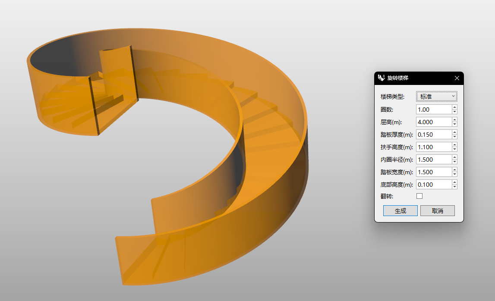

#  rsSpiralStair · Spiral Stair

> Module: Architecture / Stairs & Ramps

[← Back to command index](/en/commands/)

::: info Version 2.0

Supports 2D and 3D parametric stairs with switching in Properties. Baseline control-point editing does not apply to spiral stairs.

[View the 2.0 command changes](/en/commands/v2)

:::

**Function**: Create a spiral stair from a placement line and dimensions. Parametric 3D results support property editing and conversion to a dedicated 2D spiral representation.

*Select the base point of the spiral staircase to generate a spiral staircase. It supports two tread types: standard/hollow. The number of turns/radius/tread width, etc. are adjustable.*

> Screenshots and videos may show a Chinese-language interface. Labels and control positions can vary by Rhino or RSTool version.

**Run**: Enter `rsSpiralStair` in the Rhino command line (opens a settings window).

**Workflow**:

1. Run rsSpiralStair, pick the stair base point, then set parameters in the panel that opens.
2. Set turns, floor height, target rise, inner radius, flight width, slab, and rail.
3. Choose Standard or open treads, check flip direction and preview, then Generate.
4. For parametric results, edit dimensions or switch 2D/3D representation in Properties.

**Parameters**:

| Display name | Parameter | Type | Default | Range | Description |
| --- | --- | --- | --- | --- | --- |
| Turns | TurnCount | double | 1 | 0.01–1000 | Controls total revolutions. |
| Floor height / target rise | FloorRise | group | 4 m / 0.15 m | Floor height ≥ rise > 0 | The builder determines actual steps; there is no separate step-count input. |
| Inner radius / flight width | RadiusWidth | group | 1.5 m / 1.5 m | Valid positive sizes | Outer radius follows inner radius plus flight width. |
| Rail height / slab thickness | RailThickness | group | 1.1 m / 0.1 m | Positive rail; slab ≥0 | Displayed in current model units. |
| Type / flip | TypeFlip | group | Standard / No flip | Standard / Open treads; optional flip | Flip reverses winding direction. |
| Create parametric stair object | GenerateObject | bool | On | On / Off (3D) | Enable property editing, or disable for ordinary Brep output. |

**Output**: Parametric 3D spiral stairs or ordinary Breps; parametric results can convert to 2D.

**Notes**: Dimensions are displayed in current Rhino model units; mm and m below describe equivalent physical sizes.

Create parametric stair object is enabled for 3D by default, saving the whole stair as an independent object. Use Stair parameters in Properties to edit dimensions or switch between 2D and 3D. Editing retains placement after moves, rotations, and uniform scaling. Disable the option for ordinary Breps.

Use `rsStairMake2D` for linework and `rsStairDupEdge` for edges. Use `rsStairToGeometry` when downstream tools require ordinary geometry; Undo restores the parametric object.

The creation panel builds 3D stairs; switch to 2D from a parametric object in Properties. A dedicated plan algorithm draws outlines, treads, ascent arrows, and a break line. Break height controls the shown step level, with bounded outlines for multiple turns.

Spiral stairs do not currently provide baseline grips through `PointsOn`.

Images or videos may show the old interface. For 2.0, follow the entries, modes, and parameter descriptions on this page.
