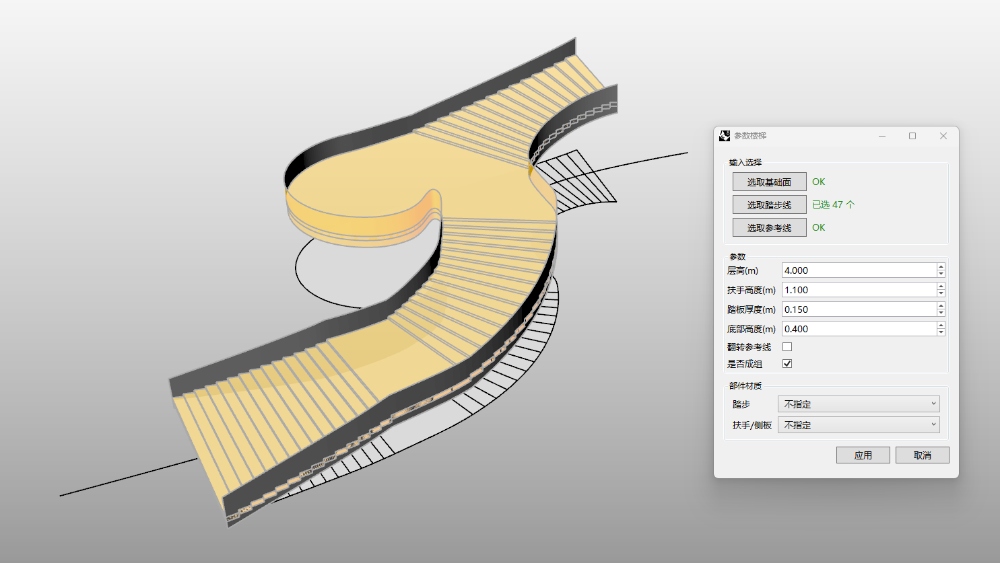

#  rsStairBySteps · Staircase by Step Count

> Module: Architecture / Stairs & Ramps

[← Back to command index](/en/commands/)

**Function**: Generate parametric stairs (including handrails) along the base surface and tread lines

*Generate parametric stairs (including handrails) along the base surface and tread lines/reference curves. Floor slabs/steps/side panels support individually specified materials.*

> Screenshots and videos may show a Chinese-language interface. Labels and control positions can vary by Rhino or RSTool version.

**Run**: Enter `rsStairBySteps` in the Rhino command line (command-line interaction).

**Workflow**:

1. Select base plane/tread line/reference line mode via form (or select directly in the scene)
2. Select base surface
3. Select tread line
4. Select a reference (guide) curve
5. Set floor height/handrail height/tread thickness/bottom height/flip
6. Real-time preview and generation of parametric stairs (including handrails)

**Parameters**:

| Display name | Parameter | Type | Default | Range | Description |
| --- | --- | --- | --- | --- | --- |
| Floor-to-floor height | FloorHeight | double | 4 | 0.001~10000 | Step 0.1, unit: meters |
| Handrail height | HandrailHeight | double | 1.1 | 0.001~10000 | Step 0.1, unit: meters |
| Tread thickness | StepHeight | double | 0.15 | 0.001~10000 | Step 0.01, unit: meters |
| Bottom height | BottomHeight | double | 0.4 | 0~10000 | Step 0.01, unit: meters |
| Flip guide curve | FlipGuide | bool | false | true\|false | Flip step reference line direction |

**Notes**: Mixed form and command line option driver
