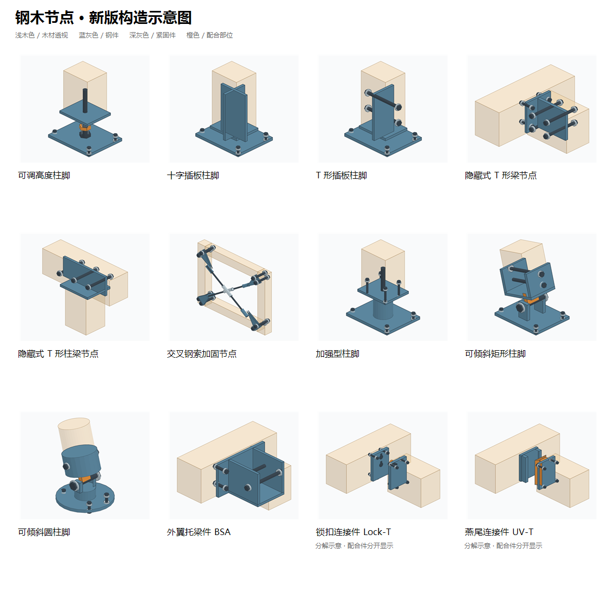

#  rsTimberJoint · Timber Joints

> Module: Architecture / Building Elements

[← Back to command index](/en/commands/)

**Function**: Create steel parts, fasteners, and timber copies with the required slots, holes, or cuts. Processed timber inherits source layers and materials. Steel and fasteners are placed on separate sublayers under the joint output layer; each batch is grouped.

*Twelve connection types: translucent pale timber, blue-grey steel, dark-grey fasteners, and orange mating regions. Diagrams explain construction and do not update with dimensions; the orange viewport preview shows the calculated geometry.*

> Screenshots and videos may show a Chinese-language interface. Labels and control positions can vary by Rhino or RSTool version.

**Run**: Enter `rsTimberJoint` in the Rhino command line (opens a settings window).

**Workflow**:

1. Run rsTimberJoint to open the Steel-to-timber joints · Fu_Wood panel, or choose rsMenu → Architecture → Timber Joints.
2. Choose a category and joint type. Changing type clears selected objects and the support plane; select inputs again for the new type.
3. Select columns, beams, or guides using the displayed buttons and press Enter to finish each selection. Bases accept batches of columns; beam joints need at least two beams; column-to-beam joints need both roles; cross-bracing needs four surrounding members and two straight guides.
4. Adjust the dimensions for the selected type, always in millimetres. Inclinable bases can capture the current construction plane as a support plane or revert to automatic horizontal planes at column bottoms.
5. Complete inputs trigger an orange preview. Parameters or valid source changes refresh it; Preview recomputes manually. Check connection counts, part counts, and diagnostic messages.
6. Click Create to recompute the current inputs and write grouped geometry to the document. One undo reverses the batch. The panel remains open and clears selections for the next batch.

**Notes**:

## Using the panel

Choose Column bases, Beam joints, Column-to-beam joints, or Bracing, then select a specific type. The illustration explains component positions. Only the relevant input buttons and dimensions are displayed. Type prefixes in the parameter tables distinguish repeated keys; they are not text to enter in Rhino.

All dimensions are entered in millimetres, even in a metre-based model; results are converted back to document units. Tables show first-use defaults. Each type remembers its dimensions within the session. Numeric controls allow 0.001–1000000, but every dimension must also exceed twice the model absolute tolerance converted to millimetres and fit the member section and joint geometry.

## Preparing the model

Timber inputs can be Breps, surfaces, or Extrusions, including curved beams and open surfaces. Meshes and block instances are unsupported. End joints and bases still require identifiable planar end faces; cross-bracing can use individual side faces. Inputs must be visible, unlocked, and editable. An object cannot act as both a column and a beam.

Joints are located from actual geometric contact, not proximity alone. Incoming beam ends must meet receiving sides, and column tops must meet beam undersides. Resolve missing contacts or ambiguous receiving members using the diagnostic messages. Cross-bracing requires two intersecting, coplanar straight guides with endpoints near the four inside corners.

## Support planes for inclined bases

Inclinable rectangular and round bases default to horizontal planes at each column bottom. Capture current construction plane saves its full position and orientation as a common support plane. Later construction-plane changes do not update it; capture again if necessary. Automatic restores the default. Height means hinge-axis distance normal to the support plane. Round bases require circular column ends.

## Source geometry and output

Processing works on copies without deleting or rewriting the original timber. Hide originals is on by default. During preview, only sources with processed copies are temporarily suppressed, and they reappear when the preview ends or the panel closes. Creation hides those sources and retains processed copies. Turn the option off to keep originals visible, potentially overlapping output. Unconnected members and the original cross-bracing frame and guides remain unchanged.

Results are ordinary geometry, not joints that can be reopened for parametric editing. One undo removes the batch and restores hidden originals; redo is supported. Switching documents closes the panel. Remembered session settings do not provide editable node history.

## Scope

This is a connection-modeling tool, not a structural analysis, fabrication drawing, or bill-of-materials tool. BSA, Lock-T, UV-T, and other types are parametric construction representations rather than exact manufacturer replicas. Defaults and assembly clearances do not replace project-specific structural design and fabrication approval.

**Parameters**:

### Shared panel controls

The category determines available types; input buttons and dimensions depend on the selected type. All joint dimensions below are in millimetres.

| Display name | Parameter | Type | Default | Range | Description |
| --- | --- | --- | --- | --- | --- |
| Category | Category | option | Column bases | Column bases / Beam joints / Column-to-beam joints / Bracing | Choose a construction category before selecting a joint type. |
| Joint type | JointType | option | Adjustable-height column base | Types in the selected category; twelve in total | Changing type clears selections and the support plane and replaces the dimension fields. |
| Support plane | SupportPlane | plane | Horizontal plane at each column bottom | Automatic / Capture current construction plane | Only available for the two inclinable bases; captures position and orientation at selection time. |
| Hide originals | HideOriginals | toggle | On | On / Off | Hides only source timber with processed copies; never deletes source geometry. |

### Adjustable-height column base

Select rectangular-section columns, individually or in a batch. A connecting rod joins the upper and lower plates. Fit the upper plate to the column section before adjusting the base height.

| Display name | Parameter | Type | Default | Range | Description |
| --- | --- | --- | --- | --- | --- |
| Top plate width | AdjustableBase.TopWidth | length (mm) | 220 | 0.001–1000000; also > 2 × document tolerance in mm | Transverse dimension of the upper plate. |
| Top plate length | AdjustableBase.TopLength | length (mm) | 400 | 0.001–1000000; also > 2 × document tolerance in mm | Longitudinal dimension of the upper plate. |
| Base plate width | AdjustableBase.BottomWidth | length (mm) | 250 | 0.001–1000000; also > 2 × document tolerance in mm | Transverse dimension of the base plate. |
| Base plate length | AdjustableBase.BottomLength | length (mm) | 400 | 0.001–1000000; also > 2 × document tolerance in mm | Longitudinal dimension of the base plate. |
| Steel plate thickness | AdjustableBase.Thickness | length (mm) | 12 | 0.001–1000000; also > 2 × document tolerance in mm | Thickness of the base or connection plate for this type. |
| Rod / bolt radius | AdjustableBase.RodRadius | length (mm) | 15 | 0.001–1000000; also > 2 × document tolerance in mm | Radius of the rod, bolt, pin, or headed pin used by this type; enter a radius, not a diameter. |
| Height | AdjustableBase.Height | length (mm) | 200 | 0.001–1000000; also > 2 × document tolerance in mm | Height of the base, knife plate, end plate, or connector identified by this type. Inclinable bases use hinge-axis distance normal to the support plane. |

### Cross knife-plate column base

Select rectangular-section columns. Crossed knife plates enter the timber above a support plate. Leave sufficient clearance between knife thickness, support height, and knife height.

| Display name | Parameter | Type | Default | Range | Description |
| --- | --- | --- | --- | --- | --- |
| Width | CrossBase.Width | length (mm) | 300 | 0.001–1000000; also > 2 × document tolerance in mm | Width of the plate, connector, or hanger identified by this joint type. |
| Base plate length | CrossBase.Length | length (mm) | 200 | 0.001–1000000; also > 2 × document tolerance in mm | Longitudinal dimension of the base plate. |
| Steel plate thickness | CrossBase.Thickness | length (mm) | 12 | 0.001–1000000; also > 2 × document tolerance in mm | Thickness of the base or connection plate for this type. |
| Knife plate thickness | CrossBase.KnifeThickness | length (mm) | 6 | 0.001–1000000; also > 2 × document tolerance in mm | Thickness of the crossed knife plates; must fit within the available section. |
| Height | CrossBase.Height | length (mm) | 310 | 0.001–1000000; also > 2 × document tolerance in mm | Height of the base, knife plate, end plate, or connector identified by this type. Inclinable bases use hinge-axis distance normal to the support plane. |
| Support plate height | CrossBase.HoldHeight | length (mm) | 50 | 0.001–1000000; also > 2 × document tolerance in mm | Support-plate height, with adequate separation from the base and knife plates. |

### T-shaped knife-plate column base

Select rectangular-section columns to create base plates, knife plates, through-bolts, and processed timber copies with matching slots and holes.

| Display name | Parameter | Type | Default | Range | Description |
| --- | --- | --- | --- | --- | --- |
| Width | TBase.Width | length (mm) | 220 | 0.001–1000000; also > 2 × document tolerance in mm | Width of the plate, connector, or hanger identified by this joint type. |
| Base plate length | TBase.Length | length (mm) | 400 | 0.001–1000000; also > 2 × document tolerance in mm | Longitudinal dimension of the base plate. |
| Steel plate thickness | TBase.Thickness | length (mm) | 12 | 0.001–1000000; also > 2 × document tolerance in mm | Thickness of the base or connection plate for this type. |
| Height | TBase.Height | length (mm) | 200 | 0.001–1000000; also > 2 × document tolerance in mm | Height of the base, knife plate, end plate, or connector identified by this type. Inclinable bases use hinge-axis distance normal to the support plane. |
| Rod / bolt radius | TBase.RodRadius | length (mm) | 5 | 0.001–1000000; also > 2 × document tolerance in mm | Radius of the rod, bolt, pin, or headed pin used by this type; enter a radius, not a diameter. |

### Concealed T-shaped beam joint

Select at least two connected beams. The joint is located where an incoming beam end meets a receiving beam side, including curved beam ends. Fit the end plate to the incoming section.

| Display name | Parameter | Type | Default | Range | Description |
| --- | --- | --- | --- | --- | --- |
| Width | BeamT.Width | length (mm) | 150 | 0.001–1000000; also > 2 × document tolerance in mm | Width of the plate, connector, or hanger identified by this joint type. |
| Height | BeamT.Height | length (mm) | 300 | 0.001–1000000; also > 2 × document tolerance in mm | Height of the base, knife plate, end plate, or connector identified by this type. Inclinable bases use hinge-axis distance normal to the support plane. |
| Steel plate thickness | BeamT.Thickness | length (mm) | 12 | 0.001–1000000; also > 2 × document tolerance in mm | Thickness of the base or connection plate for this type. |
| Insertion / bearing depth | BeamT.Depth | length (mm) | 200 | 0.001–1000000; also > 2 × document tolerance in mm | Knife insertion depth for the T joint, or bearing depth along the incoming beam for BSA. |

### Concealed T-shaped column-to-beam joint

Select columns and beams separately, with at least one of each. Connections are located at column-top to beam-underside contacts. Coaxial beams at the same location can share a connector.

| Display name | Parameter | Type | Default | Range | Description |
| --- | --- | --- | --- | --- | --- |
| Width | ColumnBeamT.Width | length (mm) | 300 | 0.001–1000000; also > 2 × document tolerance in mm | Width of the plate, connector, or hanger identified by this joint type. |
| Base plate length | ColumnBeamT.Length | length (mm) | 200 | 0.001–1000000; also > 2 × document tolerance in mm | Longitudinal dimension of the base plate. |
| Steel plate thickness | ColumnBeamT.Thickness | length (mm) | 20 | 0.001–1000000; also > 2 × document tolerance in mm | Thickness of the base or connection plate for this type. |
| Height | ColumnBeamT.Height | length (mm) | 400 | 0.001–1000000; also > 2 × document tolerance in mm | Height of the base, knife plate, end plate, or connector identified by this type. Inclinable bases use hinge-axis distance normal to the support plane. |

### Cross-cable bracing joint

Select exactly four surrounding members and two intersecting, coplanar straight guide lines. Place their endpoints near the four actual inside corners. The command creates corner plates, clips, pins, and offset diagonal rods; it does not process the frame or guides.

| Display name | Parameter | Type | Default | Range | Description |
| --- | --- | --- | --- | --- | --- |
| Height | CrossBrace.Height | length (mm) | 200 | 0.001–1000000; also > 2 × document tolerance in mm | Height of the base, knife plate, end plate, or connector identified by this type. Inclinable bases use hinge-axis distance normal to the support plane. |
| Width | CrossBrace.Width | length (mm) | 100 | 0.001–1000000; also > 2 × document tolerance in mm | Width of the plate, connector, or hanger identified by this joint type. |
| Steel plate thickness | CrossBrace.Thickness | length (mm) | 10 | 0.001–1000000; also > 2 × document tolerance in mm | Thickness of the base or connection plate for this type. |
| Rod / cable radius | CrossBrace.SteelPipeRadius | length (mm) | 15 | 0.001–1000000; also > 2 × document tolerance in mm | Radius, not diameter, of the two diagonal rods or cables. |
| Clip hole spacing | CrossBrace.ClipLength | length (mm) | 75 | 0.001–1000000; also > 2 × document tolerance in mm | Distance between the clip connection holes. |
| Clip large-end radius | CrossBrace.ClipRadius1 | length (mm) | 35 | 0.001–1000000; also > 2 × document tolerance in mm | Outline radius at the larger end of the clip. |
| Clip small-end radius | CrossBrace.ClipRadius2 | length (mm) | 25 | 0.001–1000000; also > 2 × document tolerance in mm | Outline radius at the smaller end of the clip. |
| Clip thickness | CrossBrace.ClipThickness | length (mm) | 5 | 0.001–1000000; also > 2 × document tolerance in mm | Thickness of the clip plate. |

### Reinforced column base

Select columns. A tubular support connects the upper and lower plates, while a central rod and top-plate bolts connect the timber. Upper and lower plate dimensions are independently adjustable.

| Display name | Parameter | Type | Default | Range | Description |
| --- | --- | --- | --- | --- | --- |
| Top plate width | ResistantBase.TopWidth | length (mm) | 220 | 0.001–1000000; also > 2 × document tolerance in mm | Transverse dimension of the upper plate. |
| Top plate length | ResistantBase.TopLength | length (mm) | 400 | 0.001–1000000; also > 2 × document tolerance in mm | Longitudinal dimension of the upper plate. |
| Base plate width | ResistantBase.BottomWidth | length (mm) | 220 | 0.001–1000000; also > 2 × document tolerance in mm | Transverse dimension of the base plate. |
| Base plate length | ResistantBase.BottomLength | length (mm) | 400 | 0.001–1000000; also > 2 × document tolerance in mm | Longitudinal dimension of the base plate. |
| Steel plate thickness | ResistantBase.Thickness | length (mm) | 12 | 0.001–1000000; also > 2 × document tolerance in mm | Thickness of the base or connection plate for this type. |
| Height | ResistantBase.Height | length (mm) | 200 | 0.001–1000000; also > 2 × document tolerance in mm | Height of the base, knife plate, end plate, or connector identified by this type. Inclinable bases use hinge-axis distance normal to the support plane. |
| Rod / bolt radius | ResistantBase.RodRadius | length (mm) | 5 | 0.001–1000000; also > 2 × document tolerance in mm | Radius of the rod, bolt, pin, or headed pin used by this type; enter a radius, not a diameter. |

### Inclinable rectangular column base

Select rectangular-section columns. The cradle follows the actual column inclination. Its clear width and length must accommodate the section. Height is the normal distance from the hinge axis to the support plane, not a distance along the inclined column.

| Display name | Parameter | Type | Default | Range | Description |
| --- | --- | --- | --- | --- | --- |
| Cradle clear width | InclinableBase.InternalWidth | length (mm) | 220 | 0.001–1000000; also > 2 × document tolerance in mm | Clear internal cradle width; must accommodate the column section. |
| Cradle clear length | InclinableBase.InternalLength | length (mm) | 400 | 0.001–1000000; also > 2 × document tolerance in mm | Clear internal cradle length; must accommodate the column section. |
| Base plate width | InclinableBase.BottomWidth | length (mm) | 220 | 0.001–1000000; also > 2 × document tolerance in mm | Transverse dimension of the base plate. |
| Base plate length | InclinableBase.BottomLength | length (mm) | 400 | 0.001–1000000; also > 2 × document tolerance in mm | Longitudinal dimension of the base plate. |
| Steel plate thickness | InclinableBase.Thickness | length (mm) | 12 | 0.001–1000000; also > 2 × document tolerance in mm | Thickness of the base or connection plate for this type. |
| Height | InclinableBase.Height | length (mm) | 200 | 0.001–1000000; also > 2 × document tolerance in mm | Height of the base, knife plate, end plate, or connector identified by this type. Inclinable bases use hinge-axis distance normal to the support plane. |
| Rod / bolt radius | InclinableBase.RodRadius | length (mm) | 5 | 0.001–1000000; also > 2 × document tolerance in mm | Radius of the rod, bolt, pin, or headed pin used by this type; enter a radius, not a diameter. |

### Inclinable round column base

Select columns with circular end faces to create round bases, cylindrical collars, and hinges. A support plane can be specified as for the rectangular inclinable base; height is measured normal to that plane.

| Display name | Parameter | Type | Default | Range | Description |
| --- | --- | --- | --- | --- | --- |
| Base plate radius | InclinableRoundBase.PlateRadius | length (mm) | 220 | 0.001–1000000; also > 2 × document tolerance in mm | Radius, not diameter, of the round base plate. |
| Steel plate thickness | InclinableRoundBase.Thickness | length (mm) | 12 | 0.001–1000000; also > 2 × document tolerance in mm | Thickness of the base or connection plate for this type. |
| Height | InclinableRoundBase.Height | length (mm) | 200 | 0.001–1000000; also > 2 × document tolerance in mm | Height of the base, knife plate, end plate, or connector identified by this type. Inclinable bases use hinge-axis distance normal to the support plane. |
| Rod / bolt radius | InclinableRoundBase.RodRadius | length (mm) | 5 | 0.001–1000000; also > 2 × document tolerance in mm | Radius of the rod, bolt, pin, or headed pin used by this type; enter a radius, not a diameter. |

### BSA external-wing beam hanger

Select at least two beams for an end-to-side connection. The clear hanger width must accommodate the incoming beam. Bearing depth controls extension along the beam end. Curved beam ends are supported.

| Display name | Parameter | Type | Default | Range | Description |
| --- | --- | --- | --- | --- | --- |
| Width | BeamBsa.Width | length (mm) | 150 | 0.001–1000000; also > 2 × document tolerance in mm | Width of the plate, connector, or hanger identified by this joint type. |
| Height | BeamBsa.Height | length (mm) | 300 | 0.001–1000000; also > 2 × document tolerance in mm | Height of the base, knife plate, end plate, or connector identified by this type. Inclinable bases use hinge-axis distance normal to the support plane. |
| Steel plate thickness | BeamBsa.Thickness | length (mm) | 12 | 0.001–1000000; also > 2 × document tolerance in mm | Thickness of the base or connection plate for this type. |
| Insertion / bearing depth | BeamBsa.Depth | length (mm) | 180 | 0.001–1000000; also > 2 × document tolerance in mm | Knife insertion depth for the T joint, or bearing depth along the incoming beam for BSA. |
| Rod / bolt radius | BeamBsa.RodRadius | length (mm) | 5 | 0.001–1000000; also > 2 × document tolerance in mm | Radius of the rod, bolt, pin, or headed pin used by this type; enter a radius, not a diameter. |

### Lock-T concealed connector

Select at least two beams to create paired end plates, keyholes, headed pins, and installation recesses on both sides. Assembly clearance reserves space at mating parts; it is not an approved structural fabrication tolerance.

| Display name | Parameter | Type | Default | Range | Description |
| --- | --- | --- | --- | --- | --- |
| Width | BeamLockT.Width | length (mm) | 150 | 0.001–1000000; also > 2 × document tolerance in mm | Width of the plate, connector, or hanger identified by this joint type. |
| Height | BeamLockT.Height | length (mm) | 300 | 0.001–1000000; also > 2 × document tolerance in mm | Height of the base, knife plate, end plate, or connector identified by this type. Inclinable bases use hinge-axis distance normal to the support plane. |
| Steel plate thickness | BeamLockT.Thickness | length (mm) | 12 | 0.001–1000000; also > 2 × document tolerance in mm | Thickness of the base or connection plate for this type. |
| Rod / bolt radius | BeamLockT.RodRadius | length (mm) | 5 | 0.001–1000000; also > 2 × document tolerance in mm | Radius of the rod, bolt, pin, or headed pin used by this type; enter a radius, not a diameter. |
| Assembly clearance | BeamLockT.Clearance | length (mm) | 1 | 0.001–1000000; also > 2 × document tolerance in mm | Reserved gap at mating connector parts. |

### UV-T dovetail concealed connector

Select at least two beams to create dovetail rails, mating plates, fixing holes, and installation recesses on both sides. Fit the connector to the beam section before adjusting assembly clearance.

| Display name | Parameter | Type | Default | Range | Description |
| --- | --- | --- | --- | --- | --- |
| Width | BeamUvT.Width | length (mm) | 150 | 0.001–1000000; also > 2 × document tolerance in mm | Width of the plate, connector, or hanger identified by this joint type. |
| Height | BeamUvT.Height | length (mm) | 300 | 0.001–1000000; also > 2 × document tolerance in mm | Height of the base, knife plate, end plate, or connector identified by this type. Inclinable bases use hinge-axis distance normal to the support plane. |
| Steel plate thickness | BeamUvT.Thickness | length (mm) | 12 | 0.001–1000000; also > 2 × document tolerance in mm | Thickness of the base or connection plate for this type. |
| Rod / bolt radius | BeamUvT.RodRadius | length (mm) | 5 | 0.001–1000000; also > 2 × document tolerance in mm | Radius of the rod, bolt, pin, or headed pin used by this type; enter a radius, not a diameter. |
| Assembly clearance | BeamUvT.Clearance | length (mm) | 1 | 0.001–1000000; also > 2 × document tolerance in mm | Reserved gap at mating connector parts. |
