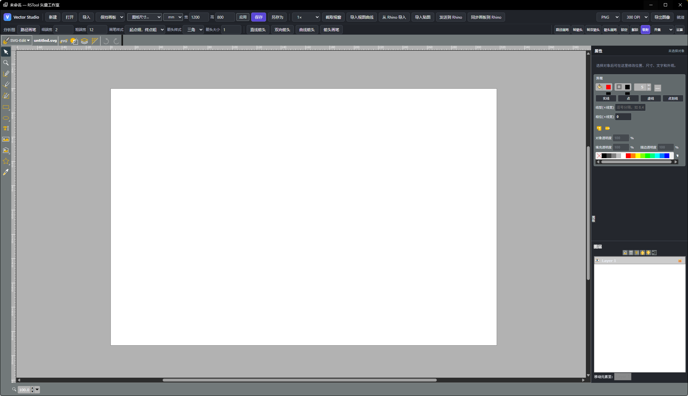

#  rsVectorStudio · Vector Studio

> Module: Productivity / Productivity

[← Back to command index](/en/commands/)

::: info Version 2.0

Version 2.0 hosts this panel in the RSTool client. Keep the client running and signed in.

[View the 2.0 command changes](/en/commands/v2)

:::

**Function**: Open Vector Studio in the client to edit SVG artwork and diagrams and exchange curves, images, and canvas dimensions with the selected Rhino document.

> Screenshots and videos may show a Chinese-language interface. Labels and control positions can vary by Rhino or RSTool version.

**Run**: Enter `rsVectorStudio` in the Rhino command line (opens a settings window).

**Workflow**:

1. Run rsVectorStudio in Rhino to open Creative Tools → Vector Studio in the client.
2. Create or open SVG artwork, then edit with selections, paths, shapes, text, and layers, or import images.
3. Confirm the Rhino target before capturing a viewport, projecting curves, or importing UV textures.
4. Adjust fills, strokes, gradients, and layers, then use booleans and path/arrow brushes to compose diagrams.
5. Save SVG or export PNG/JPEG/WebP. Use Send to Rhino or Sync Canvas to Rhino explicitly when sending content back.

**Parameters**:

| Display name | Parameter | Type | Default | Range | Description |
| --- | --- | --- | --- | --- | --- |
| Export format | Format | list | png | png / jpeg / webp | Set when exporting: Image output format |
| Zoom | Scale | double | 1.0 | > 0 (Export Size = Source Size × Scale) | Set when exporting: overall scaling |
| Width | Width | int | source size | 1 – 8192 | Settings when exporting: Exactly output according to width and height when specified |
| height | Height | int | source size | 1 – 8192 | Settings when exporting: Exactly output according to width and height when specified |

**Output**: Save editable SVG or export bitmap images. Send curves, textured images, and canvas dimensions to the selected Rhino document when needed.

**Notes**: In 2.0, Vector Studio is under Creative Tools in the client. It retains the SVG-Edit drawing tools, fills, strokes, gradients, layers, path/arrow brushes, and geometry booleans. Theme and language follow the client.

## Rhino exchange

- Capture Viewport adds a bitmap of the selected Rhino document.
- Import View Curves projects selected Curve objects into the current viewport; importing by construction plane is also supported. This does not calculate hidden lines for an entire Brep/Mesh model.
- Import textures uses UV data. Send to Rhino writes selected curves and images back; Sync Canvas to Rhino synchronizes canvas dimensions.
- Confirm the Rhino instance and document before any exchange. Saving SVG does not automatically send changes to Rhino.

## Editing and files

Use the left toolbar for selection, pencils, pens, shapes, paths, text, and images. The top toolbar groups files, Rhino exchange, diagram brushes, booleans, view controls, and export. The right panels control fill, stroke, gradients, image adjustments, and layers. Dashed strokes use width-relative dash patterns, retained in SVG.

Save SVG with Ctrl+S, or export PNG/JPEG/WebP. Up to 16 documents can remain open, with independent Undo histories and recovery. Switching client features keeps the workspace. Closing an unsaved document offers Save, Discard, and Cancel.

**Tutorial videos**:

<iframe class="rstool-video" src="https://player.bilibili.com/player.html?isOutside=true&aid=117089180325416&bvid=BV1yhgW6vEkV&cid=40884506417&p=1" scrolling="no" border="0" frameborder="no" framespacing="0" allowfullscreen="true" loading="lazy" title="RsTool · Vector Studio Vector Studio Instruction Video (Bilibili)"></iframe>
*RsTool · Vector Studio Vector Studio Instruction Video (Bilibili)*
