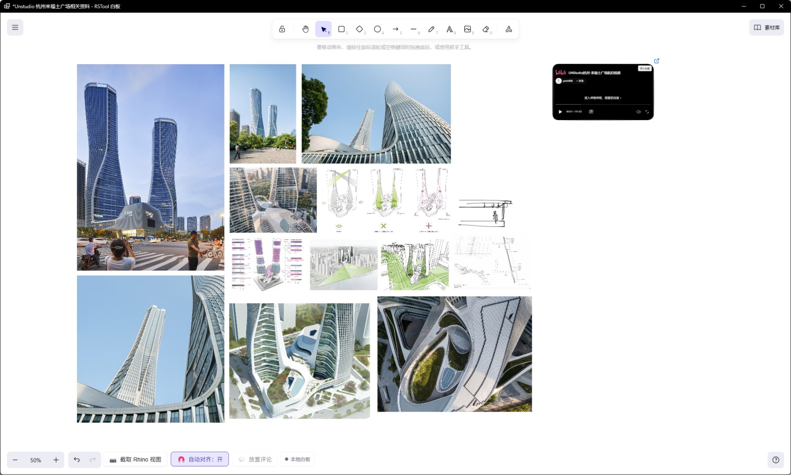

#  rsWhiteboard · Whiteboard

> Module: Productivity / Productivity

[← Back to command index](/en/commands/)

::: info Version 2.0

Version 2.0 hosts this panel in the RSTool client. Keep the client running and signed in.

[View the 2.0 command changes](/en/commands/v2)

:::

**Function**: Open Whiteboard in the client to sketch with shapes, arrows, text, and images, and collaborate through a shared folder.

*Whiteboard main interface: Top-centered Excalidraw main toolbar (Lock/Undo Redo/Select/Rectangle/Ellipse/Line/Arrow/Free Draw/Pencil/Text/Picture/Eraser/Delete) + Library button on the right; Upper left ≡ Hamburger menu; Bottom RsTool custom toolbar (Capture Rhino view/Auto-align: on/Place comments/Local snapshot) + Left zoom 50% Control; the actual project scene and design drawing reference are arranged on the drawing board, and the video card of Bilibili is embedded in the upper right corner for playback of design results.*

> Screenshots and videos may show a Chinese-language interface. Labels and control positions can vary by Rhino or RSTool version.

**Run**: Enter `rsWhiteboard` in the Rhino command line (opens a settings window).

**Workflow**:

1. Run rsWhiteboard to open Creative Tools → Whiteboard in the client.
2. Create or open an .excalidraw document and draw with shapes, arrows, text, brushes, and images.
3. Confirm the selected Rhino target before using Capture Rhino View.
4. For collaboration, save to a shared folder accessible to your team, start or join sharing, and use comments.
5. Save the original whiteboard for editing, export PNG/SVG or storyboard PDF as needed, and switch between document tabs.

**Parameters**:

| Display name | Parameter | Type | Default | Range | Description |
| --- | --- | --- | --- | --- | --- |
| automatic alignment | AutoAlign | toggle | open | on/off | Customize the toolbar switch at the bottom to control the automatic alignment of elements when placed |

**Output**: Save editable .excalidraw whiteboards, export PNG/SVG or storyboard PDF, and synchronize content and comments through a shared folder.

**Notes**: In 2.0, Whiteboard runs under Creative Tools in the client. It retains Excalidraw drawing, personal/company asset libraries, shared-folder collaboration, and comments. Theme and language follow the client. Up to 16 whiteboards can stay open, each with independent Undo, saving, and recovery; switching features keeps the workspace. Only Rhino capture needs the selected instance and document to remain connected.

## Drawing and files

Use the central drawing toolbar for selection, shapes, arrows, freehand drawing, text, and images. The file menu provides new/open/recent/save/save-as and PNG/SVG export. Keep .excalidraw files for future editing. The library panel stores reusable elements and supports company .excalidrawlib files.

## Shared whiteboards

1. Save or start sharing a whiteboard in a network folder accessible to all team members.
2. Other members open the same shared whiteboard to join. Content, cursors, and comments synchronize through that folder without a dedicated collaboration server.
3. Place comments, reply, resolve, or reopen them while sharing. If the directory goes offline, local recovery and pending changes are retained for later synchronization.

Closing an unsaved local whiteboard offers Save, Discard, and Cancel. Exiting the client prepares all open workspaces; cancelling preserves them.

## Storyboard export

Storyboards retain scenes, shots, and metadata, with A3/A4, portrait/landscape, and 3/6/9 shots per page. Exported PDF pages are images with unselectable text; retain the original whiteboard for editing.
