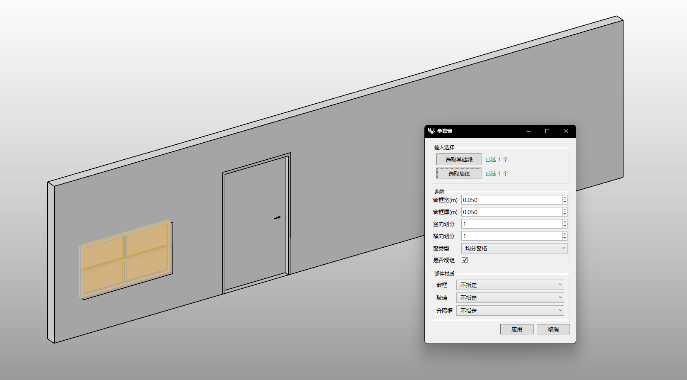

#  rsWindow · Windows (2D / 3D)

> Module: Architecture / Building Elements

[← Back to command index](/en/commands/)

::: info Version 2.0

Create 2D and 3D windows here. The old rsWindow2D name is no longer a separate entry.

[View the 2.0 command changes](/en/commands/v2)

:::

**Function**: Place windows repeatedly in 2D or 3D walls, with automatic host detection, dimensions, sill height, and along-wall positioning.

*1.x interface reference. Version 2.0 uses the unified opening panel; follow the workflow and parameter descriptions below.*

> Screenshots and videos may show a Chinese-language interface. Labels and control positions can vary by Rhino or RSTool version.

**Run**: Enter `rsWindow` in the Rhino command line (opens a settings window).

**Workflow**:

1. Run rsWindow and choose Automatic or a fixed 2D/3D mode.
2. Set width; in 3D also set height and sill height, or use a size preset.
3. Move near a wall, check size, position, and direction in the preview, and click; continue placing.
4. For precision use From start, From end, or Pier width. Esc or closing the panel finishes placement.

**Parameters**:

| Display name | Parameter | Type | Default | Range | Description |
| --- | --- | --- | --- | --- | --- |
| Placement mode | OutputMode | enum | Automatic | Automatic / 2D / 3D | Detect the wall near the pointer, or choose a fixed dimension. |
| Along-wall positioning | PositionMode | enum | Pointer | Pointer / From start / From end / Pier width | Start/end distances follow the wall axis with center, near-edge, or far-edge anchors. Pier width measures to the near opening edge. |
| Distance / pier width | PositionDistance | group | 1000 mm / 100 mm | Validated against wall length and opening clearance | Measure pier width from the nearest exposed wall end or clear corner on the pointer side; curved walls use side arc length. |
| Window width | Width | double | 1200 mm | Must fit wall ends and opening clearance | The 2D symbol follows the clear width. |
| 3D height / sill height | HeightSill | group | 1500 mm / 900 mm | Must fit the host wall height | Size presets set both width and height. |

**Output**: Independent parametric windows and hosted wall openings.

**Notes**: Dimensions are displayed in current Rhino model units; mm and m below describe equivalent physical sizes.

No wall preselection is required: move near a wall and click its preview to place repeatedly. Automatic mode detects 2D or 3D walls; a fixed mode is also available. Results are independent parametric objects with host associations; moving, deleting, or editing them updates their wall openings.

Legacy separate 2D commands have been merged into the unified entry while their entitlement keys remain compatible. Sizes must still satisfy wall-end, neighboring-opening, and clearance checks.

`rsWindow2D` and the old spelling `rsWindous` are merged into `rsWindow`. This panel places parametric windows; it does not provide the complete casement/sliding/fixed-type library implied by older text.

Images or videos may show the old interface. For 2.0, follow the entries, modes, and parameter descriptions on this page.
