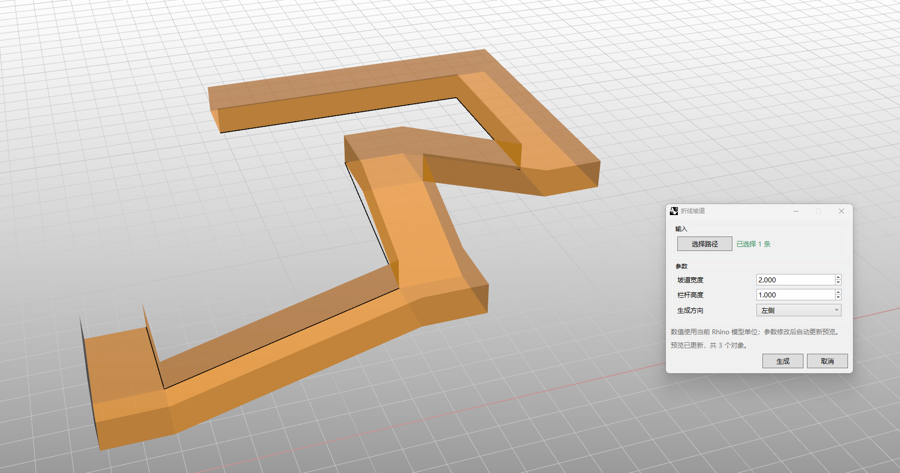

#  rsZigZagRamp · Zigzag Ramp

> Module: Architecture / Stairs & Ramps

[← Back to command index](/en/commands/)

**Function**: Generate ramp and side-rail surfaces along open polylines with real elevations, adjusting width, rail height, and left/right/center placement.

*rsZigZagRamp pops up the "Polyline Ramp" Eto dialog box (embedded 1 path + 3 lines of parameters: ramp width / railing height / generation direction; bottom preview has been updated + generate / cancel), and the Rhino viewport generates a Z-shaped 3D ramp along the polyline path with railings automatically*

> Screenshots and videos may show a Chinese-language interface. Labels and control positions can vary by Rhino or RSTool version.

**Run**: Enter `rsZigZagRamp` in the Rhino command line (opens a settings window).

**Workflow**:

1. Run rsZigZagRamp and click Select paths.
2. Select one or more open polylines with at least three vertices; Z coordinates provide elevations.
3. Set width, rail height, and Left/Right/Center placement and inspect the updating preview.
4. Click Generate. Source edits refresh the open-panel preview; previously generated output does not follow them automatically.

**Parameters**:

| Display name | Parameter | Type | Default | Range | Description |
| --- | --- | --- | --- | --- | --- |
| Ramp width | Width | double | 2 m | > model tolerance | Enter in current model units. |
| Rail height | HandrailHeight | double | 1.1 m | ≥0 | Zero or near-tolerance height produces only the ramp. |
| Placement | Placement | enum | Left | Left / Right / Center | Determines the side relative to path direction. |

**Output**: Open ramp surfaces and optional rail surfaces.

**Notes**: Dimensions are displayed in current Rhino model units; mm and m below describe equivalent physical sizes.

This remains a separate tool. Output consists of open ramp and rail surfaces rather than automatically thickened slabs. It supports modeling and does not automatically verify accessibility rules or perform road engineering.

Images or videos may show the old interface. For 2.0, follow the entries, modes, and parameter descriptions on this page.
